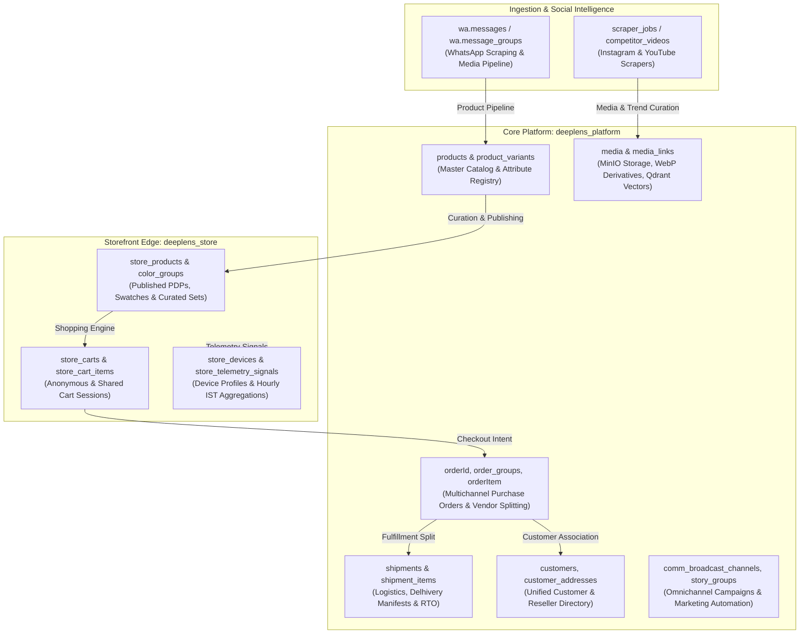

# DeepLens Domain Business Dictionary & Semantic Data Model Reference

> **Document Version:** 1.0.0  
> **Target Systems:** `deeplens_platform` (PostgreSQL), `deeplens_store` (PostgreSQL), `wa` (Schema)  
> **Work Item Reference:** ADO #1353 — *Task 2: Map Business Semantics & Generate Data Dictionary*  
> **Domain Owners:** Krishna (Lead), Naga (SQL/Data), Bhishma (Architect), Viswakarma (Storefront UI/UX)

---

## 1. Executive Domain Architecture & System Boundaries

DeepLens operates across three primary persistence boundaries designed to separate high-frequency ingestion, core master data management, and edge-facing e-commerce operations:

---

## 2. Core Business Entities & Domain Semantics

### 2.1 Orders, Logistics & Fulfillment Domain

The Orders domain governs multichannel commerce transactions initiated across WhatsApp, Instagram DM, Reseller wholesale networks, and direct Storefront checkouts.

#### Core Business Rules & Invariants
1. **Multivendor Order Group Splitting (`order_groups`)**: A single customer order (`orderId`) containing items originating from multiple physical vendor hubs is automatically partitioned into child order groups (`order_groups`). Each group represents a discrete fulfillment unit (`vendor_id`) requiring its own independent Delhivery shipping label and Air Waybill (`awb_number`).
2. **Order Lifecycle State Machine (`status`)**:
   - `0 (Unconfirmed)`: Initial state upon order capture (e.g. chat quotation or draft).
   - `1 (Confirmed)`: Payment verified or customer confirmed intent.
   - `2 (Processing / Placed)`: Sourcing or procurement initiated with suppliers.
   - `3 (Dispatched)`: Handed over to courier with active AWB.
   - `4 (Delivered)`: Successfully received by customer.
   - `5 (Cancelled)`: Order voided prior to dispatch.
3. **Composite Order Stage Tag (`ComputeStageTag`)**: The displayed stage of an order with multiple groups reflects the *least advanced* group status followed by the count of remaining groups (e.g., `Confirmed +1`, `Placed +2`).
4. **Mandatory Address Review Gate (`is_address_reviewed`)**: Courier API label creation is strictly barred until shipping address fields (`shipping_street`, `shipping_pincode`, `is_serviceable`) have passed human or automated geocoding verification.
5. **Reseller Attribution (`order_type`, `reseller_name`)**: Distinguishes end-consumer purchases (`order_type = 'Customer'`) from B2B bulk purchases (`order_type = 'Reseller'`). For reseller orders, shipping labels suppress platform brand identity to protect reseller client relationships.

---

### 2.2 Products, Catalog & Media Registry Domain

The Catalog domain manages master product definitions, fabric taxonomies, colorways, pricing histories, and multi-tier visual media assets.

#### Core Business Rules & Invariants
1. **Plural vs. Singular Database Convention**: Production tables are exclusively plural (`products`, `categories`, `media`, `product_variants`). Legacy singular tables (`product`, `category`, `image`, `seller`) represent early scaffolds and remain empty.
2. **Mandatory Media Review Requirement (`is_media_review_required`)**: A boolean quality gate flagged on products. It is automatically asserted if:
   - The product links to greater than 30 media assets (`COUNT(media_links) > 30`).
   - The product carries the tag `'needs-zoning-review'`.
   - The catalog curator flags visual discrepancies or AI background extraction flaws. Products in this state are held from automated storefront publishing.
3. **Poly-Relational Media Architecture (`media_links`)**: Media records (`media`) are immutable binary descriptors stored in MinIO. Physical associations to products, variants, or social stories are decoupled through `media_links` (`entity_id`, `entity_type`, `display_order`, `is_primary`).
4. **Visual Search & Vector Deduplication (`phash`, `vector_id`)**: Media assets undergo perceptual hashing (`phash`) to prune duplicate vendor photos, followed by deep feature extraction mapped to Qdrant vector collections (`vector_id`) for visual similarity discovery.
5. **Vendor Sourcing vs. Storefront Pricing**:
   - Procurement baseline: `vendor_listings.current_price` (wholesale cost from supplier, with flag `is_plus_shipping`).
   - Retail storefront: `store_products.mrp` (catalog retail price) and `store_products.sale_price` (customer checkout price).
   - Price audit trail: `price_history` logs immutable temporal pricing shifts.

---

### 2.3 Scrapers, Social Intelligence & Competitor Watchlist Domain

This domain powers automated ingestion of competitor viral trends across Instagram and YouTube to guide catalog merchandising and procurement.

#### Core Business Rules & Invariants
1. **Tiered Scraping Cadence (`tracking_tier`, `tracking_frequency_hours`)**: Accounts in `competitor_watchlist` are classified into tiers (`focus`, `vip`, `standard`) with execution frequencies ranging from 6 hours to 24 hours.
2. **Time-Series Viral Velocity Tracking (`instagram_post_daily_metrics`)**: Tracks day-over-day acceleration of views, likes, comments, and saves at discrete checkpoints (`day_offset`: Day 0, Day 1, Day 2, Day 7, Day 30).
3. **Virality Scoring (`velocity_score`)**: Computed as:
   $$\text{Velocity} = \frac{\Delta\text{Views} \times 0.4 + \Delta\text{Shares} \times 0.4 + \Delta\text{Comments} \times 0.2}{\text{HoursSincePosted}}$$
   Posts exceeding outlier thresholds are flagged in `view_instagram_competitor_outliers` for rapid product catalog sourcing.
4. **Collaborator Attribution (`collaborators`, `collab_curation_status`)**: Identifies co-creators and model handles tagged in competitor reels to discover upstream textile manufacturers and regional resellers.

---

### 2.4 Customers, Resellers & Multi-Tenant Identity Domain

Manages unified omnichannel customer identities, multi-address books, language preferences, and multi-tenant isolation.

#### Core Business Rules & Invariants
1. **Omnichannel Identity Resolution**: Unifies phone numbers (WhatsApp E.164), Instagram handles (`instagram_accounts`), and storefront device cookies under a single `customers.id`.
2. **Referral Code Generation (`referral_code`)**: Automatically generated using a unique uppercase hexadecimal sequence formatted with 5-character zero padding (`lpad(upper(to_hex(nextval(...))), 5, '0')`).
3. **Default Shipping Address Invariant**: A customer may possess multiple addresses in `customer_addresses`, but exactly one record must satisfy `is_default = true`.
4. **Multi-Tenant Isolation (`tenants`, `tenant_api_keys`)**: Enforces data, Qdrant vector space, and MinIO bucket isolation across white-label instances with quotas on storage (`max_storage_bytes`), user seats, and daily API consumption.

---

### 2.5 Storefront, Curation & Telemetry Domain (`deeplens_store`)

Governs the consumer-facing web application (Vayyari Storefront), persistent shopping carts, anonymous device attribution, and behavioral telemetry.

#### Core Business Rules & Invariants
1. **Anonymous-to-Identified Device Promotion (`store_devices`)**: Anonymous visitors are assigned a UUID `device_id` cross-linked with hardware canvas fingerprints (`fingerprint_hash`). When a user authenticates via WhatsApp OTP, `is_identified` flips to `true`, binding historic sessions to `primary_user_id`.
2. **Collaborative Cart Sharing (`share_token`)**: Shopping carts (`store_carts`) generate a unique short alphanumeric token (`crt_xxxxxxxx`). Anyone loading the cart via `/cart/share?token=...` views an immutable synchronized snapshot (`SharedCartViewDto`).
3. **Cart & Wishlist TTL Retention**:
   - `store_carts`: Active sliding TTL of 30 days (`last_active_at + INTERVAL '30 days'`).
   - `store_wishlists`: Extended retention TTL of 100 days.
4. **Product Lifecycle States (`lifecycle_status`)**:
   - `available`: Visible and purchasable on storefront.
   - `hidden`: Hidden from search and navigation but accessible via direct link.
   - `takedown`: Temporarily pulled down due to quality review or stock exhaustion (`take_down_expires_at`).
   - `sold_out`: Out of stock; permits customer waitlist subscriptions (`product_waitlists`).
5. **IST Hourly Telemetry Rollups (`store_telemetry_hourly_metrics`)**: Raw clickstream signals (`store_telemetry_signals`) are aggregated by background workers every 6 hours into hourly Indian Standard Time (IST) buckets (`hour_of_day_ist`, `day_of_week_ist`), retaining raw events for 30 days.

---

### 2.6 WhatsApp Automation & Omnichannel Communications Domain

Governs automated ingestion of supplier catalog drops from WhatsApp chat groups and outbound customer promotional broadcasts.

#### Core Business Rules & Invariants
1. **Message Grouping Pipeline (`wa.message_groups`)**: Supplier WhatsApp groups frequently emit batches of photos followed by a descriptive text message with pricing. The pipeline aggregates contiguous messages within a 15-minute sliding window into a `wa.message_groups` container.
2. **Automated Price Extraction & Sourcing**:
   - Text parsing detects price figures (e.g., `"Price 1450/- free shipping"` or `"1200+ship"`).
   - Sets `detected_price = 1200` and `is_plus_shipping = true`.
   - Upon curator approval (`process_as_product = true`), creates a `products` record and `vendor_listings` record.
3. **Zero-Media Tombstones (`wa.product_tombstones`)**: Prevents re-scraping or reprocessing of intentionally purged or deleted WhatsApp products.
4. **Story Queues & Cadence Management (`story_groups`)**: Groups curated visual assets into publication queues. If a scheduled reel or story post is postponed, `suspend_until` silences outbound publishing until the specified timestamp.
5. **Compliance & Opt-In Governance (`campaign_wabroadcast`)**: WhatsApp promotional broadcasts require verifiable opt-in records (`status = 'OPTED_IN'`). Opt-outs (`'OPTED_OUT'`) immediately revoke broadcast delivery.

---

## 3. Data Dictionary: Tables, Columns & Semantic Specifications

### 3.1 Table: `orderId` (Orders Master Header)
- **Database:** `deeplens_platform` | **Schema:** `public`
- **Domain Role:** Root master record for customer purchase orders across all channels.

| Column Name | Data Type | Nullable | Default | Business Semantics & Rules |
| :--- | :--- | :--- | :--- | :--- |
| `id` | `integer` | NO | `nextval('orderId_id_seq')` | Internal primary key for relational joins with items and groups. |
| `order_id` | `varchar` | NO | *None* | Business-facing order code (e.g. `ORD-2026-10492`). Displayed on invoices. |
| `source_id` | `integer` | YES | *None* | Acquisition source foreign key referencing `order_sources.id` (1=WhatsApp, 2=Instagram). |
| `payment_mode_id` | `integer` | YES | *None* | Payment method foreign key referencing `payment_modes.id` (1=COD, 2=Prepaid). |
| `customer_id` | `uuid` | YES | *None* | Foreign key referencing master `customers.id`. |
| `customer_phone` | `varchar` | YES | *None* | Primary contact number. Primary lookup key for WhatsApp commerce. |
| `customer_name` | `varchar` | YES | *None* | Recipient customer or business name. |
| `customer_address` | `text` | YES | *None* | Raw unformatted address captured during chat/checkout. |
| `shipping_street` | `text` | YES | *None* | Parsed street address line. |
| `shipping_city` | `varchar` | YES | *None* | Delivery destination city. |
| `shipping_state` | `varchar` | YES | *None* | Destination state/province. |
| `shipping_pincode` | `varchar` | YES | *None* | 6-digit Indian postal code; used for Delhivery serviceability verification. |
| `is_serviceable` | `boolean` | YES | `true` | Indicates whether courier partner can service the designated pincode. |
| `advance_paid` | `numeric` | YES | `0` | Prepaid deposit amount (mandatory for partial-COD shipments). |
| `cod_balance` | `numeric` | YES | `0` | Cash amount to be collected by delivery agent upon handover. |
| `total_amount` | `numeric` | YES | `0` | Total order gross monetary value inclusive of taxes and shipping. |
| `shipping_charges` | `numeric` | YES | `0` | Shipping fees assessed to customer. |
| `transaction_id` | `varchar` | YES | *None* | Payment gateway or UPI reference transaction ID. |
| `source_handle` | `varchar` | YES | *None* | Handle/username on origin platform (Instagram handle or WhatsApp sender). |
| `instagram_user_id`| `varchar` | YES | *None* | Social platform external ID. |
| `instagram_handle` | `varchar` | YES | *None* | Associated Instagram handle. |
| `status` | `integer` | YES | `0` | Root order state: `0=Unconfirmed, 1=Confirmed, 2=Processing, 3=Dispatched, 4=Delivered, 5=Cancelled`. |
| `need_label` | `boolean` | YES | `false` | Global order flag indicating courier shipping label generation is required. |
| `order_type` | `varchar` | YES | `'Customer'` | Distinguishes `'Customer'` (B2C) from `'Reseller'` (B2B wholesale). |
| `reseller_name` | `varchar` | YES | *None* | Reseller company name when `order_type = 'Reseller'`. Printed as sender on white-label labels. |
| `is_address_reviewed`| `boolean`| YES | `true` | Quality gate: confirms shipping address has passed review prior to courier booking. |
| `is_deleted` | `boolean` | YES | `false` | Soft-deletion flag preserving audit integrity. |
| `created_at` | `timestamptz`| YES | `now()` | Order creation timestamp (UTC). |

---

### 3.2 Table: `order_groups` (Vendor Fulfillment Splits)
- **Database:** `deeplens_platform` | **Schema:** `public`
- **Domain Role:** Partitions master orders by vendor for independent fulfillment and tracking.

| Column Name | Data Type | Nullable | Default | Business Semantics & Rules |
| :--- | :--- | :--- | :--- | :--- |
| `id` | `bigint` | NO | `nextval(...)` | Internal primary key. |
| `order_grp_id` | `varchar` | NO | *None* | Unique vendor group code (e.g. `ORD-10492-GRP-1`). |
| `order_id_ref` | `bigint` | YES | *None* | Foreign key referencing internal `orderId.id` (`ON DELETE CASCADE`). |
| `order_id` | `varchar` | NO | *None* | Master business order code. |
| `vendor_id` | `uuid` | YES | *None* | Sourcing vendor/supplier unique identifier. |
| `vendor_name` | `varchar` | YES | *None* | Vendor trade name. |
| `need_label` | `boolean` | YES | `false` | Group-level toggle indicating label readiness. |
| `awb_number` | `varchar` | YES | *None* | Assigned courier Air Waybill tracking number. |
| `label_url` | `text` | YES | *None* | S3/MinIO PDF download URL for the courier shipping label. |
| `status` | `varchar` | YES | `'unconfirmed'` | Fulfillment stage: `'unconfirmed'`, `'confirmed'`, `'processing'`, `'placed'`, `'dispatched'`, `'delivered'`. |
| `tracking_sub_status`| `varchar`| YES | *None* | Detailed courier tracking milestone (e.g., `'In Transit'`, `'Out for Delivery'`, `'NDR Open'`). |
| `created_at` | `timestamptz`| YES | `now()` | Group generation timestamp. |
| `updated_at` | `timestamptz`| YES | `now()` | Last fulfillment status update. |

---

### 3.3 Table: `orderItem` (Order Line Items)
- **Database:** `deeplens_platform` | **Schema:** `public`
- **Domain Role:** Specific product items and customization specifications under an order.

| Column Name | Data Type | Nullable | Default | Business Semantics & Rules |
| :--- | :--- | :--- | :--- | :--- |
| `id` | `integer` | NO | `nextval(...)` | Internal line item identifier. |
| `order_id_ref` | `integer` | NO | *None* | Foreign key referencing `orderId.id`. |
| `item_index` | `integer` | NO | *None* | Ordinal position within the order (1, 2, 3...). |
| `order_grp_id_ref`| `varchar` | YES | *None* | Foreign key linking line item to its specific `order_groups.order_grp_id`. |
| `product_id` | `text` | YES | *None* | Catalog product UUID reference. |
| `product_title` | `text` | YES | *None* | Product title snapshot at moment of purchase. |
| `item_id` | `varchar` | YES | *None* | Specific SKU code or variant identifier. |
| `quantity` | `integer` | YES | `1` | Purchased item count. |
| `unit_price` | `numeric` | YES | `0` | Price per single unit. |
| `price` | `numeric` | YES | *None* | Legacy price field. |
| `subtotal` | `numeric` | YES | `0` | Calculated subtotal: `quantity * unit_price`. |
| `vendor_id` | `uuid` | YES | *None* | Sourcing supplier for this specific item. |
| `source_type` | `varchar` | YES | `'catalog'` | Sourcing channel: `'catalog'`, `'custom'`, `'dropship'`. |
| `comments` | `text` | YES | *None* | Custom tailoring or buyer notes (e.g., `"Blouse size 38, fall-pico required"`). |
| `label_url` | `text` | YES | *None* | Individual item packing slip or label URL. |
| `created_at` | `timestamptz`| YES | `now()` | Line item record creation timestamp. |

---

### 3.4 Table: `shipments` (Courier Logistics & Manifests)
- **Database:** `deeplens_platform` | **Schema:** `public`
- **Domain Role:** Carrier dispatch manifestation and lifecycle tracking.

| Column Name | Data Type | Nullable | Default | Business Semantics & Rules |
| :--- | :--- | :--- | :--- | :--- |
| `id` | `uuid` | NO | `gen_random_uuid()`| Unique shipment identifier. |
| `order_id` | `uuid` | YES | *None* | Master order UUID reference. |
| `order_number` | `text` | YES | *None* | Human-readable order code. |
| `shipment_number` | `text` | YES | *None* | Unique shipment tracking code. |
| `warehouse_id` | `uuid` | YES | *None* | Origin dispatch facility FK referencing `warehouses.id`. |
| `courier_partner` | `text` | YES | *None* | Integrated logistics carrier (e.g., `'Delhivery'`). |
| `awb_number` | `text` | YES | *None* | Carrier Air Waybill tracking number. |
| `status` | `text` | NO | `'pending'` | Lifecycle: `'pending'`, `'manifested'`, `'in_transit'`, `'delivered'`, `'rto_initiated'`. |
| `shipping_mode` | `text` | YES | `'Surface'` | Transit tier: `'Surface'`, `'Express Air'`. |
| `fulfillment_type`| `text` | YES | `'direct_dispatch'`| Logistics mode: `'direct_dispatch'` vs `'cross_dock'`. |
| `cod_amount` | `numeric` | NO | `0.00` | Cash on delivery collection balance. |
| `label_url` | `text` | YES | *None* | Downloadable label URL. |
| `minio_label_key` | `text` | YES | *None* | Internal MinIO object key for shipping label PDF. |
| `pickup_scheduled_at`|`timestamptz`|YES| *None* | Scheduled carrier pickup window. |
| `pickup_token` | `text` | YES | *None* | Carrier pickup authentication manifest token. |
| `estimated_delivery_date`|`timestamptz`|YES|*None*| SLA target delivery date. |
| `vendor_name` | `text` | YES | *None* | Sourcing vendor origin name. |
| `vendor_tracking_url`| `text` | YES | *None* | Direct carrier public tracking link. |
| `procure_status` | `text` | YES | `'not_applicable'`| Cross-dock procurement state: `'ordered'`, `'received'`. |
| `metadata` | `jsonb` | NO | `'{}'` | Carrier webhook payloads and scan history. |
| `created_at` | `timestamptz`| NO | `now()` | Record creation timestamp. |
| `updated_at` | `timestamptz`| NO | `now()` | Last carrier milestone timestamp. |

---

### 3.5 Table: `products` (Master Catalog Products)
- **Database:** `deeplens_platform` | **Schema:** `public`
- **Domain Role:** Canonical apparel and saree catalog registry.

| Column Name | Data Type | Nullable | Default | Business Semantics & Rules |
| :--- | :--- | :--- | :--- | :--- |
| `id` | `uuid` | NO | `gen_random_uuid()`| Master product primary key. |
| `category_id` | `uuid` | YES | *None* | Taxonomy FK referencing `categories.id`. |
| `base_sku` | `varchar` | YES | *None* | Base product style SKU (e.g. `VF-BAN-104`). |
| `title` | `varchar` | YES | *None* | Merchandising title (e.g. `"Pure Katan Silk Banarasi Saree"`). |
| `fabric` | `text` | YES | *None* | Primary material (e.g., `'Katan Silk'`, `'Organza'`, `'Georgette'`). |
| `stitch_type` | `text` | YES | *None* | Tailoring type (`'Unstitched'`, `'Semi-Stitched'`, `'Ready-to-Wear'`). |
| `work_heaviness` | `text` | YES | *None* | Embellishment scale (`'Light Daily'`, `'Festive'`, `'Heavy Bridal'`). |
| `description` | `text` | YES | *None* | Rich product copy and draping details. |
| `tags` | `text[]` | YES | *None* | Search keywords and flags (`'trending'`, `'wedding'`, `'zoning-review'`). |
| `unified_attributes`| `jsonb` | YES | *None* | Structured attributes: weave technique, border style, blouse included. |
| `is_starred` | `boolean` | NO | `false` | Editorial curation flag for spotlight promotions. |
| `is_archived` | `boolean` | NO | `false` | Soft-archived catalog item pulled from active search. |
| `is_published` | `boolean` | YES | `false` | Indicates availability on downstream Storefront. |
| `is_media_review_required`|`boolean`| NO | `false` | Quality gate: prevents automated publishing if media > 30 or zoning flagged. |
| `media_updated_at` | `timestamptz`| YES | *None* | Timestamp when gallery media was last altered. |
| `store_publish_updated_at`|`timestamptz`|YES| *None* | Timestamp of last sync to `deeplens_store`. |
| `sequence_id` | `integer` | YES | *None* | Integer sequence for legacy inventory tracking. |
| `is_deleted` | `boolean` | YES | `false` | Soft-deletion flag. |
| `created_at` | `timestamptz`| YES | `now()` | Ingestion timestamp. |
| `updated_at` | `timestamptz`| YES | `now()` | Attribute modification timestamp. |

---

### 3.6 Table: `media` (Binary Media Asset Registry)
- **Database:** `deeplens_platform` | **Schema:** `public`
- **Domain Role:** Centralized multi-resolution visual and video asset registry.

| Column Name | Data Type | Nullable | Default | Business Semantics & Rules |
| :--- | :--- | :--- | :--- | :--- |
| `id` | `uuid` | NO | `gen_random_uuid()`| Asset unique identifier. |
| `storage_path` | `varchar` | NO | *None* | MinIO/S3 object path (e.g. `catalog/products/2026/04/p_104.webp`). |
| `media_type` | `smallint` | YES | `1` | Asset type: `1 = Image, 2 = Video / Reel, 3 = Document`. |
| `original_filename`| `varchar` | YES | *None* | Original uploaded filename. |
| `file_size_bytes` | `bigint` | YES | *None* | File size in bytes. |
| `mime_type` | `varchar` | YES | *None* | Standard MIME type (e.g. `'image/webp'`, `'video/mp4'`). |
| `status` | `smallint` | YES | `0` | Processing state: `0=Uploaded, 1=Processed, 2=Indexed, 98=PendingDelete, 99=Failed`. |
| `vector_id` | `uuid` | YES | *None* | Qdrant vector collection reference for visual similarity search. |
| `phash` | `varchar` | YES | *None* | 64-bit perceptual hash for near-duplicate image pruning. |
| `quality_score` | `numeric` | YES | *None* | Computed aesthetic quality score (0.00 to 1.00). |
| `width` | `integer` | YES | *None* | Pixel width. |
| `height` | `integer` | YES | *None* | Pixel height. |
| `duration_seconds` | `numeric` | YES | *None* | Video clip runtime. |
| `thumbnail_path` | `varchar` | YES | *None* | Standard 300px thumbnail path. |
| `thumbnail_s` | `varchar` | YES | *None* | Small 150px WebP thumbnail. |
| `thumbnail_m` | `varchar` | YES | *None* | Medium 300px WebP thumbnail. |
| `thumbnail_l` | `varchar` | YES | *None* | Large 600px WebP thumbnail. |
| `blur_data` | `text` | YES | *None* | Low-resolution Base64 placeholder blur string for progressive UI loading. |
| `color` | `text` | YES | *None* | Detected dominant hex color code. |
| `features_extracted`|`boolean` | YES | `false` | True when deep visual features have been computed. |
| `indexed` | `boolean` | YES | `false` | True when vector is indexed in Qdrant. |
| `is_compressed_thumbnail`|`boolean`|NO| `false` | Flags modern WebP compressed thumbnail generation. |
| `metadata_json` | `jsonb` | YES | *None* | Media metadata: EXIF data, codec, FPS. |
| `uploaded_at` | `timestamptz`| YES | `now()` | Ingestion timestamp. |

---

### 3.7 Table: `competitor_watchlist` (Competitor Tracking Profiles)
- **Database:** `deeplens_platform` | **Schema:** `public`
- **Domain Role:** Social intelligence target accounts across Instagram and YouTube.

| Column Name | Data Type | Nullable | Default | Business Semantics & Rules |
| :--- | :--- | :--- | :--- | :--- |
| `id` | `uuid` | NO | `gen_random_uuid()`| Profile unique identifier. |
| `platform` | `varchar` | NO | *None* | Target network: `'instagram'` or `'youtube'`. |
| `username` | `varchar` | NO | *None* | Social account handle (e.g. `'competitor_sarees'`). |
| `display_name` | `varchar` | YES | *None* | Public brand profile name. |
| `external_id` | `varchar` | YES | *None* | Platform internal numeric account ID. |
| `profile_pic_url` | `text` | YES | *None* | External CDN profile picture link. |
| `profile_pic_storage_path`|`text`| YES | *None* | MinIO archived profile avatar path. |
| `follower_count` | `integer` | YES | *None* | Social audience size. |
| `following_count` | `integer` | YES | *None* | Following count. |
| `post_count` | `integer` | YES | *None* | Published media count. |
| `is_competitor` | `boolean` | NO | `false` | True for business competitors; false for benchmark accounts. |
| `tracking_tier` | `varchar` | NO | `'standard'` | Scraping priority: `'focus'`, `'vip'`, `'standard'`. |
| `tracking_frequency_hours`|`integer`|NO| `24` | Scrape frequency in hours (e.g. 6, 12, 24). |
| `channel_type` | `varchar` | YES | `'focus'` | Merchandising role: `'focus'`, `'benchmark'`, `'supplier'`. |
| `category_focus` | `text[]` | YES | `'{}'` | Focused apparel niches (e.g. `{'Banarasi', 'Kanchi', 'Bridal'}`). |
| `cadence_config` | `jsonb` | YES | *Config* | Automated posting and crawl frequency parameters. |
| `is_pinned` | `boolean` | YES | `false` | Spotlight profile pinned on analytics dashboard. |
| `is_active` | `boolean` | YES | `true` | Active scraping status. |
| `last_scraped_at` | `timestamptz`| YES | *None* | Most recent successful crawl execution. |
| `created_at` | `timestamptz`| YES | `now()` | Profile creation timestamp. |

---

### 3.8 Table: `competitor_videos` (Scraped Reels & Media)
- **Database:** `deeplens_platform` | **Schema:** `public`
- **Domain Role:** Harvested social posts, viral reels, and engagement metrics.

| Column Name | Data Type | Nullable | Default | Business Semantics & Rules |
| :--- | :--- | :--- | :--- | :--- |
| `id` | `uuid` | NO | `gen_random_uuid()`| Video record unique identifier. |
| `watchlist_id` | `uuid` | NO | *None* | FK referencing `competitor_watchlist.id`. |
| `platform` | `varchar` | NO | *None* | Social network: `'instagram'`, `'youtube'`. |
| `platform_video_id`|`varchar` | NO | *None* | External reel/video ID (e.g. Instagram shortcode). |
| `url` | `text` | NO | *None* | Public post permalink. |
| `title` | `text` | YES | *None* | Video title or headline. |
| `description` | `text` | YES | *None* | Full caption text, hashtags, and price mentions. |
| `posted_at` | `timestamptz`| NO | *None* | Post publication timestamp on social network. |
| `like_count` | `bigint` | YES | `0` | Cumulative likes. |
| `comment_count` | `bigint` | YES | `0` | Cumulative comments. |
| `share_count` | `bigint` | YES | `0` | Cumulative shares. |
| `repost_count` | `bigint` | YES | `0` | Cumulative reposts. |
| `media_type` | `varchar` | YES | *None* | Asset format: `'reel'`, `'video'`, `'carousel'`, `'image'`. |
| `thumbnail_url` | `text` | YES | *None* | Remote thumbnail link. |
| `media_url` | `text` | YES | *None* | Remote video stream URL. |
| `storage_path` | `text` | YES | *None* | MinIO archived video MP4 file path. |
| `product_id` | `uuid` | YES | *None* | DeepLens catalog product linked for sourcing. |
| `tagged_sku_ids` | `text[]` | YES | *None* | Manually confirmed matching catalog SKU codes. |
| `ai_suggested_sku_ids`|`text[]` | YES | *None* | AI visual match candidate SKUs. |
| `collaborators` | `jsonb` | YES | `'[]'` | List of co-creator usernames tagged on post. |
| `collab_curation_status`|`varchar`|YES| `'pending'` | Review state of collaborators: `'pending'`, `'approved'`. |
| `is_boosted` | `boolean` | YES | `false` | True if post exhibits paid ad boosting markers. |
| `deleted_on_instagram`|`boolean`| NO | `false` | Flags if post was removed by the creator. |
| `download_status` | `varchar` | YES | `'pending'` | Archival state: `'pending'`, `'downloaded'`, `'failed'`. |
| `scraped_at` | `timestamptz`| YES | `now()` | Ingestion timestamp. |

---

### 3.9 Table: `instagram_post_daily_metrics` (Viral Velocity Time-Series)
- **Database:** `deeplens_platform` | **Schema:** `public`
- **Domain Role:** Longitudinal daily metric snapshots for trend detection.

| Column Name | Data Type | Nullable | Default | Business Semantics & Rules |
| :--- | :--- | :--- | :--- | :--- |
| `id` | `uuid` | NO | `gen_random_uuid()`| Metric snapshot identifier. |
| `post_id` | `uuid` | NO | *None* | Foreign key referencing `competitor_videos.id`. |
| `profile_id` | `uuid` | NO | *None* | Foreign key referencing `competitor_watchlist.id`. |
| `day_offset` | `integer` | NO | *None* | Days since publication: `0` (day of post), `1`, `2`, `7`, `30`. |
| `snapshot_date` | `date` | NO | *None* | Calendar date of metric recording. |
| `view_count` | `bigint` | YES | `0` | Recorded views at snapshot. |
| `like_count` | `bigint` | YES | `0` | Recorded likes at snapshot. |
| `comment_count` | `bigint` | YES | `0` | Recorded comments at snapshot. |
| `share_count` | `bigint` | YES | `0` | Recorded shares at snapshot. |
| `save_count` | `bigint` | YES | `0` | Recorded saves at snapshot. |
| `daily_delta_views` | `bigint` | YES | `0` | Views accumulated since prior day snapshot. |
| `daily_delta_likes` | `bigint` | YES | `0` | Likes accumulated since prior day snapshot. |
| `velocity_score` | `numeric` | YES | `0` | Calculated viral momentum index. |
| `engagement_rate`| `numeric` | YES | `0` | Engagement percentage relative to follower baseline. |
| `created_at` | `timestamptz`| NO | `now()` | Snapshot creation timestamp. |

---

### 3.10 Table: `customers` (Master Customer Directory)
- **Database:** `deeplens_platform` | **Schema:** `public`
- **Domain Role:** Unified customer and reseller profile registry.

| Column Name | Data Type | Nullable | Default | Business Semantics & Rules |
| :--- | :--- | :--- | :--- | :--- |
| `id` | `uuid` | NO | `gen_random_uuid()`| Canonical customer UUID. |
| `customer_id` | `integer` | NO | `nextval(...)` | Sequential integer customer code. |
| `first_name` | `varchar` | YES | *None* | Customer given name. |
| `last_name` | `varchar` | YES | *None* | Customer family name. |
| `phone_number` | `varchar` | YES | *None* | Normalized E.164 phone number. Primary WhatsApp commerce key. |
| `instagram_id` | `varchar` | YES | *None* | Primary Instagram handle. |
| `email` | `varchar` | YES | *None* | Email address. |
| `referral_code` | `varchar` | NO | `lpad(...)` | Unique 5-char hex referral code (e.g. `00A1F`). |
| `gender` | `varchar` | YES | *None* | Customer gender. |
| `notes` | `text` | YES | *None* | CRM operator notes and VIP buyer preferences. |
| `is_follower` | `boolean` | NO | `false` | True if verified follower of brand Instagram profile. |
| `is_archived` | `boolean` | NO | `false` | Deactivated or banned customer record. |
| `created_at` | `timestamptz`| YES | `CURRENT_TIMESTAMP`| Account creation timestamp. |
| `updated_at` | `timestamptz`| YES | `CURRENT_TIMESTAMP`| Last profile update timestamp. |

---

### 3.11 Table: `customer_addresses` (Shipping Address Book)
- **Database:** `deeplens_platform` | **Schema:** `public`
- **Domain Role:** Multi-address directory for customer fulfillment.

| Column Name | Data Type | Nullable | Default | Business Semantics & Rules |
| :--- | :--- | :--- | :--- | :--- |
| `id` | `uuid` | NO | `gen_random_uuid()`| Address unique identifier. |
| `customer_id` | `uuid` | NO | *None* | FK referencing `customers.id` (`ON DELETE CASCADE`). |
| `name` | `varchar` | NO | *None* | Recipient name at delivery destination. |
| `phone` | `varchar` | NO | *None* | Contact phone for delivery driver. |
| `line1` | `text` | NO | *None* | Complete street address, house/flat number, landmark. |
| `pincode` | `varchar` | NO | *None* | 6-digit Indian postal code. |
| `is_default` | `boolean` | YES | `false` | True if this is the default address. Invariant: max 1 per customer. |
| `created_at` | `timestamptz`| YES | `CURRENT_TIMESTAMP`| Address creation timestamp. |
| `updated_at` | `timestamptz`| YES | `CURRENT_TIMESTAMP`| Last address update timestamp. |

---

### 3.12 Table: `store_products` (Published PDPs)
- **Database:** `deeplens_store` & `deeplens_platform` | **Schema:** `public`
- **Domain Role:** Consumer-facing storefront product catalog.

| Column Name | Data Type | Nullable | Default | Business Semantics & Rules |
| :--- | :--- | :--- | :--- | :--- |
| `id` | `uuid` | NO | `gen_random_uuid()`| Storefront product identifier. |
| `vayyari_product_id`|`uuid` | NO | *None* | Foreign key referencing master `products.id`. |
| `product_code` | `varchar` | NO | *None* | Human-friendly SKU and PDP route slug (e.g. `VF-BAN-104`). |
| `title` | `varchar` | NO | *None* | Store display title. |
| `description` | `text` | YES | *None* | Formatted HTML/Markdown product description. |
| `category_name` | `varchar` | NO | `'Sarees'` | Taxonomy category display name. |
| `fabric` | `varchar` | YES | *None* | Material specification. |
| `base_cost` | `numeric` | NO | `0.00` | Sourcing base cost for gross margin calculation. |
| `mrp` | `numeric` | NO | `0.00` | Maximum Retail Price (struck-through anchor price). |
| `sale_price` | `numeric` | NO | `0.00` | Final customer checkout price. |
| `lifecycle_status`| `varchar` | NO | `'available'` | Store state: `'available'`, `'hidden'`, `'takedown'`, `'sold_out'`. |
| `stock_quantity` | `integer` | NO | `10` | Available stock count. |
| `color_group_id` | `uuid` | YES | *None* | FK linking sibling colorways in `store_color_groups`. |
| `colorway_name` | `varchar` | NO | `'Standard'` | Colorway title (e.g. `'Peacock Green'`, `'Ruby Crimson'`). |
| `color_hex` | `varchar` | NO | `'#1B4D3E'` | Primary swatch hex color for frontend selector. |
| `media_order` | `jsonb` | NO | `'[]'` | Ordered array of gallery images with covers and dwell timings. |
| `tags` | `jsonb` | NO | `'[]'` | Visual filter tags (`"Bridal"`, `"Zari Work"`). |
| `is_published` | `boolean` | NO | `true` | Storefront visibility toggle. |
| `published_at` | `timestamptz`| NO | `now()` | Initial storefront publication timestamp. |
| `created_at` | `timestamptz`| NO | `now()` | Record creation timestamp. |
| `updated_at` | `timestamptz`| NO | `now()` | Last modification timestamp. |

---

### 3.13 Table: `store_carts` & `store_cart_items` (Shopping Carts)
- **Database:** `deeplens_store` | **Schema:** `public`
- **Domain Role:** Ephemeral and collaborative shopping carts.

#### `store_carts`
| Column Name | Data Type | Nullable | Default | Business Semantics & Rules |
| :--- | :--- | :--- | :--- | :--- |
| `id` | `uuid` | NO | `gen_random_uuid()`| Cart session identifier. |
| `device_id` | `varchar` | NO | *None* | Client browser device fingerprint or authenticated UUID. |
| `share_token` | `varchar` | NO | *None* | Unique short token (`crt_xxxxxx`) for collaborative cart sharing. |
| `total_amount` | `numeric` | NO | `0.00` | Net payable cart total after discounts. |
| `total_mrp` | `numeric` | NO | `0.00` | Total cumulative MRP value. |
| `total_discount`| `numeric` | NO | `0.00` | Total savings: `total_mrp - total_amount`. |
| `item_count` | `integer` | NO | `0` | Cumulative quantity of all items in cart. |
| `last_active_at` | `timestamptz`| NO | `now()` | Timestamp of last cart item addition/removal. |
| `expires_at` | `timestamptz`| NO | `NOW() + 30d` | Sliding TTL expiration timestamp (30 days from last activity). |

#### `store_cart_items`
| Column Name | Data Type | Nullable | Default | Business Semantics & Rules |
| :--- | :--- | :--- | :--- | :--- |
| `id` | `uuid` | NO | `gen_random_uuid()`| Cart line item identifier. |
| `cart_id` | `uuid` | NO | *None* | Foreign key referencing `store_carts.id`. |
| `product_id` | `varchar` | NO | *None* | Store product ID. |
| `product_code` | `varchar` | NO | *None* | SKU code. |
| `title` | `varchar` | NO | *None* | Product title at moment of cart addition. |
| `price` | `numeric` | NO | *None* | Checkout price per unit. |
| `original_price`| `numeric` | NO | `0.00` | Original MRP per unit. |
| `quantity` | `integer` | NO | `1` | Quantity in cart. |
| `selected_color` | `varchar` | YES | *None* | Selected colorway attribute. |
| `selected_size` | `varchar` | YES | *None* | Selected size attribute. |
| `primary_image_uri`|`text` | NO | *None* | WebP thumbnail URI for cart drawer display. |

---

### 3.14 Table: `store_devices` (Device Identity Profiles)
- **Database:** `deeplens_store` | **Schema:** `public`
- **Domain Role:** Client hardware profiling and behavioral identity clustering.

| Column Name | Data Type | Nullable | Default | Business Semantics & Rules |
| :--- | :--- | :--- | :--- | :--- |
| `device_id` | `varchar` | NO | *None* | Primary device identifier (UUID or hardware fingerprint). |
| `fingerprint_hash`| `varchar` | YES | *None* | Canvas/audio hardware fingerprint hash. |
| `platform` | `varchar` | NO | `'web'` | Client operating system/platform: `'web'`, `'ios'`, `'android'`. |
| `os` | `varchar` | YES | *None* | OS version (e.g. `'iOS 18.1'`, `'Windows 11'`). |
| `browser` | `varchar` | YES | *None* | User agent browser (e.g. `'Mobile Safari'`). |
| `screen_resolution`|`varchar`| YES | *None* | Screen dimensions (e.g. `'390x844'`). |
| `first_seen_at` | `timestamptz`| NO | `now()` | Initial visit timestamp. |
| `last_seen_at` | `timestamptz`| NO | `now()` | Most recent interaction timestamp. |
| `total_events` | `integer` | NO | `1` | Cumulative telemetry signals recorded. |
| `total_sessions` | `integer` | NO | `1` | Distinct user browsing sessions. |
| `total_orders` | `integer` | NO | `0` | Cumulative orders placed by this device. |
| `lifetime_value` | `numeric` | NO | `0.00` | Net customer revenue generated. |
| `is_identified` | `boolean` | NO | `false` | True when authenticated and linked to a verified customer phone number. |
| `primary_user_id`| `varchar` | YES | *None* | Verified customer identifier upon login. |
| `taste_profile` | `jsonb` | NO | `'{}'` | Algorithmic preference weights (e.g. favorite fabrics, color families). |

---

### 3.15 Table: `store_telemetry_hourly_metrics` (IST Hourly Rollups)
- **Database:** `deeplens_store` | **Schema:** `public`
- **Domain Role:** 6-hour aggregated IST rollups for business observability.

| Column Name | Data Type | Nullable | Default | Business Semantics & Rules |
| :--- | :--- | :--- | :--- | :--- |
| `bucket_hour` | `timestamptz`| NO | *None* | Floor of the hour in Indian Standard Time (IST). |
| `hour_of_day_ist`| `integer` | NO | *None* | Hour index in IST (0 to 23) for diurnal heatmaps. |
| `day_of_week_ist`| `integer` | NO | *None* | Day of week index (0=Sunday to 6=Saturday). |
| `active_devices` | `integer` | NO | `0` | Count of unique active device IDs in this hour. |
| `active_users` | `integer` | NO | `0` | Count of authenticated customer accounts active. |
| `total_events` | `integer` | NO | `0` | Cumulative clickstream signals ingested. |
| `total_sessions` | `integer` | NO | `0` | Active browsing sessions during the hour. |
| `platform_breakdown`|`jsonb` | NO | `'{}'` | JSON breakdown of events by device platform (`{"web": 450, "mobile_web": 820}`). |
| `created_at` | `timestamptz`| NO | `now()` | Aggregation computation timestamp. |
| `updated_at` | `timestamptz`| NO | `now()` | Last rollup update timestamp. |

---

### 3.16 Table: `wa.message_groups` (WhatsApp Sourcing Ingestion)
- **Database:** `deeplens_platform` | **Schema:** `wa`
- **Domain Role:** Aggregated supplier chat batches parsed for automated catalog onboarding.

| Column Name | Data Type | Nullable | Default | Business Semantics & Rules |
| :--- | :--- | :--- | :--- | :--- |
| `group_id` | `varchar` | NO | *None* | Sourcing batch identifier (e.g. `grp_msg_104928`). |
| `jid` | `varchar` | NO | *None* | WhatsApp group JID (e.g. `120363028391@g.us`). |
| `status` | `varchar` | NO | `'staging'` | Pipeline status: `'staging'`, `'processed'`, `'rejected'`, `'error'`. |
| `process_as_product`|`boolean`| NO | `false` | Curator approval toggle: triggers automated `products` creation. |
| `description` | `text` | YES | *None* | Raw extracted product text copy and fabric details. |
| `detected_price` | `numeric` | YES | *None* | Parsed numeric wholesale price from message text. |
| `is_plus_shipping`| `boolean` | YES | `true` | Indicates whether parsed supplier price excludes shipping charges. |
| `media_count` | `integer` | NO | `0` | Number of attached image/video files in this batch. |
| `text_count` | `integer` | NO | `0` | Number of text messages in this batch. |
| `deeplens_product_id`|`uuid` | YES | *None* | Output FK linking newly created master `products.id`. |
| `deeplens_listing_id`|`uuid` | YES | *None* | Output FK linking newly created `vendor_listings.id`. |
| `category` | `varchar` | YES | *None* | Auto-classified category name. |
| `sub_category` | `varchar` | YES | *None* | Auto-classified subcategory name. |
| `has_pending_media`| `boolean` | NO | `false` | True while media binaries are downloading from WhatsApp CDN. |
| `retry_count` | `integer` | NO | `0` | Ingestion retry attempts. |
| `last_message_at`| `timestamptz`| NO | *None* | Timestamp of final message in this sliding aggregation window. |
| `created_at` | `timestamptz`| NO | `now()` | Group initialization timestamp. |

---

### 3.17 Table: `story_groups` (Story Queues & Publishing Cadence)
- **Database:** `deeplens_platform` | **Schema:** `public`
- **Domain Role:** Curated visual story groupings for Instagram/WhatsApp scheduled publishing.

| Column Name | Data Type | Nullable | Default | Business Semantics & Rules |
| :--- | :--- | :--- | :--- | :--- |
| `id` | `uuid` | NO | `gen_random_uuid()`| Story group unique identifier. |
| `name` | `varchar` | NO | *None* | Thematic group name (e.g. `"Banarasi Wedding Edit - Oct 2026"`). |
| `status` | `varchar` | NO | `'active'` | Publishing state: `'active'`, `'suspended'`, `'completed'`, `'archived'`. |
| `keywords` | `varchar` | YES | *None* | Search tags associated with the story collection. |
| `suspend_until` | `timestamptz`| YES | *None* | Snooze timer: halts automated publication until this timestamp passes. |
| `last_reviewed_at`|`timestamptz`|YES| *None* | Timestamp of last curator editorial review. |
| `created_at` | `timestamptz`| NO | `now()` | Collection creation timestamp. |
| `updated_at` | `timestamptz`| NO | `now()` | Last modification timestamp. |

---

### 3.18 Table: `campaign_wabroadcast` (WhatsApp Broadcast Subscriptions)
- **Database:** `deeplens_platform` | **Schema:** `public`
- **Domain Role:** Customer opt-in governance for WhatsApp promotional campaigns.

| Column Name | Data Type | Nullable | Default | Business Semantics & Rules |
| :--- | :--- | :--- | :--- | :--- |
| `id` | `uuid` | NO | `gen_random_uuid()`| Subscription record identifier. |
| `customer_id` | `uuid` | NO | *None* | FK referencing `customers.id`. |
| `channel_id` | `uuid` | NO | *None* | FK referencing `comm_broadcast_channels.id`. |
| `status` | `varchar` | NO | `'OPTED_IN'` | Consent state: `'OPTED_IN'` vs `'OPTED_OUT'`. |
| `opted_in_at` | `timestamptz`| YES | `CURRENT_TIMESTAMP`| Verification timestamp of opt-in consent. |
| `opted_out_at` | `timestamptz`| YES | *None* | Timestamp when customer revoked consent. |
| `notes` | `text` | YES | *None* | Operator remarks (e.g. `"Subscribed via Storefront checkout checkbox"`). |
| `created_at` | `timestamptz`| YES | `CURRENT_TIMESTAMP`| Subscription record creation timestamp. |
| `updated_at` | `timestamptz`| YES | `CURRENT_TIMESTAMP`| Consent status update timestamp. |

---

## 4. Key Cross-Domain Invariants & Synchronization Workflows

### 4.1 Invariant Table Summary

| Subsystem | Master Table | Dependent Child Table | Cascade / Enforcement Mechanism | Business Risk Mitigated |
| :--- | :--- | :--- | :--- | :--- |
| **Logistics** | `"orderId"` | `order_groups` | Application logic splits by `vendor_id`; `order_id_ref` FK | Prevents single AWB multi-vendor packing errors |
| **Logistics** | `"orderId"` | Courier Label API | Gate: `is_address_reviewed = true` & `is_serviceable = true` | Eliminates courier RTO penalties from bad address/pincode |
| **Catalog** | `products` | `store_products` | Gate: `is_media_review_required = false` | Prevents unreviewed or poorly cropped imagery from reaching buyers |
| **Catalog** | `products` | `media_links` | Poly-relational join (`entity_id = products.id AND entity_type = 'Product'`) | Unlinks media on product deletion without losing binary MinIO assets |
| **Storefront** | `store_products` | `store_carts` | Validation against `lifecycle_status = 'available'` | Prevents checkout of takedown or sold out inventory |
| **Storefront** | `store_devices`| `customers` | Promotes `is_identified = true` upon WhatsApp OTP verification | Merges guest browsing history with permanent customer record |
| **WhatsApp** | `wa.message_groups`| `products` | Triggered when `process_as_product = true` | Guarantees human curation approval before automated product creation |

---

## 5. Verification & Audit History

- **Audited By:** Vyasa (Documentation Specialist)
- **Schema Validation Engine:** `deeplens-squad_postgres` MCP & PostgreSQL Shell Inspector (`deeplens_platform`, `deeplens_store`)
- **Domain Codebase References:**
  - `DeepLens.Domain/Entities/Catalog/CatalogEntities.cs`
  - `DeepLens.Domain/Entities/CustomerEntities.cs`
  - `DeepLens.Domain/Enums/OrderEnums.cs`
  - `DeepLens.Infrastructure/Persistence/Repositories/OrderRepository.cs`
  - `DeepLens.Infrastructure/Persistence/Repositories/CustomerRepository.cs`
  - `Store.Api/Models/CartModels.cs`
  - `Store.Api/Models/StoreProductDto.cs`
  - `Store.Api/Models/TelemetryModels.cs`
  - `Store.Api/Services/CartService.cs`
  - `Store.Api/Services/CurationService.cs`
  - `Store.Api/Services/TelemetryService.cs`
  - `migrations/20261009_order_grouping_and_unconfirmed_status.sql`
  - `migrations/20261010_add_is_address_reviewed.sql`
  - `migrations/20261010_add_order_type_and_reseller.sql`
  - `migrations/20261029_add_is_media_review_required.sql`
