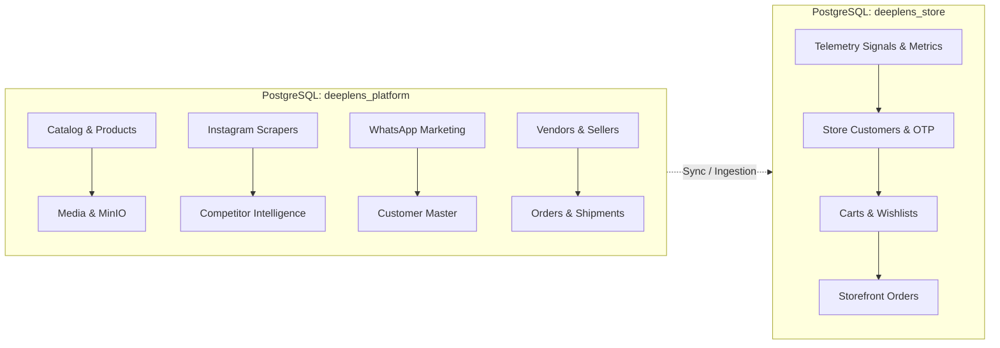

# DeepLens PostgreSQL Schema Catalog

> **Generated by:** Naga (SQL / Data Specialist)  
> **Host:** `192.168.0.170:5432`  
> **Extracted At:** `2026-10-30T09:45:10.037036+00:00`  
> **Scope:** `deeplens_platform` (116 relations, 1,217 cols) & `deeplens_store` (18 relations, 207 cols)  
> **Total Catalog:** 134 relations | 1,424 columns  

## Table of Contents
- [1. Executive Architectural Overview](#1-executive-architectural-overview)
- [2. Domain Summary Matrix](#2-domain-summary-matrix)
- [3. Domain: Catalog & Products](#3-domain-catalog-products)
- [4. Domain: Orders & Fulfillment](#4-domain-orders-fulfillment)
- [5. Domain: Customers, Identity & Auth](#5-domain-customers-identity-auth)
- [6. Domain: Scrapers & Ingestion](#6-domain-scrapers-ingestion)
- [7. Domain: Media & Storage](#7-domain-media-storage)
- [8. Domain: WhatsApp & Communications](#8-domain-whatsapp-communications)
- [9. Domain: Storefront](#9-domain-storefront)
- [10. Domain: Settings, Infrastructure & Telemetry](#10-domain-settings-infrastructure-telemetry)
- [11. Cross-Database & Legacy Schema Observations](#11-cross-database--legacy-schema-observations)

## 1. Executive Architectural Overview
DeepLens employs a decoupled two-database topology hosted on PostgreSQL:
1. **`deeplens_platform`**: The central administrative, scraping, and intelligence monolith. Manages core catalog entities, vendor integrations, competitor intelligence, Instagram media ingestion, WhatsApp broadcast campaigns, logistics/orders, and LLM telemetry.
2. **`deeplens_store`**: The high-concurrency, customer-facing storefront and telemetry database. Powers shopper authentication (phone OTP, sessions, device fingerprints), customer carts/wishlists, customer orders, and real-time frontend telemetry signal ingestion.

## 2. Domain Summary Matrix

| Domain | Platform Tables | Store Tables | Total Relations | Key Responsibilities |
|:---|:---:|:---:|:---:|:---|
| **Catalog & Products** | 19 | 4 | 23 | Product master, variants, categories, color groups, price tracking, merchandising audits, and merge/unmerge deduplication. |
| **Orders & Fulfillment** | 10 | 1 | 11 | Omnichannel and storefront orders, order items, shipments, tracking, escalation workflows, NDR tasks, and warehouses. |
| **Customers, Identity & Auth** | 15 | 4 | 19 | Customer profile master, localized languages, internal users, roles, RBAC permissions, refresh tokens, and storefront OTP/identity links. |
| **Scrapers & Ingestion** | 25 | 0 | 25 | Instagram scraper queues, proxy accounts, competitor watchlist, video engagement metrics, historical follower snapshots, and outlier detection views. |
| **Media & Storage** | 8 | 2 | 10 | MinIO object attachments, entity attachment links, image metadata, media links, and storage lifecycle/deletion queues. |
| **WhatsApp & Communications** | 20 | 0 | 20 | WhatsApp multi-channel broadcasts, automated communication purpose workflows, templates, snippet copies, and story group postings. |
| **Storefront** | 3 | 5 | 8 | Customer carts, cart items, wishlists, browsing sessions, and device session summaries. |
| **Settings, Infrastructure & Telemetry** | 16 | 2 | 18 | Application configurations, Infisical secret bridges, LLM correction logs, vendor logistical agreements, migrations history, and telemetry event streams. |

## 3. Domain: Catalog & Products

**Domain Focus:** Product master, variants, categories, color groups, price tracking, merchandising audits, and merge/unmerge deduplication.

### Tables Summary

| Database | Table / Relation | Type | Approx Rows | PK Column(s) | Description / Notes |
|:---|:---|:---:|:---:|:---|:---|
| `deeplens_platform` | `product` | BASE TABLE | 0 | `id` | Managed relation in `deeplens_platform` |
| `deeplens_platform` | `products` | BASE TABLE | 63 | `id` | Managed relation in `deeplens_platform` |
| `deeplens_store` | `products` | BASE TABLE | 5 | `id` | Managed relation in `deeplens_store` |
| `deeplens_platform` | `product_variant` | BASE TABLE | 0 | `id` | Managed relation in `deeplens_platform` |
| `deeplens_platform` | `product_variants` | BASE TABLE | 0 | `id` | Managed relation in `deeplens_platform` |
| `deeplens_platform` | `product_merge_candidates` | BASE TABLE | 56 | `id` | Managed relation in `deeplens_platform` |
| `deeplens_platform` | `product_merges` | BASE TABLE | 2 | `source_id` | Managed relation in `deeplens_platform` |
| `deeplens_platform` | `product_unmerges_audit` | BASE TABLE | 0 | `id` | Managed relation in `deeplens_platform` |
| `deeplens_platform` | `product_publishing_events` | BASE TABLE | 0 | `id` | Managed relation in `deeplens_platform` |
| `deeplens_platform` | `product_share_logs` | BASE TABLE | 0 | `id` | Managed relation in `deeplens_platform` |
| `deeplens_platform` | `categories` | BASE TABLE | 0 | `id` | Managed relation in `deeplens_platform` |
| `deeplens_platform` | `category` | BASE TABLE | 0 | `id` | Managed relation in `deeplens_platform` |
| `deeplens_platform` | `price_history` | BASE TABLE | 3 | `id` | Managed relation in `deeplens_platform` |
| `deeplens_platform` | `store_products` | BASE TABLE | 0 | `id` | Managed relation in `deeplens_platform` |
| `deeplens_platform` | `store_color_groups` | BASE TABLE | 0 | `id` | Managed relation in `deeplens_platform` |
| `deeplens_platform` | `store_product_audit` | BASE TABLE | 0 | `id` | Managed relation in `deeplens_platform` |
| `deeplens_platform` | `taxonomy_facets` | BASE TABLE | 0 | `id` | Managed relation in `deeplens_platform` |
| `deeplens_platform` | `seller_listing` | BASE TABLE | 0 | `id` | Managed relation in `deeplens_platform` |
| `deeplens_platform` | `seller_listings` | BASE TABLE | 0 | `id` | Managed relation in `deeplens_platform` |
| `deeplens_platform` | `vendor_listings` | BASE TABLE | 68 | `id` | Managed relation in `deeplens_platform` |
| `deeplens_store` | `color_groups` | BASE TABLE | 0 | `id` | Managed relation in `deeplens_store` |
| `deeplens_store` | `product_audits` | BASE TABLE | 12 | `id` | Managed relation in `deeplens_store` |
| `deeplens_store` | `product_waitlists` | BASE TABLE | 0 | `id` | Managed relation in `deeplens_store` |

### `deeplens_platform.product`
**Columns:**

| # | Column | Type | Nullable | Default | Constraints | Description |
|:---:|:---|:---|:---:|:---|:---|:---|
| 1 | `id` | `uuid` | NOT NULL | `` | `PK` | - |
| 2 | `category_id` | `uuid` | NULL | `` | `FK → `category`` | - |
| 3 | `base_sku` | `text` | NULL | `` | - | - |
| 4 | `title` | `text` | NULL | `` | - | - |
| 5 | `fabric` | `text` | NULL | `` | - | - |
| 6 | `stitch_type` | `text` | NULL | `` | - | - |
| 7 | `work_heaviness` | `text` | NULL | `` | - | - |
| 8 | `tags` | `ARRAY` | NOT NULL | `` | - | - |
| 9 | `unified_attributes` | `text` | NULL | `` | - | - |
| 10 | `created_at` | `timestamp with time zone` | NOT NULL | `` | - | - |
| 11 | `is_starred` | `boolean` | NOT NULL | `false` | - | - |
| 12 | `is_media_review_required` | `boolean` | NOT NULL | `false` | - | - |

**Foreign Keys:**

| Constraint | Columns | References | On Update | On Delete |
|:---|:---|:---|:---:|:---:|
| `fk_product_category_category_id` | `category_id` | `category(id)` | `NO ACTION` | `NO ACTION` |

**Indexes:**

| Index Name | Columns | Unique | Definition |
|:---|:---|:---:|:---|
| `ix_product_category_id` | `category_id` | NO | `CREATE INDEX ix_product_category_id ON public.product USING btree (category_id)` |

---

### `deeplens_platform.products`
**Columns:**

| # | Column | Type | Nullable | Default | Constraints | Description |
|:---:|:---|:---|:---:|:---|:---|:---|
| 1 | `id` | `uuid` | NOT NULL | `gen_random_uuid()` | `PK` | - |
| 2 | `category_id` | `uuid` | NULL | `` | `FK → `categories`` | - |
| 3 | `base_sku` | `varchar(100)` | NULL | `` | `UNIQUE` | - |
| 4 | `title` | `varchar(255)` | NULL | `` | - | - |
| 5 | `tags` | `ARRAY` | NULL | `` | - | - |
| 6 | `unified_attributes` | `jsonb` | NULL | `` | - | - |
| 7 | `created_at` | `timestamp with time zone` | NULL | `now()` | - | - |
| 8 | `sequence_id` | `integer` | NULL | `` | - | - |
| 9 | `is_deleted` | `boolean` | NULL | `false` | - | - |
| 10 | `fabric` | `text` | NULL | `` | - | - |
| 11 | `stitch_type` | `text` | NULL | `` | - | - |
| 12 | `work_heaviness` | `text` | NULL | `` | - | - |
| 13 | `description` | `text` | NULL | `` | - | - |
| 14 | `is_starred` | `boolean` | NOT NULL | `false` | - | - |
| 15 | `is_archived` | `boolean` | NOT NULL | `false` | - | - |
| 16 | `updated_at` | `timestamp with time zone` | NULL | `now()` | - | - |
| 17 | `is_published` | `boolean` | NULL | `false` | - | - |
| 18 | `media_updated_at` | `timestamp with time zone` | NULL | `` | - | - |
| 19 | `store_publish_updated_at` | `timestamp with time zone` | NULL | `` | - | - |
| 20 | `is_media_review_required` | `boolean` | NOT NULL | `false` | - | - |

**Foreign Keys:**

| Constraint | Columns | References | On Update | On Delete |
|:---|:---|:---|:---:|:---:|
| `products_category_id_fkey` | `category_id` | `categories(id)` | `NO ACTION` | `SET NULL` |

**Indexes:**

| Index Name | Columns | Unique | Definition |
|:---|:---|:---:|:---|
| `idx_platform_products_active_fuzzy` | `title, base_sku, fabric` | NO | `CREATE INDEX idx_platform_products_active_fuzzy ON public.products USING gin (title gin_trgm_ops, base_sku gin_trgm_ops, fabric gin_trgm_ops) WHERE ((is_deleted = false) AND (is_archived = false))` |
| `idx_products_catalog_sort` | `is_deleted, is_archived, created_at, sequence_id, id` | NO | `CREATE INDEX idx_products_catalog_sort ON public.products USING btree (is_deleted, is_archived, created_at DESC, sequence_id DESC, id DESC)` |
| `idx_products_desc_trgm` | `description` | NO | `CREATE INDEX idx_products_desc_trgm ON public.products USING gin (description gin_trgm_ops)` |
| `idx_products_is_archived` | `is_archived` | NO | `CREATE INDEX idx_products_is_archived ON public.products USING btree (is_archived)` |
| `idx_products_sku` | `base_sku` | NO | `CREATE INDEX idx_products_sku ON public.products USING btree (base_sku)` |
| `idx_products_sku_trgm` | `base_sku` | NO | `CREATE INDEX idx_products_sku_trgm ON public.products USING gin (base_sku gin_trgm_ops)` |
| `idx_products_title_trgm` | `title` | NO | `CREATE INDEX idx_products_title_trgm ON public.products USING gin (title gin_trgm_ops)` |
| `products_base_sku_key` | `base_sku` | YES | `CREATE UNIQUE INDEX products_base_sku_key ON public.products USING btree (base_sku)` |

---

### `deeplens_store.products`
**Columns:**

| # | Column | Type | Nullable | Default | Constraints | Description |
|:---:|:---|:---|:---:|:---|:---|:---|
| 1 | `id` | `uuid` | NOT NULL | `gen_random_uuid()` | `PK` | - |
| 2 | `vayyari_product_id` | `uuid` | NOT NULL | `` | - | - |
| 3 | `product_code` | `varchar(64)` | NOT NULL | `` | `UNIQUE` | - |
| 4 | `title` | `varchar(255)` | NOT NULL | `` | - | - |
| 5 | `description` | `text` | NULL | `` | - | - |
| 6 | `category_name` | `varchar(100)` | NOT NULL | `'Sarees'::character varying` | - | - |
| 7 | `fabric` | `varchar(100)` | NULL | `` | - | - |
| 8 | `base_cost` | `numeric(12,2)` | NOT NULL | `0.00` | - | - |
| 9 | `mrp` | `numeric(12,2)` | NOT NULL | `0.00` | - | - |
| 10 | `sale_price` | `numeric(12,2)` | NOT NULL | `0.00` | - | - |
| 11 | `lifecycle_status` | `varchar(32)` | NOT NULL | `'available'::character varying` | - | - |
| 12 | `stock_quantity` | `integer` | NOT NULL | `10` | - | - |
| 13 | `color_group_id` | `uuid` | NULL | `` | `FK → `color_groups`` | - |
| 14 | `colorway_name` | `varchar(64)` | NOT NULL | `'Standard'::character varying` | - | - |
| 15 | `color_hex` | `varchar(16)` | NOT NULL | `'#1B4D3E'::character varying` | - | - |
| 16 | `swatch_template` | `varchar(32)` | NOT NULL | `'solid'::character varying` | - | - |
| 17 | `media_order` | `jsonb` | NOT NULL | `'[]'::jsonb` | - | - |
| 18 | `tags` | `jsonb` | NOT NULL | `'[]'::jsonb` | - | - |
| 19 | `is_published` | `boolean` | NOT NULL | `true` | - | - |
| 20 | `published_at` | `timestamp with time zone` | NOT NULL | `now()` | - | - |
| 21 | `created_at` | `timestamp with time zone` | NOT NULL | `now()` | - | - |
| 22 | `updated_at` | `timestamp with time zone` | NOT NULL | `now()` | - | - |
| 23 | `color_groups` | `jsonb` | NULL | `'[]'::jsonb` | - | - |
| 24 | `parent_catalog_id` | `uuid` | NULL | `` | - | - |
| 25 | `catalog_color_group_id` | `uuid` | NULL | `` | - | - |
| 26 | `parent_product_code` | `varchar(50)` | NULL | `` | - | - |
| 27 | `previous_lifecycle_status` | `varchar(50)` | NULL | `` | - | - |
| 28 | `take_down_expires_at` | `timestamp with time zone` | NULL | `` | - | - |
| 29 | `is_re_evaluation_pending` | `boolean` | NULL | `false` | - | - |
| 30 | `skus` | `jsonb` | NULL | `'[]'::jsonb` | - | - |

**Foreign Keys:**

| Constraint | Columns | References | On Update | On Delete |
|:---|:---|:---|:---:|:---:|
| `products_color_group_id_fkey` | `color_group_id` | `color_groups(id)` | `NO ACTION` | `SET NULL` |

**Indexes:**

| Index Name | Columns | Unique | Definition |
|:---|:---|:---:|:---|
| `idx_products_category` | `category_name` | NO | `CREATE INDEX idx_products_category ON public.products USING btree (category_name)` |
| `idx_products_lifecycle` | `lifecycle_status` | NO | `CREATE INDEX idx_products_lifecycle ON public.products USING btree (lifecycle_status)` |
| `idx_products_parent_catalog_id` | `parent_catalog_id` | NO | `CREATE INDEX idx_products_parent_catalog_id ON public.products USING btree (parent_catalog_id)` |
| `idx_products_parent_color` | `parent_catalog_id, catalog_color_group_id` | YES | `CREATE UNIQUE INDEX idx_products_parent_color ON public.products USING btree (parent_catalog_id, catalog_color_group_id) WHERE (catalog_color_group_id IS NOT NULL)` |
| `idx_products_published_at` | `published_at` | NO | `CREATE INDEX idx_products_published_at ON public.products USING btree (published_at DESC)` |
| `idx_products_tags_gin` | `tags` | NO | `CREATE INDEX idx_products_tags_gin ON public.products USING gin (tags)` |
| `idx_products_title_trgm` | `title` | NO | `CREATE INDEX idx_products_title_trgm ON public.products USING gin (title gin_trgm_ops)` |
| `idx_store_products_active_fuzzy` | `title, product_code, fabric, colorway_name` | NO | `CREATE INDEX idx_store_products_active_fuzzy ON public.products USING gin (title gin_trgm_ops, product_code gin_trgm_ops, fabric gin_trgm_ops, colorway_name gin_trgm_ops) WHERE (is_published = true)` |
| `products_product_code_key` | `product_code` | YES | `CREATE UNIQUE INDEX products_product_code_key ON public.products USING btree (product_code)` |

---

### `deeplens_platform.product_variant`
**Columns:**

| # | Column | Type | Nullable | Default | Constraints | Description |
|:---:|:---|:---|:---:|:---|:---|:---|
| 1 | `id` | `uuid` | NOT NULL | `` | `PK` | - |
| 2 | `product_id` | `uuid` | NOT NULL | `` | `FK → `product`` | - |
| 3 | `variant_sku` | `text` | NULL | `` | - | - |
| 4 | `color` | `text` | NULL | `` | - | - |
| 5 | `fabric` | `text` | NULL | `` | - | - |
| 6 | `stitch_type` | `text` | NULL | `` | - | - |
| 7 | `work_heaviness` | `text` | NULL | `` | - | - |
| 8 | `search_keywords` | `ARRAY` | NOT NULL | `` | - | - |
| 9 | `attributes_json` | `text` | NULL | `` | - | - |
| 10 | `created_at` | `timestamp with time zone` | NOT NULL | `` | - | - |

**Foreign Keys:**

| Constraint | Columns | References | On Update | On Delete |
|:---|:---|:---|:---:|:---:|
| `fk_product_variant_product_product_id` | `product_id` | `product(id)` | `NO ACTION` | `CASCADE` |

**Indexes:**

| Index Name | Columns | Unique | Definition |
|:---|:---|:---:|:---|
| `ix_product_variant_product_id` | `product_id` | NO | `CREATE INDEX ix_product_variant_product_id ON public.product_variant USING btree (product_id)` |

---

### `deeplens_platform.product_variants`
**Columns:**

| # | Column | Type | Nullable | Default | Constraints | Description |
|:---:|:---|:---|:---:|:---|:---|:---|
| 1 | `id` | `uuid` | NOT NULL | `gen_random_uuid()` | `PK` | - |
| 2 | `product_id` | `uuid` | NULL | `` | `FK → `products`` | - |
| 3 | `variant_sku` | `varchar(100)` | NULL | `` | - | - |
| 4 | `color` | `varchar(50)` | NULL | `` | - | - |
| 5 | `fabric` | `varchar(100)` | NULL | `` | - | - |
| 6 | `stitch_type` | `varchar(50)` | NULL | `` | - | - |
| 7 | `work_heaviness` | `varchar(50)` | NULL | `` | - | - |
| 8 | `search_keywords` | `ARRAY` | NULL | `` | - | - |
| 9 | `attributes_json` | `jsonb` | NULL | `` | - | - |
| 10 | `created_at` | `timestamp with time zone` | NULL | `now()` | - | - |

**Foreign Keys:**

| Constraint | Columns | References | On Update | On Delete |
|:---|:---|:---|:---:|:---:|
| `product_variants_product_id_fkey` | `product_id` | `products(id)` | `NO ACTION` | `CASCADE` |

---

### `deeplens_platform.product_merge_candidates`
**Columns:**

| # | Column | Type | Nullable | Default | Constraints | Description |
|:---:|:---|:---|:---:|:---|:---|:---|
| 1 | `id` | `uuid` | NOT NULL | `gen_random_uuid()` | `PK` | - |
| 2 | `product_a_id` | `uuid` | NOT NULL | `` | `FK → `products`` | - |
| 3 | `product_b_id` | `uuid` | NOT NULL | `` | `FK → `products`` | - |
| 4 | `similarity_score` | `double precision` | NOT NULL | `` | - | - |
| 5 | `status` | `varchar(20)` | NULL | `'pending'::character varying` | - | - |
| 6 | `detected_at` | `timestamp with time zone` | NOT NULL | `now()` | - | - |
| 7 | `resolved_at` | `timestamp with time zone` | NULL | `` | - | - |
| 8 | `resolved_by` | `varchar(100)` | NULL | `` | - | - |

**Foreign Keys:**

| Constraint | Columns | References | On Update | On Delete |
|:---|:---|:---|:---:|:---:|
| `product_merge_candidates_product_a_id_fkey` | `product_a_id` | `products(id)` | `NO ACTION` | `CASCADE` |
| `product_merge_candidates_product_b_id_fkey` | `product_b_id` | `products(id)` | `NO ACTION` | `CASCADE` |

**Indexes:**

| Index Name | Columns | Unique | Definition |
|:---|:---|:---:|:---|
| `idx_pmc_product_pair` | `product_a_id, product_b_id` | YES | `CREATE UNIQUE INDEX idx_pmc_product_pair ON public.product_merge_candidates USING btree (product_a_id, product_b_id)` |
| `idx_pmc_status` | `status` | NO | `CREATE INDEX idx_pmc_status ON public.product_merge_candidates USING btree (status) WHERE ((status)::text = 'pending'::text)` |

---

### `deeplens_platform.product_merges`
**Columns:**

| # | Column | Type | Nullable | Default | Constraints | Description |
|:---:|:---|:---|:---:|:---|:---|:---|
| 1 | `source_id` | `uuid` | NOT NULL | `` | `PK` | - |
| 2 | `target_id` | `uuid` | NOT NULL | `` | `FK → `products`` | - |
| 3 | `merged_at` | `timestamp with time zone` | NULL | `now()` | - | - |
| 4 | `metadata` | `jsonb` | NULL | `` | - | - |

**Foreign Keys:**

| Constraint | Columns | References | On Update | On Delete |
|:---|:---|:---|:---:|:---:|
| `product_merges_target_id_fkey` | `target_id` | `products(id)` | `NO ACTION` | `NO ACTION` |

**Indexes:**

| Index Name | Columns | Unique | Definition |
|:---|:---|:---:|:---|
| `idx_product_merges_target` | `target_id` | NO | `CREATE INDEX idx_product_merges_target ON public.product_merges USING btree (target_id)` |

---

### `deeplens_platform.product_unmerges_audit`
**Columns:**

| # | Column | Type | Nullable | Default | Constraints | Description |
|:---:|:---|:---|:---:|:---|:---|:---|
| 1 | `id` | `uuid` | NOT NULL | `gen_random_uuid()` | `PK` | - |
| 2 | `source_id` | `uuid` | NOT NULL | `` | - | - |
| 3 | `target_id` | `uuid` | NOT NULL | `` | - | - |
| 4 | `merged_at` | `timestamp with time zone` | NULL | `` | - | - |
| 5 | `metadata` | `jsonb` | NULL | `` | - | - |
| 6 | `unmerged_at` | `timestamp with time zone` | NULL | `now()` | - | - |
| 7 | `unmerged_by` | `text` | NULL | `'ADO_TASK_612'::text` | - | - |
| 8 | `notes` | `text` | NULL | `` | - | - |

---

### `deeplens_platform.product_publishing_events`
**Columns:**

| # | Column | Type | Nullable | Default | Constraints | Description |
|:---:|:---|:---|:---:|:---|:---|:---|
| 1 | `id` | `uuid` | NOT NULL | `gen_random_uuid()` | `PK` | - |
| 2 | `product_id` | `uuid` | NOT NULL | `` | `FK → `products`` | - |
| 3 | `platform` | `varchar(50)` | NOT NULL | `` | - | - |
| 4 | `account_id` | `varchar(100)` | NULL | `` | - | - |
| 5 | `account_name` | `varchar(100)` | NULL | `` | - | - |
| 6 | `published_url` | `text` | NULL | `` | - | - |
| 7 | `external_post_id` | `varchar(255)` | NULL | `` | - | - |
| 8 | `description_used` | `text` | NULL | `` | - | - |
| 9 | `status` | `varchar(50)` | NOT NULL | `'published'::character varying` | - | - |
| 10 | `published_at` | `timestamp with time zone` | NOT NULL | `now()` | - | - |
| 11 | `created_at` | `timestamp with time zone` | NOT NULL | `now()` | - | - |

**Foreign Keys:**

| Constraint | Columns | References | On Update | On Delete |
|:---|:---|:---|:---:|:---:|
| `product_publishing_events_product_id_fkey` | `product_id` | `products(id)` | `NO ACTION` | `CASCADE` |

**Indexes:**

| Index Name | Columns | Unique | Definition |
|:---|:---|:---:|:---|
| `idx_product_publishing_events_platform` | `platform` | NO | `CREATE INDEX idx_product_publishing_events_platform ON public.product_publishing_events USING btree (platform)` |
| `idx_product_publishing_events_product_id` | `product_id` | NO | `CREATE INDEX idx_product_publishing_events_product_id ON public.product_publishing_events USING btree (product_id)` |

---

### `deeplens_platform.product_share_logs`
**Columns:**

| # | Column | Type | Nullable | Default | Constraints | Description |
|:---:|:---|:---|:---:|:---|:---|:---|
| 1 | `id` | `uuid` | NOT NULL | `` | `PK` | - |
| 2 | `product_id` | `uuid` | NOT NULL | `` | - | - |
| 3 | `platform` | `varchar(50)` | NOT NULL | `` | - | - |
| 4 | `shared_at` | `timestamp with time zone` | NOT NULL | `` | - | - |
| 5 | `description_used` | `text` | NULL | `` | - | - |

**Indexes:**

| Index Name | Columns | Unique | Definition |
|:---|:---|:---:|:---|
| `ix_product_share_logs_product_id` | `product_id` | NO | `CREATE INDEX ix_product_share_logs_product_id ON public.product_share_logs USING btree (product_id)` |

---

### `deeplens_platform.categories`
**Columns:**

| # | Column | Type | Nullable | Default | Constraints | Description |
|:---:|:---|:---|:---:|:---|:---|:---|
| 1 | `id` | `uuid` | NOT NULL | `gen_random_uuid()` | `PK` | - |
| 2 | `name` | `varchar(100)` | NOT NULL | `` | - | - |
| 3 | `slug` | `varchar(100)` | NOT NULL | `` | `UNIQUE` | - |
| 4 | `metadata_json` | `jsonb` | NULL | `` | - | - |
| 5 | `created_at` | `timestamp with time zone` | NULL | `now()` | - | - |
| 6 | `icon_name` | `text` | NULL | `` | - | - |
| 7 | `classification_keywords` | `ARRAY` | NULL | `'{}'::text[]` | - | - |

**Indexes:**

| Index Name | Columns | Unique | Definition |
|:---|:---|:---:|:---|
| `categories_slug_key` | `slug` | YES | `CREATE UNIQUE INDEX categories_slug_key ON public.categories USING btree (slug)` |

---

### `deeplens_platform.category`
**Columns:**

| # | Column | Type | Nullable | Default | Constraints | Description |
|:---:|:---|:---|:---:|:---|:---|:---|
| 1 | `id` | `uuid` | NOT NULL | `` | `PK` | - |
| 2 | `name` | `text` | NOT NULL | `` | - | - |
| 3 | `slug` | `text` | NOT NULL | `` | - | - |
| 4 | `metadata_json` | `text` | NULL | `` | - | - |

---

### `deeplens_platform.price_history`
**Columns:**

| # | Column | Type | Nullable | Default | Constraints | Description |
|:---:|:---|:---|:---:|:---|:---|:---|
| 1 | `id` | `uuid` | NOT NULL | `` | `PK` | - |
| 2 | `listing_id` | `uuid` | NOT NULL | `` | - | - |
| 3 | `price` | `numeric` | NOT NULL | `` | - | - |
| 4 | `currency` | `text` | NOT NULL | `` | - | - |
| 5 | `effective_date` | `timestamp with time zone` | NOT NULL | `` | - | - |
| 6 | `seller_listing_id` | `uuid` | NULL | `` | `FK → `seller_listing`` | - |

**Foreign Keys:**

| Constraint | Columns | References | On Update | On Delete |
|:---|:---|:---|:---:|:---:|
| `fk_price_history_seller_listing_seller_listing_id` | `seller_listing_id` | `seller_listing(id)` | `NO ACTION` | `NO ACTION` |

**Indexes:**

| Index Name | Columns | Unique | Definition |
|:---|:---|:---:|:---|
| `ix_price_history_seller_listing_id` | `seller_listing_id` | NO | `CREATE INDEX ix_price_history_seller_listing_id ON public.price_history USING btree (seller_listing_id)` |

---

### `deeplens_platform.store_products`
**Columns:**

| # | Column | Type | Nullable | Default | Constraints | Description |
|:---:|:---|:---|:---:|:---|:---|:---|
| 1 | `id` | `uuid` | NOT NULL | `gen_random_uuid()` | `PK` | - |
| 2 | `vayyari_product_id` | `uuid` | NOT NULL | `` | `UNIQUE` | - |
| 3 | `product_code` | `varchar(64)` | NOT NULL | `` | - | - |
| 4 | `title` | `varchar(255)` | NOT NULL | `` | - | - |
| 5 | `description` | `text` | NULL | `` | - | - |
| 6 | `category_name` | `varchar(100)` | NOT NULL | `'Sarees'::character varying` | - | - |
| 7 | `fabric` | `varchar(100)` | NULL | `` | - | - |
| 8 | `base_cost` | `numeric(12,2)` | NOT NULL | `0.00` | - | - |
| 9 | `mrp` | `numeric(12,2)` | NOT NULL | `0.00` | - | - |
| 10 | `sale_price` | `numeric(12,2)` | NOT NULL | `0.00` | - | - |
| 11 | `lifecycle_status` | `varchar(32)` | NOT NULL | `'available'::character varying` | - | - |
| 12 | `stock_quantity` | `integer` | NOT NULL | `10` | - | - |
| 13 | `color_group_id` | `uuid` | NULL | `` | `FK → `store_color_groups`` | - |
| 14 | `colorway_name` | `varchar(64)` | NOT NULL | `'Standard'::character varying` | - | - |
| 15 | `color_hex` | `varchar(16)` | NOT NULL | `'#1B4D3E'::character varying` | - | - |
| 16 | `media_order` | `jsonb` | NOT NULL | `'[]'::jsonb` | - | - |
| 17 | `tags` | `jsonb` | NOT NULL | `'[]'::jsonb` | - | - |
| 18 | `is_published` | `boolean` | NOT NULL | `true` | - | - |
| 19 | `published_at` | `timestamp with time zone` | NOT NULL | `now()` | - | - |
| 20 | `created_at` | `timestamp with time zone` | NOT NULL | `now()` | - | - |
| 21 | `updated_at` | `timestamp with time zone` | NOT NULL | `now()` | - | - |

**Foreign Keys:**

| Constraint | Columns | References | On Update | On Delete |
|:---|:---|:---|:---:|:---:|
| `store_products_color_group_id_fkey` | `color_group_id` | `store_color_groups(id)` | `NO ACTION` | `SET NULL` |

**Indexes:**

| Index Name | Columns | Unique | Definition |
|:---|:---|:---:|:---|
| `idx_store_products_category` | `category_name` | NO | `CREATE INDEX idx_store_products_category ON public.store_products USING btree (category_name)` |
| `idx_store_products_color_group` | `color_group_id` | NO | `CREATE INDEX idx_store_products_color_group ON public.store_products USING btree (color_group_id)` |
| `idx_store_products_lifecycle` | `lifecycle_status` | NO | `CREATE INDEX idx_store_products_lifecycle ON public.store_products USING btree (lifecycle_status)` |
| `idx_store_products_published_at` | `published_at` | NO | `CREATE INDEX idx_store_products_published_at ON public.store_products USING btree (published_at DESC)` |
| `idx_store_products_vayyari_id` | `vayyari_product_id` | NO | `CREATE INDEX idx_store_products_vayyari_id ON public.store_products USING btree (vayyari_product_id)` |
| `uq_store_products_vayyari_id` | `vayyari_product_id` | YES | `CREATE UNIQUE INDEX uq_store_products_vayyari_id ON public.store_products USING btree (vayyari_product_id)` |

---

### `deeplens_platform.store_color_groups`
**Columns:**

| # | Column | Type | Nullable | Default | Constraints | Description |
|:---:|:---|:---|:---:|:---|:---|:---|
| 1 | `id` | `uuid` | NOT NULL | `gen_random_uuid()` | `PK` | - |
| 2 | `master_title` | `varchar(255)` | NOT NULL | `` | - | - |
| 3 | `description` | `text` | NULL | `` | - | - |
| 4 | `created_at` | `timestamp with time zone` | NOT NULL | `now()` | - | - |
| 5 | `updated_at` | `timestamp with time zone` | NOT NULL | `now()` | - | - |

---

### `deeplens_platform.store_product_audit`
**Columns:**

| # | Column | Type | Nullable | Default | Constraints | Description |
|:---:|:---|:---|:---:|:---|:---|:---|
| 1 | `id` | `uuid` | NOT NULL | `gen_random_uuid()` | `PK` | - |
| 2 | `store_product_id` | `uuid` | NOT NULL | `` | `FK → `store_products`` | - |
| 3 | `action_type` | `varchar(64)` | NOT NULL | `` | - | - |
| 4 | `field_name` | `varchar(64)` | NULL | `` | - | - |
| 5 | `old_value` | `text` | NULL | `` | - | - |
| 6 | `new_value` | `text` | NULL | `` | - | - |
| 7 | `author_email` | `varchar(255)` | NOT NULL | `'system'::character varying` | - | - |
| 8 | `created_at` | `timestamp with time zone` | NOT NULL | `now()` | - | - |

**Foreign Keys:**

| Constraint | Columns | References | On Update | On Delete |
|:---|:---|:---|:---:|:---:|
| `store_product_audit_store_product_id_fkey` | `store_product_id` | `store_products(id)` | `NO ACTION` | `CASCADE` |

**Indexes:**

| Index Name | Columns | Unique | Definition |
|:---|:---|:---:|:---|
| `idx_store_product_audit_product` | `store_product_id, created_at` | NO | `CREATE INDEX idx_store_product_audit_product ON public.store_product_audit USING btree (store_product_id, created_at DESC)` |

---

### `deeplens_platform.taxonomy_facets`
**Columns:**

| # | Column | Type | Nullable | Default | Constraints | Description |
|:---:|:---|:---|:---:|:---|:---|:---|
| 1 | `id` | `uuid` | NOT NULL | `gen_random_uuid()` | `PK` | - |
| 2 | `dimension` | `varchar(50)` | NOT NULL | `` | - | - |
| 3 | `canonical_name` | `varchar(100)` | NOT NULL | `` | - | - |
| 4 | `aliases` | `ARRAY` | NOT NULL | `'{}'::text[]` | - | - |
| 5 | `usage_count` | `integer` | NOT NULL | `1` | - | - |
| 6 | `is_verified` | `boolean` | NOT NULL | `true` | - | - |
| 7 | `metadata` | `jsonb` | NOT NULL | `'{}'::jsonb` | - | - |
| 8 | `created_at` | `timestamp with time zone` | NOT NULL | `now()` | - | - |
| 9 | `updated_at` | `timestamp with time zone` | NOT NULL | `now()` | - | - |

**Indexes:**

| Index Name | Columns | Unique | Definition |
|:---|:---|:---:|:---|
| `idx_taxonomy_facets_aliases_gin` | `aliases` | NO | `CREATE INDEX idx_taxonomy_facets_aliases_gin ON public.taxonomy_facets USING gin (aliases)` |
| `idx_taxonomy_facets_dimension` | `dimension` | NO | `CREATE INDEX idx_taxonomy_facets_dimension ON public.taxonomy_facets USING btree (dimension)` |
| `idx_taxonomy_facets_usage_count` | `usage_count` | NO | `CREATE INDEX idx_taxonomy_facets_usage_count ON public.taxonomy_facets USING btree (usage_count DESC)` |
| `uq_taxonomy_facets_dimension_canonical` | `dimension` | YES | `CREATE UNIQUE INDEX uq_taxonomy_facets_dimension_canonical ON public.taxonomy_facets USING btree (dimension, lower((canonical_name)::text))` |

---

### `deeplens_platform.seller_listing`
**Columns:**

| # | Column | Type | Nullable | Default | Constraints | Description |
|:---:|:---|:---|:---:|:---|:---|:---|
| 1 | `id` | `uuid` | NOT NULL | `` | `PK` | - |
| 2 | `variant_id` | `uuid` | NULL | `` | `FK → `product_variant`` | - |
| 3 | `product_id` | `uuid` | NOT NULL | `` | `FK → `product`` | - |
| 4 | `seller_id` | `uuid` | NOT NULL | `` | `FK → `seller`` | - |
| 5 | `external_id` | `text` | NULL | `` | - | - |
| 6 | `current_price` | `numeric` | NULL | `` | - | - |
| 7 | `currency` | `text` | NOT NULL | `` | - | - |
| 8 | `shipping_info` | `text` | NOT NULL | `` | - | - |
| 9 | `is_favorite` | `boolean` | NOT NULL | `` | - | - |
| 10 | `is_active` | `boolean` | NOT NULL | `` | - | - |
| 11 | `description` | `text` | NULL | `` | - | - |
| 12 | `url` | `text` | NULL | `` | - | - |
| 13 | `last_priced_at` | `timestamp with time zone` | NOT NULL | `` | - | - |
| 14 | `raw_data_json` | `text` | NULL | `` | - | - |
| 15 | `updated_at` | `timestamp with time zone` | NOT NULL | `` | - | - |

**Foreign Keys:**

| Constraint | Columns | References | On Update | On Delete |
|:---|:---|:---|:---:|:---:|
| `fk_seller_listing_product_product_id` | `product_id` | `product(id)` | `NO ACTION` | `CASCADE` |
| `fk_seller_listing_product_variant_variant_id` | `variant_id` | `product_variant(id)` | `NO ACTION` | `NO ACTION` |
| `fk_seller_listing_seller_seller_id` | `seller_id` | `seller(id)` | `NO ACTION` | `CASCADE` |

**Indexes:**

| Index Name | Columns | Unique | Definition |
|:---|:---|:---:|:---|
| `ix_seller_listing_product_id` | `product_id` | NO | `CREATE INDEX ix_seller_listing_product_id ON public.seller_listing USING btree (product_id)` |
| `ix_seller_listing_seller_id` | `seller_id` | NO | `CREATE INDEX ix_seller_listing_seller_id ON public.seller_listing USING btree (seller_id)` |
| `ix_seller_listing_variant_id` | `variant_id` | NO | `CREATE INDEX ix_seller_listing_variant_id ON public.seller_listing USING btree (variant_id)` |

---

### `deeplens_platform.seller_listings`
**Columns:**

| # | Column | Type | Nullable | Default | Constraints | Description |
|:---:|:---|:---|:---:|:---|:---|:---|
| 1 | `id` | `uuid` | NOT NULL | `gen_random_uuid()` | `PK` | - |
| 2 | `variant_id` | `uuid` | NOT NULL | `` | - | - |
| 3 | `seller_id` | `uuid` | NULL | `` | `FK → `sellers`` | - |
| 4 | `external_id` | `varchar(100)` | NULL | `` | - | - |
| 5 | `current_price` | `numeric(18,2)` | NULL | `` | - | - |
| 6 | `currency` | `varchar(10)` | NULL | `'INR'::character varying` | - | - |
| 7 | `updated_at` | `timestamp with time zone` | NULL | `now()` | - | - |

**Foreign Keys:**

| Constraint | Columns | References | On Update | On Delete |
|:---|:---|:---|:---:|:---:|
| `seller_listings_seller_id_fkey` | `seller_id` | `sellers(id)` | `NO ACTION` | `SET NULL` |

---

### `deeplens_platform.vendor_listings`
**Columns:**

| # | Column | Type | Nullable | Default | Constraints | Description |
|:---:|:---|:---|:---:|:---|:---|:---|
| 1 | `id` | `uuid` | NOT NULL | `gen_random_uuid()` | `PK` | - |
| 2 | `variant_id` | `uuid` | NULL | `` | `FK → `product_variants`` | - |
| 3 | `vendor_id` | `uuid` | NULL | `` | - | - |
| 4 | `external_id` | `varchar(100)` | NULL | `` | - | - |
| 5 | `current_price` | `numeric(18,2)` | NULL | `` | - | - |
| 6 | `currency` | `varchar(10)` | NULL | `'INR'::character varying` | - | - |
| 8 | `is_favorite` | `boolean` | NULL | `false` | - | - |
| 9 | `is_active` | `boolean` | NULL | `true` | - | - |
| 10 | `description` | `text` | NULL | `` | - | - |
| 11 | `url` | `varchar(500)` | NULL | `` | - | - |
| 12 | `last_priced_at` | `timestamp with time zone` | NULL | `now()` | - | - |
| 13 | `raw_data_json` | `jsonb` | NULL | `` | - | - |
| 14 | `updated_at` | `timestamp with time zone` | NULL | `now()` | - | - |
| 15 | `product_id` | `uuid` | NULL | `` | `FK → `products`` | - |
| 16 | `source_group_id` | `varchar(255)` | NULL | `` | - | - |
| 17 | `is_plus_shipping` | `boolean` | NULL | `true` | - | - |

**Foreign Keys:**

| Constraint | Columns | References | On Update | On Delete |
|:---|:---|:---|:---:|:---:|
| `seller_listings_variant_id_fkey` | `variant_id` | `product_variants(id)` | `NO ACTION` | `CASCADE` |
| `vendor_listings_product_id_fkey` | `product_id` | `products(id)` | `NO ACTION` | `NO ACTION` |

**Indexes:**

| Index Name | Columns | Unique | Definition |
|:---|:---|:---:|:---|
| `idx_vendor_listings_product_active` | `product_id, is_active` | NO | `CREATE INDEX idx_vendor_listings_product_active ON public.vendor_listings USING btree (product_id, is_active)` |
| `idx_vendor_listings_product_id` | `product_id` | NO | `CREATE INDEX idx_vendor_listings_product_id ON public.vendor_listings USING btree (product_id)` |
| `idx_vendor_listings_product_price` | `product_id, current_price` | NO | `CREATE INDEX idx_vendor_listings_product_price ON public.vendor_listings USING btree (product_id, current_price)` |

---

### `deeplens_store.color_groups`
**Columns:**

| # | Column | Type | Nullable | Default | Constraints | Description |
|:---:|:---|:---|:---:|:---|:---|:---|
| 1 | `id` | `uuid` | NOT NULL | `gen_random_uuid()` | `PK` | - |
| 2 | `master_title` | `varchar(255)` | NOT NULL | `` | - | - |
| 3 | `description` | `text` | NULL | `` | - | - |
| 4 | `created_at` | `timestamp with time zone` | NOT NULL | `now()` | - | - |
| 5 | `updated_at` | `timestamp with time zone` | NOT NULL | `now()` | - | - |

---

### `deeplens_store.product_audits`
**Columns:**

| # | Column | Type | Nullable | Default | Constraints | Description |
|:---:|:---|:---|:---:|:---|:---|:---|
| 1 | `id` | `uuid` | NOT NULL | `gen_random_uuid()` | `PK` | - |
| 2 | `product_id` | `uuid` | NOT NULL | `` | `FK → `products`` | - |
| 3 | `action_type` | `varchar(64)` | NOT NULL | `` | - | - |
| 4 | `field_name` | `varchar(64)` | NULL | `` | - | - |
| 5 | `old_value` | `text` | NULL | `` | - | - |
| 6 | `new_value` | `text` | NULL | `` | - | - |
| 7 | `author_email` | `varchar(255)` | NOT NULL | `'system'::character varying` | - | - |
| 8 | `created_at` | `timestamp with time zone` | NOT NULL | `now()` | - | - |

**Foreign Keys:**

| Constraint | Columns | References | On Update | On Delete |
|:---|:---|:---|:---:|:---:|
| `product_audits_product_id_fkey` | `product_id` | `products(id)` | `NO ACTION` | `CASCADE` |

**Indexes:**

| Index Name | Columns | Unique | Definition |
|:---|:---|:---:|:---|
| `idx_product_audits_product` | `product_id, created_at` | NO | `CREATE INDEX idx_product_audits_product ON public.product_audits USING btree (product_id, created_at DESC)` |

---

### `deeplens_store.product_waitlists`
**Columns:**

| # | Column | Type | Nullable | Default | Constraints | Description |
|:---:|:---|:---|:---:|:---|:---|:---|
| 1 | `id` | `uuid` | NOT NULL | `gen_random_uuid()` | `PK` | - |
| 2 | `product_id` | `uuid` | NOT NULL | `` | `UNIQUE` `FK → `products`` | - |
| 3 | `customer_id` | `uuid` | NOT NULL | `` | `UNIQUE` | - |
| 4 | `created_at` | `timestamp with time zone` | NOT NULL | `now()` | - | - |

**Foreign Keys:**

| Constraint | Columns | References | On Update | On Delete |
|:---|:---|:---|:---:|:---:|
| `product_waitlists_product_id_fkey` | `product_id` | `products(id)` | `NO ACTION` | `CASCADE` |

**Indexes:**

| Index Name | Columns | Unique | Definition |
|:---|:---|:---:|:---|
| `idx_product_waitlists_customer_id` | `customer_id` | NO | `CREATE INDEX idx_product_waitlists_customer_id ON public.product_waitlists USING btree (customer_id)` |
| `idx_product_waitlists_product_id` | `product_id` | NO | `CREATE INDEX idx_product_waitlists_product_id ON public.product_waitlists USING btree (product_id)` |
| `uq_product_waitlist_customer` | `product_id, customer_id` | YES | `CREATE UNIQUE INDEX uq_product_waitlist_customer ON public.product_waitlists USING btree (product_id, customer_id)` |

---

## 4. Domain: Orders & Fulfillment

**Domain Focus:** Omnichannel and storefront orders, order items, shipments, tracking, escalation workflows, NDR tasks, and warehouses.

### Tables Summary

| Database | Table / Relation | Type | Approx Rows | PK Column(s) | Description / Notes |
|:---|:---|:---:|:---:|:---|:---|
| `deeplens_platform` | `orderId` | BASE TABLE | 130 | `id` | Stores generated order IDs and associated metadata. Source handle can be whatsapp number or instagram handle. |
| `deeplens_platform` | `orderItem` | BASE TABLE | 76 | `id` | Managed relation in `deeplens_platform` |
| `deeplens_platform` | `order_groups` | BASE TABLE | 8 | `id` | Managed relation in `deeplens_platform` |
| `deeplens_platform` | `order_sources` | BASE TABLE | 0 | `id` | Managed relation in `deeplens_platform` |
| `deeplens_platform` | `payment_modes` | BASE TABLE | 0 | `id` | Managed relation in `deeplens_platform` |
| `deeplens_platform` | `shipments` | BASE TABLE | 7 | `id` | Managed relation in `deeplens_platform` |
| `deeplens_platform` | `shipment_items` | BASE TABLE | 0 | `id` | Managed relation in `deeplens_platform` |
| `deeplens_platform` | `shipping_escalations` | BASE TABLE | 0 | `id` | Managed relation in `deeplens_platform` |
| `deeplens_platform` | `ndr_tasks` | BASE TABLE | 0 | `id` | Managed relation in `deeplens_platform` |
| `deeplens_platform` | `warehouses` | BASE TABLE | 0 | `id` | Managed relation in `deeplens_platform` |
| `deeplens_store` | `orders` | BASE TABLE | 0 | `id` | Managed relation in `deeplens_store` |

### `deeplens_platform.orderId`
> Stores generated order IDs and associated metadata. Source handle can be whatsapp number or instagram handle.

**Columns:**

| # | Column | Type | Nullable | Default | Constraints | Description |
|:---:|:---|:---|:---:|:---|:---|:---|
| 1 | `id` | `integer` | NOT NULL | `nextval('"orderId_id_seq"':...` | `PK` | - |
| 2 | `order_id` | `varchar(10)` | NOT NULL | `` | `UNIQUE` | - |
| 3 | `source_id` | `integer` | NULL | `` | `FK → `order_sources`` | - |
| 4 | `payment_mode_id` | `integer` | NULL | `` | `FK → `payment_modes`` | - |
| 5 | `created_at` | `timestamp with time zone` | NULL | `now()` | - | - |
| 6 | `customer_phone` | `varchar(20)` | NULL | `` | - | - |
| 10 | `source_handle` | `varchar(255)` | NULL | `` | - | - |
| 11 | `instagram_user_id` | `varchar(100)` | NULL | `` | - | - |
| 12 | `customer_address` | `text` | NULL | `` | - | - |
| 14 | `transaction_id` | `varchar(100)` | NULL | `` | - | UPI or bank transaction ID for the order payment |
| 21 | `instagram_handle` | `varchar(255)` | NULL | `` | - | Fallback/Original instagram handle for the order. |
| 22 | `is_deleted` | `boolean` | NULL | `false` | - | - |
| 23 | `customer_id` | `uuid` | NULL | `` | `FK → `customers`` | - |
| 24 | `customer_name` | `varchar(255)` | NULL | `` | - | - |
| 25 | `advance_paid` | `numeric(12,2)` | NULL | `0` | - | - |
| 26 | `cod_balance` | `numeric(12,2)` | NULL | `0` | - | - |
| 27 | `total_amount` | `numeric(12,2)` | NULL | `0` | - | - |
| 28 | `shipping_charges` | `numeric(12,2)` | NULL | `0` | - | - |
| 29 | `shipping_street` | `text` | NULL | `` | - | - |
| 30 | `shipping_city` | `varchar(100)` | NULL | `` | - | - |
| 31 | `shipping_state` | `varchar(100)` | NULL | `` | - | - |
| 32 | `shipping_pincode` | `varchar(10)` | NULL | `` | - | - |
| 33 | `is_serviceable` | `boolean` | NULL | `true` | - | - |
| 34 | `status` | `integer` | NULL | `0` | - | - |
| 35 | `need_label` | `boolean` | NULL | `false` | - | - |
| 36 | `order_type` | `varchar(50)` | NULL | `'Customer'::character varying` | - | - |
| 37 | `reseller_name` | `varchar(255)` | NULL | `` | - | - |
| 38 | `is_address_reviewed` | `boolean` | NULL | `true` | - | - |

**Foreign Keys:**

| Constraint | Columns | References | On Update | On Delete |
|:---|:---|:---|:---:|:---:|
| `orderId_customer_id_fkey` | `customer_id` | `customers(id)` | `NO ACTION` | `NO ACTION` |
| `studio_orders_payment_mode_id_fkey` | `payment_mode_id` | `payment_modes(id)` | `NO ACTION` | `NO ACTION` |
| `studio_orders_source_id_fkey` | `source_id` | `order_sources(id)` | `NO ACTION` | `NO ACTION` |

**Indexes:**

| Index Name | Columns | Unique | Definition |
|:---|:---|:---:|:---|
| `studio_orders_order_id_key` | `order_id` | YES | `CREATE UNIQUE INDEX studio_orders_order_id_key ON public."orderId" USING btree (order_id)` |

---

### `deeplens_platform.orderItem`
**Columns:**

| # | Column | Type | Nullable | Default | Constraints | Description |
|:---:|:---|:---|:---:|:---|:---|:---|
| 1 | `id` | `integer` | NOT NULL | `nextval('"orderItem_id_seq"...` | `PK` | - |
| 2 | `order_id_ref` | `integer` | NOT NULL | `` | `UNIQUE` `FK → `orderId`` | - |
| 3 | `item_index` | `integer` | NOT NULL | `` | `UNIQUE` | - |
| 5 | `quantity` | `integer` | NULL | `1` | - | - |
| 6 | `price` | `numeric(10,2)` | NULL | `` | - | - |
| 7 | `created_at` | `timestamp with time zone` | NULL | `now()` | - | - |
| 8 | `product_id` | `text` | NULL | `` | - | Unified text field for product identification (handles both generated and manual IDs). |
| 10 | `comments` | `text` | NULL | `` | - | - |
| 13 | `unit_price` | `numeric(12,2)` | NULL | `0` | - | - |
| 14 | `subtotal` | `numeric(12,2)` | NULL | `0` | - | - |
| 15 | `vendor_id` | `uuid` | NULL | `` | - | - |
| 16 | `source_type` | `varchar(20)` | NULL | `'catalog'::character varying` | - | - |
| 17 | `product_title` | `text` | NULL | `` | - | - |
| 18 | `item_id` | `varchar(100)` | NULL | `` | - | - |
| 19 | `order_grp_id_ref` | `varchar(100)` | NULL | `` | - | - |
| 20 | `label_url` | `text` | NULL | `` | - | - |

**Foreign Keys:**

| Constraint | Columns | References | On Update | On Delete |
|:---|:---|:---|:---:|:---:|
| `fk_order_ref` | `order_id_ref` | `orderId(id)` | `NO ACTION` | `CASCADE` |

**Indexes:**

| Index Name | Columns | Unique | Definition |
|:---|:---|:---:|:---|
| `idx_order_item_grp_id_ref` | `order_grp_id_ref` | NO | `CREATE INDEX idx_order_item_grp_id_ref ON public."orderItem" USING btree (order_grp_id_ref)` |
| `uk_order_item_index` | `order_id_ref, item_index` | YES | `CREATE UNIQUE INDEX uk_order_item_index ON public."orderItem" USING btree (order_id_ref, item_index)` |

---

### `deeplens_platform.order_groups`
**Columns:**

| # | Column | Type | Nullable | Default | Constraints | Description |
|:---:|:---|:---|:---:|:---|:---|:---|
| 1 | `id` | `bigint` | NOT NULL | `nextval('order_groups_id_se...` | `PK` | - |
| 2 | `order_grp_id` | `varchar(100)` | NOT NULL | `` | `UNIQUE` | - |
| 3 | `order_id_ref` | `bigint` | NULL | `` | `FK → `orderId`` | - |
| 4 | `order_id` | `varchar(100)` | NOT NULL | `` | - | - |
| 5 | `vendor_id` | `uuid` | NULL | `` | - | - |
| 6 | `vendor_name` | `varchar(255)` | NULL | `` | - | - |
| 7 | `need_label` | `boolean` | NULL | `false` | - | - |
| 8 | `awb_number` | `varchar(100)` | NULL | `` | - | - |
| 9 | `label_url` | `text` | NULL | `` | - | - |
| 10 | `status` | `varchar(50)` | NULL | `'unconfirmed'::character va...` | - | - |
| 11 | `tracking_sub_status` | `varchar(100)` | NULL | `` | - | - |
| 12 | `created_at` | `timestamp with time zone` | NULL | `now()` | - | - |
| 13 | `updated_at` | `timestamp with time zone` | NULL | `now()` | - | - |

**Foreign Keys:**

| Constraint | Columns | References | On Update | On Delete |
|:---|:---|:---|:---:|:---:|
| `order_groups_order_id_ref_fkey` | `order_id_ref` | `orderId(id)` | `NO ACTION` | `CASCADE` |

**Indexes:**

| Index Name | Columns | Unique | Definition |
|:---|:---|:---:|:---|
| `idx_order_groups_order_id` | `order_id` | NO | `CREATE INDEX idx_order_groups_order_id ON public.order_groups USING btree (order_id)` |
| `order_groups_order_grp_id_key` | `order_grp_id` | YES | `CREATE UNIQUE INDEX order_groups_order_grp_id_key ON public.order_groups USING btree (order_grp_id)` |

---

### `deeplens_platform.order_sources`
**Columns:**

| # | Column | Type | Nullable | Default | Constraints | Description |
|:---:|:---|:---|:---:|:---|:---|:---|
| 1 | `id` | `integer` | NOT NULL | `nextval('studio_order_sourc...` | `PK` | - |
| 2 | `name` | `varchar(50)` | NOT NULL | `` | `UNIQUE` | - |

**Indexes:**

| Index Name | Columns | Unique | Definition |
|:---|:---|:---:|:---|
| `studio_order_sources_name_key` | `name` | YES | `CREATE UNIQUE INDEX studio_order_sources_name_key ON public.order_sources USING btree (name)` |

---

### `deeplens_platform.payment_modes`
**Columns:**

| # | Column | Type | Nullable | Default | Constraints | Description |
|:---:|:---|:---|:---:|:---|:---|:---|
| 1 | `id` | `integer` | NOT NULL | `nextval('studio_payment_mod...` | `PK` | - |
| 2 | `name` | `varchar(50)` | NOT NULL | `` | `UNIQUE` | - |

**Indexes:**

| Index Name | Columns | Unique | Definition |
|:---|:---|:---:|:---|
| `studio_payment_modes_name_key` | `name` | YES | `CREATE UNIQUE INDEX studio_payment_modes_name_key ON public.payment_modes USING btree (name)` |

---

### `deeplens_platform.shipments`
**Columns:**

| # | Column | Type | Nullable | Default | Constraints | Description |
|:---:|:---|:---|:---:|:---|:---|:---|
| 1 | `id` | `uuid` | NOT NULL | `gen_random_uuid()` | `PK` | - |
| 2 | `order_id` | `uuid` | NULL | `` | - | - |
| 3 | `order_number` | `text` | NULL | `` | - | - |
| 4 | `shipment_number` | `text` | NULL | `` | `UNIQUE` | - |
| 5 | `warehouse_id` | `uuid` | NULL | `` | `FK → `warehouses`` | - |
| 6 | `courier_partner` | `text` | NULL | `` | - | - |
| 7 | `awb_number` | `text` | NULL | `` | - | - |
| 8 | `status` | `text` | NOT NULL | `'pending'::text` | - | - |
| 9 | `shipping_mode` | `text` | NULL | `'Surface'::text` | - | - |
| 10 | `fulfillment_type` | `text` | NULL | `'direct_dispatch'::text` | - | - |
| 11 | `cod_amount` | `numeric(12,2)` | NOT NULL | `0.00` | - | - |
| 12 | `label_url` | `text` | NULL | `` | - | - |
| 13 | `minio_label_key` | `text` | NULL | `` | - | - |
| 14 | `pickup_scheduled_at` | `timestamp with time zone` | NULL | `` | - | - |
| 15 | `pickup_token` | `text` | NULL | `` | - | - |
| 16 | `estimated_delivery_date` | `timestamp with time zone` | NULL | `` | - | - |
| 17 | `vendor_name` | `text` | NULL | `` | - | - |
| 18 | `vendor_tracking_url` | `text` | NULL | `` | - | - |
| 19 | `customer_notified_at` | `timestamp with time zone` | NULL | `` | - | - |
| 20 | `procure_status` | `text` | NULL | `'not_applicable'::text` | - | - |
| 21 | `metadata` | `jsonb` | NOT NULL | `'{}'::jsonb` | - | - |
| 22 | `created_at` | `timestamp with time zone` | NOT NULL | `now()` | - | - |
| 23 | `updated_at` | `timestamp with time zone` | NOT NULL | `now()` | - | - |

**Foreign Keys:**

| Constraint | Columns | References | On Update | On Delete |
|:---|:---|:---|:---:|:---:|
| `shipments_warehouse_id_fkey` | `warehouse_id` | `warehouses(id)` | `NO ACTION` | `SET NULL` |

**Indexes:**

| Index Name | Columns | Unique | Definition |
|:---|:---|:---:|:---|
| `idx_shipments_awb_number` | `awb_number` | NO | `CREATE INDEX idx_shipments_awb_number ON public.shipments USING btree (awb_number)` |
| `idx_shipments_courier_partner` | `courier_partner` | NO | `CREATE INDEX idx_shipments_courier_partner ON public.shipments USING btree (courier_partner)` |
| `idx_shipments_order_id` | `order_id` | NO | `CREATE INDEX idx_shipments_order_id ON public.shipments USING btree (order_id)` |
| `idx_shipments_order_number` | `order_number` | NO | `CREATE INDEX idx_shipments_order_number ON public.shipments USING btree (order_number)` |
| `idx_shipments_status` | `status` | NO | `CREATE INDEX idx_shipments_status ON public.shipments USING btree (status)` |
| `idx_shipments_warehouse_id` | `warehouse_id` | NO | `CREATE INDEX idx_shipments_warehouse_id ON public.shipments USING btree (warehouse_id)` |
| `shipments_shipment_number_key` | `shipment_number` | YES | `CREATE UNIQUE INDEX shipments_shipment_number_key ON public.shipments USING btree (shipment_number)` |

---

### `deeplens_platform.shipment_items`
**Columns:**

| # | Column | Type | Nullable | Default | Constraints | Description |
|:---:|:---|:---|:---:|:---|:---|:---|
| 1 | `id` | `uuid` | NOT NULL | `gen_random_uuid()` | `PK` | - |
| 2 | `shipment_id` | `uuid` | NOT NULL | `` | `FK → `shipments`` | - |
| 3 | `order_item_id` | `uuid` | NULL | `` | - | - |
| 4 | `product_id` | `uuid` | NULL | `` | - | - |
| 5 | `product_name` | `text` | NULL | `` | - | - |
| 6 | `sku` | `text` | NULL | `` | - | - |
| 7 | `quantity` | `integer` | NOT NULL | `1` | - | - |
| 8 | `unit_price` | `numeric(12,2)` | NOT NULL | `0.00` | - | - |
| 9 | `created_at` | `timestamp with time zone` | NOT NULL | `now()` | - | - |

**Foreign Keys:**

| Constraint | Columns | References | On Update | On Delete |
|:---|:---|:---|:---:|:---:|
| `shipment_items_shipment_id_fkey` | `shipment_id` | `shipments(id)` | `NO ACTION` | `CASCADE` |

**Indexes:**

| Index Name | Columns | Unique | Definition |
|:---|:---|:---:|:---|
| `idx_shipment_items_product_id` | `product_id` | NO | `CREATE INDEX idx_shipment_items_product_id ON public.shipment_items USING btree (product_id)` |
| `idx_shipment_items_shipment_id` | `shipment_id` | NO | `CREATE INDEX idx_shipment_items_shipment_id ON public.shipment_items USING btree (shipment_id)` |

---

### `deeplens_platform.shipping_escalations`
**Columns:**

| # | Column | Type | Nullable | Default | Constraints | Description |
|:---:|:---|:---|:---:|:---|:---|:---|
| 1 | `id` | `uuid` | NOT NULL | `gen_random_uuid()` | `PK` | - |
| 2 | `shipment_id` | `uuid` | NOT NULL | `` | `FK → `shipments`` | - |
| 3 | `awb_number` | `text` | NULL | `` | - | - |
| 4 | `issue_type` | `text` | NOT NULL | `` | - | - |
| 5 | `description` | `text` | NULL | `` | - | - |
| 6 | `status` | `text` | NOT NULL | `'open'::text` | - | - |
| 7 | `external_ticket_id` | `text` | NULL | `` | - | - |
| 8 | `resolution_notes` | `text` | NULL | `` | - | - |
| 9 | `created_at` | `timestamp with time zone` | NOT NULL | `now()` | - | - |
| 10 | `resolved_at` | `timestamp with time zone` | NULL | `` | - | - |

**Foreign Keys:**

| Constraint | Columns | References | On Update | On Delete |
|:---|:---|:---|:---:|:---:|
| `shipping_escalations_shipment_id_fkey` | `shipment_id` | `shipments(id)` | `NO ACTION` | `CASCADE` |

**Indexes:**

| Index Name | Columns | Unique | Definition |
|:---|:---|:---:|:---|
| `idx_shipping_escalations_awb_number` | `awb_number` | NO | `CREATE INDEX idx_shipping_escalations_awb_number ON public.shipping_escalations USING btree (awb_number)` |
| `idx_shipping_escalations_shipment_id` | `shipment_id` | NO | `CREATE INDEX idx_shipping_escalations_shipment_id ON public.shipping_escalations USING btree (shipment_id)` |
| `idx_shipping_escalations_status` | `status` | NO | `CREATE INDEX idx_shipping_escalations_status ON public.shipping_escalations USING btree (status)` |

---

### `deeplens_platform.ndr_tasks`
**Columns:**

| # | Column | Type | Nullable | Default | Constraints | Description |
|:---:|:---|:---|:---:|:---|:---|:---|
| 1 | `id` | `uuid` | NOT NULL | `gen_random_uuid()` | `PK` | - |
| 2 | `shipment_id` | `uuid` | NOT NULL | `` | `FK → `shipments`` | - |
| 3 | `awb_number` | `text` | NULL | `` | - | - |
| 4 | `ndr_reason` | `text` | NULL | `` | - | - |
| 5 | `ndr_code` | `text` | NULL | `` | - | - |
| 6 | `customer_phone` | `text` | NULL | `` | - | - |
| 7 | `customer_feedback` | `text` | NULL | `` | - | - |
| 8 | `action_status` | `text` | NOT NULL | `'open'::text` | - | - |
| 9 | `chosen_action` | `text` | NULL | `` | - | - |
| 10 | `reattempt_date` | `timestamp with time zone` | NULL | `` | - | - |
| 11 | `remarks` | `text` | NULL | `` | - | - |
| 12 | `dispatched_to_delhivery` | `boolean` | NOT NULL | `false` | - | - |
| 13 | `created_at` | `timestamp with time zone` | NOT NULL | `now()` | - | - |
| 14 | `updated_at` | `timestamp with time zone` | NOT NULL | `now()` | - | - |

**Foreign Keys:**

| Constraint | Columns | References | On Update | On Delete |
|:---|:---|:---|:---:|:---:|
| `ndr_tasks_shipment_id_fkey` | `shipment_id` | `shipments(id)` | `NO ACTION` | `CASCADE` |

**Indexes:**

| Index Name | Columns | Unique | Definition |
|:---|:---|:---:|:---|
| `idx_ndr_tasks_action_status` | `action_status` | NO | `CREATE INDEX idx_ndr_tasks_action_status ON public.ndr_tasks USING btree (action_status)` |
| `idx_ndr_tasks_awb_number` | `awb_number` | NO | `CREATE INDEX idx_ndr_tasks_awb_number ON public.ndr_tasks USING btree (awb_number)` |
| `idx_ndr_tasks_shipment_id` | `shipment_id` | NO | `CREATE INDEX idx_ndr_tasks_shipment_id ON public.ndr_tasks USING btree (shipment_id)` |

---

### `deeplens_platform.warehouses`
**Columns:**

| # | Column | Type | Nullable | Default | Constraints | Description |
|:---:|:---|:---|:---:|:---|:---|:---|
| 1 | `id` | `uuid` | NOT NULL | `gen_random_uuid()` | `PK` | - |
| 2 | `name` | `text` | NOT NULL | `` | - | - |
| 3 | `code` | `text` | NOT NULL | `` | `UNIQUE` | - |
| 4 | `address_line1` | `text` | NULL | `` | - | - |
| 5 | `address_line2` | `text` | NULL | `` | - | - |
| 6 | `city` | `text` | NULL | `` | - | - |
| 7 | `state` | `text` | NULL | `` | - | - |
| 8 | `pincode` | `text` | NULL | `` | - | - |
| 9 | `phone` | `text` | NULL | `` | - | - |
| 10 | `contact_person` | `text` | NULL | `` | - | - |
| 11 | `is_central` | `boolean` | NOT NULL | `false` | - | - |
| 12 | `is_active` | `boolean` | NOT NULL | `true` | - | - |
| 13 | `created_at` | `timestamp with time zone` | NOT NULL | `now()` | - | - |
| 14 | `is_starred` | `boolean` | NOT NULL | `false` | - | - |
| 15 | `alias` | `varchar(255)` | NULL | `` | - | - |

**Indexes:**

| Index Name | Columns | Unique | Definition |
|:---|:---|:---:|:---|
| `idx_warehouses_alias` | `alias` | NO | `CREATE INDEX idx_warehouses_alias ON public.warehouses USING btree (alias)` |
| `idx_warehouses_code` | `code` | NO | `CREATE INDEX idx_warehouses_code ON public.warehouses USING btree (code)` |
| `idx_warehouses_is_active` | `is_active` | NO | `CREATE INDEX idx_warehouses_is_active ON public.warehouses USING btree (is_active)` |
| `idx_warehouses_is_central` | `is_central` | NO | `CREATE INDEX idx_warehouses_is_central ON public.warehouses USING btree (is_central)` |
| `warehouses_code_key` | `code` | YES | `CREATE UNIQUE INDEX warehouses_code_key ON public.warehouses USING btree (code)` |

---

### `deeplens_store.orders`
**Columns:**

| # | Column | Type | Nullable | Default | Constraints | Description |
|:---:|:---|:---|:---:|:---|:---|:---|
| 1 | `id` | `uuid` | NOT NULL | `gen_random_uuid()` | `PK` | - |
| 2 | `order_number` | `varchar(64)` | NOT NULL | `` | `UNIQUE` | - |
| 3 | `device_id` | `varchar(128)` | NULL | `` | - | - |
| 4 | `customer_name` | `varchar(128)` | NULL | `` | - | - |
| 5 | `customer_phone` | `varchar(32)` | NULL | `` | - | - |
| 6 | `customer_email` | `varchar(128)` | NULL | `` | - | - |
| 7 | `shipping_address` | `jsonb` | NOT NULL | `'{}'::jsonb` | - | - |
| 8 | `total_amount` | `numeric(12,2)` | NOT NULL | `` | - | - |
| 9 | `payment_status` | `varchar(32)` | NOT NULL | `'pending'::character varying` | - | - |
| 10 | `order_status` | `varchar(32)` | NOT NULL | `'created'::character varying` | - | - |
| 11 | `items` | `jsonb` | NOT NULL | `'[]'::jsonb` | - | - |
| 12 | `created_at` | `timestamp with time zone` | NOT NULL | `now()` | - | - |
| 13 | `updated_at` | `timestamp with time zone` | NOT NULL | `now()` | - | - |

**Indexes:**

| Index Name | Columns | Unique | Definition |
|:---|:---|:---:|:---|
| `idx_orders_device` | `device_id` | NO | `CREATE INDEX idx_orders_device ON public.orders USING btree (device_id)` |
| `orders_order_number_key` | `order_number` | YES | `CREATE UNIQUE INDEX orders_order_number_key ON public.orders USING btree (order_number)` |

---

## 5. Domain: Customers, Identity & Auth

**Domain Focus:** Customer profile master, localized languages, internal users, roles, RBAC permissions, refresh tokens, and storefront OTP/identity links.

### Tables Summary

| Database | Table / Relation | Type | Approx Rows | PK Column(s) | Description / Notes |
|:---|:---|:---:|:---:|:---|:---|
| `deeplens_platform` | `customers` | BASE TABLE | 6 | `id` | Managed relation in `deeplens_platform` |
| `deeplens_platform` | `customer_addresses` | BASE TABLE | 0 | `id` | Managed relation in `deeplens_platform` |
| `deeplens_platform` | `customer_languages` | BASE TABLE | 6 | `customer_id, language_code` | Managed relation in `deeplens_platform` |
| `deeplens_platform` | `customer_languages_master` | BASE TABLE | 0 | `code` | Managed relation in `deeplens_platform` |
| `deeplens_platform` | `country_codes` | BASE TABLE | 0 | `code` | Managed relation in `deeplens_platform` |
| `deeplens_platform` | `users` | BASE TABLE | 0 | `id` | User accounts within tenants |
| `deeplens_platform` | `roles` | BASE TABLE | 0 | `id` | Managed relation in `deeplens_platform` |
| `deeplens_platform` | `permissions` | BASE TABLE | 0 | `id` | Managed relation in `deeplens_platform` |
| `deeplens_platform` | `role_permissions` | BASE TABLE | 0 | `role_id, permission_id` | Managed relation in `deeplens_platform` |
| `deeplens_platform` | `user_permissions` | BASE TABLE | 0 | `user_id, permission_id` | Managed relation in `deeplens_platform` |
| `deeplens_platform` | `user_roles` | BASE TABLE | 0 | `user_id, role_id` | Managed relation in `deeplens_platform` |
| `deeplens_platform` | `user_preferences` | BASE TABLE | 0 | `id` | Managed relation in `deeplens_platform` |
| `deeplens_platform` | `refresh_tokens` | BASE TABLE | 52 | `id` | JWT refresh tokens for session management |
| `deeplens_platform` | `tenants` | BASE TABLE | 0 | `id` | Multi-tenant organizations |
| `deeplens_platform` | `tenant_api_keys` | BASE TABLE | 0 | `id` | API keys for programmatic tenant access |
| `deeplens_store` | `store_customers` | BASE TABLE | 0 | `id` | Managed relation in `deeplens_store` |
| `deeplens_store` | `store_identity_links` | BASE TABLE | 0 | `id` | Managed relation in `deeplens_store` |
| `deeplens_store` | `store_otp_requests` | BASE TABLE | 0 | `id` | Managed relation in `deeplens_store` |
| `deeplens_store` | `store_devices` | BASE TABLE | 265 | `device_id` | Managed relation in `deeplens_store` |

### `deeplens_platform.customers`
**Columns:**

| # | Column | Type | Nullable | Default | Constraints | Description |
|:---:|:---|:---|:---:|:---|:---|:---|
| 1 | `id` | `uuid` | NOT NULL | `gen_random_uuid()` | `PK` | - |
| 2 | `first_name` | `varchar(100)` | NULL | `` | - | - |
| 3 | `last_name` | `varchar(100)` | NULL | `` | - | - |
| 4 | `phone_number` | `varchar(20)` | NULL | `` | `UNIQUE` | - |
| 5 | `instagram_id` | `varchar(100)` | NULL | `` | `UNIQUE` | - |
| 6 | `email` | `varchar(255)` | NULL | `` | - | - |
| 7 | `notes` | `text` | NULL | `` | - | - |
| 8 | `created_at` | `timestamp with time zone` | NULL | `CURRENT_TIMESTAMP` | - | - |
| 9 | `updated_at` | `timestamp with time zone` | NULL | `CURRENT_TIMESTAMP` | - | - |
| 10 | `customer_id` | `integer` | NOT NULL | `nextval('customer_dummy_id_...` | `UNIQUE` | - |
| 11 | `referral_code` | `varchar(5)` | NOT NULL | `lpad(upper(to_hex(nextval('...` | `UNIQUE` | - |
| 12 | `gender` | `varchar(50)` | NULL | `` | - | - |
| 13 | `is_archived` | `boolean` | NOT NULL | `false` | - | - |
| 14 | `is_follower` | `boolean` | NOT NULL | `false` | - | - |

**Indexes:**

| Index Name | Columns | Unique | Definition |
|:---|:---|:---:|:---|
| `idx_customers_instagram` | `instagram_id` | NO | `CREATE INDEX idx_customers_instagram ON public.customers USING btree (instagram_id)` |
| `idx_customers_phone` | `phone_number` | NO | `CREATE INDEX idx_customers_phone ON public.customers USING btree (phone_number)` |
| `unique_customer_id` | `customer_id` | YES | `CREATE UNIQUE INDEX unique_customer_id ON public.customers USING btree (customer_id)` |
| `unique_customer_referral_code` | `referral_code` | YES | `CREATE UNIQUE INDEX unique_customer_referral_code ON public.customers USING btree (referral_code)` |
| `unique_instagram_id` | `instagram_id` | YES | `CREATE UNIQUE INDEX unique_instagram_id ON public.customers USING btree (instagram_id)` |
| `unique_phone_number` | `phone_number` | YES | `CREATE UNIQUE INDEX unique_phone_number ON public.customers USING btree (phone_number)` |

---

### `deeplens_platform.customer_addresses`
**Columns:**

| # | Column | Type | Nullable | Default | Constraints | Description |
|:---:|:---|:---|:---:|:---|:---|:---|
| 1 | `id` | `uuid` | NOT NULL | `gen_random_uuid()` | `PK` | - |
| 2 | `customer_id` | `uuid` | NOT NULL | `` | `FK → `customers`` | - |
| 3 | `name` | `varchar(100)` | NOT NULL | `` | - | - |
| 4 | `phone` | `varchar(20)` | NOT NULL | `` | - | - |
| 5 | `line1` | `text` | NOT NULL | `` | - | - |
| 7 | `pincode` | `varchar(10)` | NOT NULL | `` | - | - |
| 10 | `is_default` | `boolean` | NULL | `false` | - | - |
| 11 | `created_at` | `timestamp with time zone` | NULL | `CURRENT_TIMESTAMP` | - | - |
| 12 | `updated_at` | `timestamp with time zone` | NULL | `CURRENT_TIMESTAMP` | - | - |

**Foreign Keys:**

| Constraint | Columns | References | On Update | On Delete |
|:---|:---|:---|:---:|:---:|
| `customer_addresses_customer_id_fkey` | `customer_id` | `customers(id)` | `NO ACTION` | `CASCADE` |

**Indexes:**

| Index Name | Columns | Unique | Definition |
|:---|:---|:---:|:---|
| `idx_customer_addresses_customer_id` | `customer_id` | NO | `CREATE INDEX idx_customer_addresses_customer_id ON public.customer_addresses USING btree (customer_id)` |

---

### `deeplens_platform.customer_languages`
**Columns:**

| # | Column | Type | Nullable | Default | Constraints | Description |
|:---:|:---|:---|:---:|:---|:---|:---|
| 1 | `customer_id` | `uuid` | NOT NULL | `` | `PK` `FK → `customers`` | - |
| 2 | `language_code` | `varchar(10)` | NOT NULL | `` | `PK` `FK → `customer_languages_master`` | - |

**Foreign Keys:**

| Constraint | Columns | References | On Update | On Delete |
|:---|:---|:---|:---:|:---:|
| `customer_languages_customer_id_fkey` | `customer_id` | `customers(id)` | `NO ACTION` | `CASCADE` |
| `customer_languages_language_code_fkey` | `language_code` | `customer_languages_master(code)` | `NO ACTION` | `CASCADE` |

---

### `deeplens_platform.customer_languages_master`
**Columns:**

| # | Column | Type | Nullable | Default | Constraints | Description |
|:---:|:---|:---|:---:|:---|:---|:---|
| 1 | `code` | `varchar(10)` | NOT NULL | `` | `PK` | - |
| 2 | `name` | `varchar(100)` | NOT NULL | `` | - | - |
| 3 | `is_default` | `boolean` | NOT NULL | `false` | - | - |

---

### `deeplens_platform.country_codes`
**Columns:**

| # | Column | Type | Nullable | Default | Constraints | Description |
|:---:|:---|:---|:---:|:---|:---|:---|
| 1 | `code` | `varchar(5)` | NOT NULL | `` | `PK` | - |
| 2 | `name` | `varchar(100)` | NOT NULL | `` | - | - |
| 3 | `dial_code` | `varchar(10)` | NOT NULL | `` | - | - |

---

### `deeplens_platform.users`
> User accounts within tenants

**Columns:**

| # | Column | Type | Nullable | Default | Constraints | Description |
|:---:|:---|:---|:---:|:---|:---|:---|
| 1 | `id` | `uuid` | NOT NULL | `gen_random_uuid()` | `PK` | - |
| 2 | `tenant_id` | `uuid` | NOT NULL | `` | `UNIQUE` `FK → `tenants`` | - |
| 3 | `email` | `varchar(255)` | NOT NULL | `` | `UNIQUE` | - |
| 4 | `password_hash` | `varchar(255)` | NOT NULL | `` | - | - |
| 5 | `first_name` | `varchar(100)` | NOT NULL | `` | - | - |
| 6 | `last_name` | `varchar(100)` | NOT NULL | `` | - | - |
| 7 | `email_confirmed` | `boolean` | NOT NULL | `false` | - | - |
| 8 | `email_confirmation_token` | `varchar(255)` | NULL | `` | - | - |
| 9 | `email_confirmation_token_expiry` | `timestamp without time zone` | NULL | `` | - | - |
| 10 | `password_reset_token` | `varchar(255)` | NULL | `` | - | - |
| 11 | `password_reset_token_expiry` | `timestamp without time zone` | NULL | `` | - | - |
| 12 | `role` | `smallint` | NOT NULL | `1` | - | - |
| 13 | `is_active` | `boolean` | NOT NULL | `true` | - | - |
| 14 | `created_at` | `timestamp without time zone` | NOT NULL | `CURRENT_TIMESTAMP` | - | - |
| 15 | `last_login_at` | `timestamp without time zone` | NULL | `` | - | - |
| 16 | `updated_at` | `timestamp without time zone` | NULL | `` | - | - |
| 17 | `deleted_at` | `timestamp without time zone` | NULL | `` | - | - |

**Foreign Keys:**

| Constraint | Columns | References | On Update | On Delete |
|:---|:---|:---|:---:|:---:|
| `users_tenant_id_fkey` | `tenant_id` | `tenants(id)` | `NO ACTION` | `CASCADE` |

**Indexes:**

| Index Name | Columns | Unique | Definition |
|:---|:---|:---:|:---|
| `idx_users_email` | `email` | NO | `CREATE INDEX idx_users_email ON public.users USING btree (email) WHERE (deleted_at IS NULL)` |
| `idx_users_tenant_email` | `tenant_id, email` | NO | `CREATE INDEX idx_users_tenant_email ON public.users USING btree (tenant_id, email) WHERE (deleted_at IS NULL)` |
| `idx_users_tenant_id` | `tenant_id` | NO | `CREATE INDEX idx_users_tenant_id ON public.users USING btree (tenant_id)` |
| `uq_tenant_email` | `tenant_id, email` | YES | `CREATE UNIQUE INDEX uq_tenant_email ON public.users USING btree (tenant_id, email)` |

---

### `deeplens_platform.roles`
**Columns:**

| # | Column | Type | Nullable | Default | Constraints | Description |
|:---:|:---|:---|:---:|:---|:---|:---|
| 1 | `id` | `uuid` | NOT NULL | `gen_random_uuid()` | `PK` | - |
| 2 | `tenant_id` | `uuid` | NULL | `` | `UNIQUE` | - |
| 3 | `code` | `varchar(50)` | NOT NULL | `` | `UNIQUE` | - |
| 4 | `name` | `varchar(100)` | NOT NULL | `` | - | - |
| 5 | `description` | `text` | NULL | `` | - | - |
| 6 | `is_system` | `boolean` | NULL | `false` | - | - |
| 7 | `created_at` | `timestamp without time zone` | NULL | `CURRENT_TIMESTAMP` | - | - |
| 8 | `updated_at` | `timestamp without time zone` | NULL | `` | - | - |

**Indexes:**

| Index Name | Columns | Unique | Definition |
|:---|:---|:---:|:---|
| `idx_roles_tenant` | `tenant_id` | NO | `CREATE INDEX idx_roles_tenant ON public.roles USING btree (tenant_id)` |
| `uq_role_tenant_code` | `tenant_id, code` | YES | `CREATE UNIQUE INDEX uq_role_tenant_code ON public.roles USING btree (tenant_id, code)` |
| `uq_system_role_code` | `code` | YES | `CREATE UNIQUE INDEX uq_system_role_code ON public.roles USING btree (code) WHERE (tenant_id IS NULL)` |

---

### `deeplens_platform.permissions`
**Columns:**

| # | Column | Type | Nullable | Default | Constraints | Description |
|:---:|:---|:---|:---:|:---|:---|:---|
| 1 | `id` | `uuid` | NOT NULL | `gen_random_uuid()` | `PK` | - |
| 2 | `code` | `varchar(100)` | NOT NULL | `` | `UNIQUE` | - |
| 3 | `name` | `varchar(150)` | NOT NULL | `` | - | - |
| 4 | `category` | `varchar(50)` | NOT NULL | `` | - | - |
| 5 | `description` | `text` | NULL | `` | - | - |
| 6 | `created_at` | `timestamp without time zone` | NULL | `CURRENT_TIMESTAMP` | - | - |

**Indexes:**

| Index Name | Columns | Unique | Definition |
|:---|:---|:---:|:---|
| `idx_permissions_category` | `category` | NO | `CREATE INDEX idx_permissions_category ON public.permissions USING btree (category)` |
| `permissions_code_key` | `code` | YES | `CREATE UNIQUE INDEX permissions_code_key ON public.permissions USING btree (code)` |

---

### `deeplens_platform.role_permissions`
**Columns:**

| # | Column | Type | Nullable | Default | Constraints | Description |
|:---:|:---|:---|:---:|:---|:---|:---|
| 1 | `role_id` | `uuid` | NOT NULL | `` | `PK` `FK → `roles`` | - |
| 2 | `permission_id` | `uuid` | NOT NULL | `` | `PK` `FK → `permissions`` | - |
| 3 | `granted_at` | `timestamp without time zone` | NULL | `CURRENT_TIMESTAMP` | - | - |

**Foreign Keys:**

| Constraint | Columns | References | On Update | On Delete |
|:---|:---|:---|:---:|:---:|
| `role_permissions_permission_id_fkey` | `permission_id` | `permissions(id)` | `NO ACTION` | `CASCADE` |
| `role_permissions_role_id_fkey` | `role_id` | `roles(id)` | `NO ACTION` | `CASCADE` |

---

### `deeplens_platform.user_permissions`
**Columns:**

| # | Column | Type | Nullable | Default | Constraints | Description |
|:---:|:---|:---|:---:|:---|:---|:---|
| 1 | `user_id` | `uuid` | NOT NULL | `` | `PK` | - |
| 2 | `permission_id` | `uuid` | NOT NULL | `` | `PK` `FK → `permissions`` | - |
| 3 | `tenant_id` | `uuid` | NOT NULL | `` | - | - |
| 4 | `granted_at` | `timestamp without time zone` | NULL | `CURRENT_TIMESTAMP` | - | - |
| 5 | `granted_by` | `uuid` | NULL | `` | - | - |

**Foreign Keys:**

| Constraint | Columns | References | On Update | On Delete |
|:---|:---|:---|:---:|:---:|
| `user_permissions_permission_id_fkey` | `permission_id` | `permissions(id)` | `NO ACTION` | `CASCADE` |

**Indexes:**

| Index Name | Columns | Unique | Definition |
|:---|:---|:---:|:---|
| `idx_user_permissions_user_tenant` | `user_id, tenant_id` | NO | `CREATE INDEX idx_user_permissions_user_tenant ON public.user_permissions USING btree (user_id, tenant_id)` |

---

### `deeplens_platform.user_roles`
**Columns:**

| # | Column | Type | Nullable | Default | Constraints | Description |
|:---:|:---|:---|:---:|:---|:---|:---|
| 1 | `user_id` | `uuid` | NOT NULL | `` | `PK` | - |
| 2 | `role_id` | `uuid` | NOT NULL | `` | `PK` `FK → `roles`` | - |
| 3 | `tenant_id` | `uuid` | NOT NULL | `` | - | - |
| 4 | `assigned_at` | `timestamp without time zone` | NULL | `CURRENT_TIMESTAMP` | - | - |
| 5 | `assigned_by` | `uuid` | NULL | `` | - | - |

**Foreign Keys:**

| Constraint | Columns | References | On Update | On Delete |
|:---|:---|:---|:---:|:---:|
| `user_roles_role_id_fkey` | `role_id` | `roles(id)` | `NO ACTION` | `CASCADE` |

**Indexes:**

| Index Name | Columns | Unique | Definition |
|:---|:---|:---:|:---|
| `idx_user_roles_role_id` | `role_id` | NO | `CREATE INDEX idx_user_roles_role_id ON public.user_roles USING btree (role_id)` |
| `idx_user_roles_user_tenant` | `user_id, tenant_id` | NO | `CREATE INDEX idx_user_roles_user_tenant ON public.user_roles USING btree (user_id, tenant_id)` |

---

### `deeplens_platform.user_preferences`
**Columns:**

| # | Column | Type | Nullable | Default | Constraints | Description |
|:---:|:---|:---|:---:|:---|:---|:---|
| 1 | `id` | `uuid` | NOT NULL | `uuid_generate_v4()` | `PK` | - |
| 2 | `user_id` | `uuid` | NOT NULL | `` | `UNIQUE` | - |
| 3 | `preference_key` | `varchar(255)` | NOT NULL | `` | `UNIQUE` | - |
| 4 | `preference_value` | `jsonb` | NOT NULL | `` | - | - |
| 5 | `created_at` | `timestamp with time zone` | NULL | `now()` | - | - |
| 6 | `updated_at` | `timestamp with time zone` | NULL | `now()` | - | - |

**Indexes:**

| Index Name | Columns | Unique | Definition |
|:---|:---|:---:|:---|
| `user_preferences_user_id_preference_key_key` | `user_id, preference_key` | YES | `CREATE UNIQUE INDEX user_preferences_user_id_preference_key_key ON public.user_preferences USING btree (user_id, preference_key)` |

---

### `deeplens_platform.refresh_tokens`
> JWT refresh tokens for session management

**Columns:**

| # | Column | Type | Nullable | Default | Constraints | Description |
|:---:|:---|:---|:---:|:---|:---|:---|
| 1 | `id` | `uuid` | NOT NULL | `gen_random_uuid()` | `PK` | - |
| 2 | `user_id` | `uuid` | NOT NULL | `` | `FK → `users`` | - |
| 3 | `token` | `varchar(500)` | NOT NULL | `` | `UNIQUE` | - |
| 4 | `expires_at` | `timestamp without time zone` | NOT NULL | `` | - | - |
| 5 | `created_at` | `timestamp without time zone` | NOT NULL | `CURRENT_TIMESTAMP` | - | - |
| 6 | `is_revoked` | `boolean` | NOT NULL | `false` | - | - |
| 7 | `revoked_at` | `timestamp without time zone` | NULL | `` | - | - |
| 8 | `revoked_reason` | `varchar(255)` | NULL | `` | - | - |
| 9 | `ip_address` | `varchar(45)` | NULL | `` | - | - |
| 10 | `user_agent` | `varchar(500)` | NULL | `` | - | - |

**Foreign Keys:**

| Constraint | Columns | References | On Update | On Delete |
|:---|:---|:---|:---:|:---:|
| `refresh_tokens_user_id_fkey` | `user_id` | `users(id)` | `NO ACTION` | `CASCADE` |

**Indexes:**

| Index Name | Columns | Unique | Definition |
|:---|:---|:---:|:---|
| `idx_refresh_tokens_expires` | `expires_at` | NO | `CREATE INDEX idx_refresh_tokens_expires ON public.refresh_tokens USING btree (expires_at) WHERE (is_revoked = false)` |
| `idx_refresh_tokens_token` | `token` | NO | `CREATE INDEX idx_refresh_tokens_token ON public.refresh_tokens USING btree (token) WHERE (is_revoked = false)` |
| `idx_refresh_tokens_user_id` | `user_id` | NO | `CREATE INDEX idx_refresh_tokens_user_id ON public.refresh_tokens USING btree (user_id)` |
| `refresh_tokens_token_key` | `token` | YES | `CREATE UNIQUE INDEX refresh_tokens_token_key ON public.refresh_tokens USING btree (token)` |

---

### `deeplens_platform.tenants`
> Multi-tenant organizations

**Columns:**

| # | Column | Type | Nullable | Default | Constraints | Description |
|:---:|:---|:---|:---:|:---|:---|:---|
| 1 | `id` | `uuid` | NOT NULL | `gen_random_uuid()` | `PK` | - |
| 2 | `name` | `varchar(255)` | NOT NULL | `` | - | - |
| 3 | `description` | `text` | NULL | `` | - | - |
| 4 | `slug` | `varchar(100)` | NOT NULL | `` | `UNIQUE` | - |
| 5 | `database_name` | `varchar(100)` | NOT NULL | `` | - | - |
| 6 | `connection_string` | `text` | NULL | `` | - | - |
| 7 | `qdrant_container_name` | `varchar(100)` | NOT NULL | `` | - | - |
| 8 | `qdrant_http_port` | `integer` | NOT NULL | `` | - | - |
| 9 | `qdrant_grpc_port` | `integer` | NOT NULL | `` | - | - |
| 10 | `minio_endpoint` | `varchar(255)` | NOT NULL | `` | - | - |
| 11 | `minio_bucket_name` | `varchar(100)` | NOT NULL | `` | - | - |
| 12 | `status` | `smallint` | NOT NULL | `1` | - | - |
| 13 | `tier` | `smallint` | NOT NULL | `1` | - | - |
| 14 | `max_storage_bytes` | `bigint` | NOT NULL | `'10737418240'::bigint` | - | - |
| 15 | `max_users` | `integer` | NOT NULL | `10` | - | - |
| 16 | `max_api_calls_per_day` | `integer` | NOT NULL | `10000` | - | - |
| 17 | `created_at` | `timestamp without time zone` | NOT NULL | `CURRENT_TIMESTAMP` | - | - |
| 18 | `updated_at` | `timestamp without time zone` | NULL | `` | - | - |
| 19 | `deleted_at` | `timestamp without time zone` | NULL | `` | - | - |
| 20 | `created_by` | `uuid` | NULL | `` | - | - |

**Indexes:**

| Index Name | Columns | Unique | Definition |
|:---|:---|:---:|:---|
| `idx_tenants_slug` | `slug` | NO | `CREATE INDEX idx_tenants_slug ON public.tenants USING btree (slug)` |
| `idx_tenants_status` | `status` | NO | `CREATE INDEX idx_tenants_status ON public.tenants USING btree (status) WHERE (deleted_at IS NULL)` |
| `tenants_slug_key` | `slug` | YES | `CREATE UNIQUE INDEX tenants_slug_key ON public.tenants USING btree (slug)` |

---

### `deeplens_platform.tenant_api_keys`
> API keys for programmatic tenant access

**Columns:**

| # | Column | Type | Nullable | Default | Constraints | Description |
|:---:|:---|:---|:---:|:---|:---|:---|
| 1 | `id` | `uuid` | NOT NULL | `gen_random_uuid()` | `PK` | - |
| 2 | `tenant_id` | `uuid` | NOT NULL | `` | `FK → `tenants`` | - |
| 3 | `name` | `varchar(100)` | NOT NULL | `` | - | - |
| 4 | `key_hash` | `varchar(255)` | NOT NULL | `` | - | - |
| 5 | `key_prefix` | `varchar(8)` | NOT NULL | `` | - | - |
| 6 | `scopes` | `text` | NULL | `` | - | - |
| 7 | `created_at` | `timestamp without time zone` | NOT NULL | `CURRENT_TIMESTAMP` | - | - |
| 8 | `expires_at` | `timestamp without time zone` | NULL | `` | - | - |
| 9 | `last_used_at` | `timestamp without time zone` | NULL | `` | - | - |
| 10 | `is_active` | `boolean` | NOT NULL | `true` | - | - |
| 11 | `created_by` | `uuid` | NOT NULL | `` | - | - |

**Foreign Keys:**

| Constraint | Columns | References | On Update | On Delete |
|:---|:---|:---|:---:|:---:|
| `tenant_api_keys_tenant_id_fkey` | `tenant_id` | `tenants(id)` | `NO ACTION` | `CASCADE` |

**Indexes:**

| Index Name | Columns | Unique | Definition |
|:---|:---|:---:|:---|
| `idx_api_keys_prefix` | `key_prefix` | NO | `CREATE INDEX idx_api_keys_prefix ON public.tenant_api_keys USING btree (key_prefix) WHERE (is_active = true)` |
| `idx_api_keys_tenant_id` | `tenant_id` | NO | `CREATE INDEX idx_api_keys_tenant_id ON public.tenant_api_keys USING btree (tenant_id)` |

---

### `deeplens_store.store_customers`
**Columns:**

| # | Column | Type | Nullable | Default | Constraints | Description |
|:---:|:---|:---|:---:|:---|:---|:---|
| 1 | `id` | `varchar(64)` | NOT NULL | `` | `PK` | - |
| 2 | `phone` | `varchar(20)` | NOT NULL | `` | `UNIQUE` | - |
| 3 | `full_name` | `varchar(128)` | NULL | `` | - | - |
| 4 | `email` | `varchar(128)` | NULL | `` | - | - |
| 5 | `default_address` | `jsonb` | NOT NULL | `'{}'::jsonb` | - | - |
| 6 | `created_at` | `timestamp with time zone` | NOT NULL | `now()` | - | - |
| 7 | `updated_at` | `timestamp with time zone` | NOT NULL | `now()` | - | - |

**Indexes:**

| Index Name | Columns | Unique | Definition |
|:---|:---|:---:|:---|
| `idx_store_customers_phone` | `phone` | NO | `CREATE INDEX idx_store_customers_phone ON public.store_customers USING btree (phone)` |
| `store_customers_phone_key` | `phone` | YES | `CREATE UNIQUE INDEX store_customers_phone_key ON public.store_customers USING btree (phone)` |

---

### `deeplens_store.store_identity_links`
**Columns:**

| # | Column | Type | Nullable | Default | Constraints | Description |
|:---:|:---|:---|:---:|:---|:---|:---|
| 1 | `id` | `bigint` | NOT NULL | `nextval('store_identity_lin...` | `PK` | - |
| 2 | `device_id` | `varchar(64)` | NOT NULL | `` | `UNIQUE` `FK → `store_devices`` | - |
| 3 | `user_id` | `varchar(64)` | NOT NULL | `` | `UNIQUE` | - |
| 4 | `confidence_score` | `numeric(3,2)` | NOT NULL | `1.00` | - | - |
| 5 | `link_source` | `varchar(32)` | NOT NULL | `` | - | - |
| 6 | `is_active` | `boolean` | NOT NULL | `true` | - | - |
| 7 | `created_at` | `timestamp with time zone` | NOT NULL | `now()` | - | - |
| 8 | `updated_at` | `timestamp with time zone` | NOT NULL | `now()` | - | - |

**Foreign Keys:**

| Constraint | Columns | References | On Update | On Delete |
|:---|:---|:---|:---:|:---:|
| `store_identity_links_device_id_fkey` | `device_id` | `store_devices(device_id)` | `NO ACTION` | `CASCADE` |

**Indexes:**

| Index Name | Columns | Unique | Definition |
|:---|:---|:---:|:---|
| `idx_identity_links_device` | `device_id` | NO | `CREATE INDEX idx_identity_links_device ON public.store_identity_links USING btree (device_id)` |
| `idx_identity_links_user` | `user_id` | NO | `CREATE INDEX idx_identity_links_user ON public.store_identity_links USING btree (user_id)` |
| `uq_device_user_link` | `device_id, user_id` | YES | `CREATE UNIQUE INDEX uq_device_user_link ON public.store_identity_links USING btree (device_id, user_id)` |

---

### `deeplens_store.store_otp_requests`
**Columns:**

| # | Column | Type | Nullable | Default | Constraints | Description |
|:---:|:---|:---|:---:|:---|:---|:---|
| 1 | `id` | `uuid` | NOT NULL | `gen_random_uuid()` | `PK` | - |
| 2 | `phone` | `varchar(20)` | NOT NULL | `` | - | - |
| 3 | `device_id` | `varchar(64)` | NOT NULL | `` | - | - |
| 4 | `otp_hash` | `varchar(128)` | NOT NULL | `` | - | - |
| 5 | `salt` | `varchar(64)` | NOT NULL | `` | - | - |
| 6 | `attempts_count` | `integer` | NOT NULL | `0` | - | - |
| 7 | `is_verified` | `boolean` | NOT NULL | `false` | - | - |
| 8 | `expires_at` | `timestamp with time zone` | NOT NULL | `` | - | - |
| 9 | `created_at` | `timestamp with time zone` | NOT NULL | `now()` | - | - |

**Indexes:**

| Index Name | Columns | Unique | Definition |
|:---|:---|:---:|:---|
| `idx_store_otp_device_created` | `device_id, created_at` | NO | `CREATE INDEX idx_store_otp_device_created ON public.store_otp_requests USING btree (device_id, created_at DESC)` |
| `idx_store_otp_expires` | `expires_at` | NO | `CREATE INDEX idx_store_otp_expires ON public.store_otp_requests USING btree (expires_at)` |
| `idx_store_otp_phone_created` | `phone, created_at` | NO | `CREATE INDEX idx_store_otp_phone_created ON public.store_otp_requests USING btree (phone, created_at DESC)` |

---

### `deeplens_store.store_devices`
**Columns:**

| # | Column | Type | Nullable | Default | Constraints | Description |
|:---:|:---|:---|:---:|:---|:---|:---|
| 1 | `device_id` | `varchar(64)` | NOT NULL | `` | `PK` | - |
| 2 | `fingerprint_hash` | `varchar(128)` | NULL | `` | - | - |
| 3 | `platform` | `varchar(20)` | NOT NULL | `'web'::character varying` | - | - |
| 4 | `os` | `varchar(50)` | NULL | `` | - | - |
| 5 | `model` | `varchar(100)` | NULL | `` | - | - |
| 6 | `browser` | `varchar(50)` | NULL | `` | - | - |
| 7 | `screen_resolution` | `varchar(30)` | NULL | `` | - | - |
| 8 | `first_seen_at` | `timestamp with time zone` | NOT NULL | `now()` | - | - |
| 9 | `last_seen_at` | `timestamp with time zone` | NOT NULL | `now()` | - | - |
| 10 | `last_ip` | `inet` | NULL | `` | - | - |
| 11 | `last_user_id` | `varchar(64)` | NULL | `` | - | - |
| 12 | `total_events` | `integer` | NOT NULL | `1` | - | - |
| 13 | `metadata` | `jsonb` | NULL | `` | - | - |
| 14 | `primary_user_id` | `varchar(64)` | NULL | `` | - | - |
| 15 | `is_identified` | `boolean` | NOT NULL | `false` | - | - |
| 16 | `household_cluster_id` | `varchar(64)` | NULL | `` | - | - |
| 17 | `total_sessions` | `integer` | NOT NULL | `1` | - | - |
| 18 | `total_orders` | `integer` | NOT NULL | `0` | - | - |
| 19 | `lifetime_value` | `numeric(12,2)` | NOT NULL | `0.00` | - | - |
| 20 | `taste_profile` | `jsonb` | NOT NULL | `'{}'::jsonb` | - | - |

**Indexes:**

| Index Name | Columns | Unique | Definition |
|:---|:---|:---:|:---|
| `idx_store_devices_first_seen` | `first_seen_at` | NO | `CREATE INDEX idx_store_devices_first_seen ON public.store_devices USING btree (first_seen_at DESC)` |
| `idx_store_devices_household` | `household_cluster_id` | NO | `CREATE INDEX idx_store_devices_household ON public.store_devices USING btree (household_cluster_id)` |
| `idx_store_devices_last_seen` | `last_seen_at` | NO | `CREATE INDEX idx_store_devices_last_seen ON public.store_devices USING btree (last_seen_at DESC)` |
| `idx_store_devices_platform` | `platform` | NO | `CREATE INDEX idx_store_devices_platform ON public.store_devices USING btree (platform)` |
| `idx_store_devices_primary_user` | `primary_user_id` | NO | `CREATE INDEX idx_store_devices_primary_user ON public.store_devices USING btree (primary_user_id)` |

---

## 6. Domain: Scrapers & Ingestion

**Domain Focus:** Instagram scraper queues, proxy accounts, competitor watchlist, video engagement metrics, historical follower snapshots, and outlier detection views.

### Tables Summary

| Database | Table / Relation | Type | Approx Rows | PK Column(s) | Description / Notes |
|:---|:---|:---:|:---:|:---|:---|
| `deeplens_platform` | `scraper_config` | BASE TABLE | 0 | `id` | Dynamic scraper configuration (alternative to YAML files) |
| `deeplens_platform` | `scraper_history` | BASE TABLE | 16 | `id` | Managed relation in `deeplens_platform` |
| `deeplens_platform` | `scraper_jobs` | BASE TABLE | 0 | `id` | Event-driven job tracking for Kafka-based scraping workflow |
| `deeplens_platform` | `scraper_logs` | BASE TABLE | 175 | `id` | Managed relation in `deeplens_platform` |
| `deeplens_platform` | `scraper_queue` | BASE TABLE | 18 | `id` | Managed relation in `deeplens_platform` |
| `deeplens_platform` | `scraper_sessions` | BASE TABLE | 0 | `id` | Account pool for Instagram/YouTube scraping sessions |
| `deeplens_platform` | `ingestion_meta` | BASE TABLE | 0 | `id` | Managed relation in `deeplens_platform` |
| `deeplens_platform` | `instagram_accounts` | BASE TABLE | 2 | `id` | Managed relation in `deeplens_platform` |
| `deeplens_platform` | `instagram_post_daily_metrics` | BASE TABLE | 598 | `id` | Managed relation in `deeplens_platform` |
| `deeplens_platform` | `instagram_post_wa_shares` | BASE TABLE | 0 | `id` | Managed relation in `deeplens_platform` |
| `deeplens_platform` | `instagram_product_links` | BASE TABLE | 0 | `id` | Managed relation in `deeplens_platform` |
| `deeplens_platform` | `instagram_profile_cache` | BASE TABLE | 0 | `username` | Managed relation in `deeplens_platform` |
| `deeplens_platform` | `competitor_watchlist` | BASE TABLE | 0 | `id` | Competitor Instagram accounts and YouTube channels to monitor |
| `deeplens_platform` | `competitor_videos` | BASE TABLE | 6,472 | `id` | All scraped Instagram posts and YouTube videos from competitors |
| `deeplens_platform` | `engagement_snapshots` | BASE TABLE | 0 | `id` | Time-series engagement data for performance graphs and viral spike detection |
| `deeplens_platform` | `follower_snapshots` | BASE TABLE | 16 | `id` | Follower/following count snapshots (twice daily, counts-only for safety) |
| `deeplens_platform` | `master_profile_categories` | BASE TABLE | 0 | `id` | Managed relation in `deeplens_platform` |
| `deeplens_platform` | `video_insights` | BASE TABLE | 0 | `id` | AI-generated and rule-based insights about competitor performance |
| `deeplens_platform` | `instagram_competitor_outlier_snapshots` | BASE TABLE | 22,900 | `id` | Managed relation in `deeplens_platform` |
| `deeplens_platform` | `view_instagram_competitor_outliers` | VIEW | 0 | `(none)` | Managed relation in `deeplens_platform` |
| `deeplens_platform` | `view_instagram_niche_day_n_baselines` | VIEW | 0 | `(none)` | Managed relation in `deeplens_platform` |
| `deeplens_platform` | `view_instagram_profile_day_n_baselines` | VIEW | 0 | `(none)` | Managed relation in `deeplens_platform` |
| `deeplens_platform` | `vw_account_pool_health` | VIEW | 0 | `(none)` | Account pool status for anti-detection monitoring |
| `deeplens_platform` | `vw_engagement_growth` | VIEW | 0 | `(none)` | Calculates engagement growth between snapshots |
| `deeplens_platform` | `vw_follower_growth` | VIEW | 0 | `(none)` | Calculates follower growth velocity and trends |

### `deeplens_platform.scraper_config`
> Dynamic scraper configuration (alternative to YAML files)

**Columns:**

| # | Column | Type | Nullable | Default | Constraints | Description |
|:---:|:---|:---|:---:|:---|:---|:---|
| 1 | `id` | `uuid` | NOT NULL | `gen_random_uuid()` | `PK` | - |
| 2 | `config_key` | `varchar(100)` | NOT NULL | `` | `UNIQUE` | - |
| 3 | `config_value` | `jsonb` | NOT NULL | `` | - | - |
| 4 | `config_type` | `varchar(50)` | NULL | `` | - | - |
| 5 | `description` | `text` | NULL | `` | - | - |
| 6 | `version` | `integer` | NULL | `1` | - | - |
| 7 | `is_active` | `boolean` | NULL | `true` | - | - |
| 8 | `created_at` | `timestamp with time zone` | NULL | `now()` | - | - |
| 9 | `updated_at` | `timestamp with time zone` | NULL | `now()` | - | - |

**Indexes:**

| Index Name | Columns | Unique | Definition |
|:---|:---|:---:|:---|
| `idx_config_key` | `config_key` | NO | `CREATE INDEX idx_config_key ON public.scraper_config USING btree (config_key)` |
| `idx_config_type` | `config_type, is_active` | NO | `CREATE INDEX idx_config_type ON public.scraper_config USING btree (config_type, is_active)` |
| `scraper_config_config_key_key` | `config_key` | YES | `CREATE UNIQUE INDEX scraper_config_config_key_key ON public.scraper_config USING btree (config_key)` |

---

### `deeplens_platform.scraper_history`
**Columns:**

| # | Column | Type | Nullable | Default | Constraints | Description |
|:---:|:---|:---|:---:|:---|:---|:---|
| 1 | `id` | `uuid` | NOT NULL | `gen_random_uuid()` | `PK` | - |
| 2 | `job_id` | `uuid` | NOT NULL | `` | `UNIQUE` | - |
| 3 | `watchlist_id` | `uuid` | NULL | `` | `FK → `competitor_watchlist`` | - |
| 4 | `job_type` | `varchar(30)` | NOT NULL | `` | - | - |
| 5 | `status` | `varchar(20)` | NULL | `'pending'::character varying` | - | - |
| 6 | `items_found` | `integer` | NULL | `0` | - | - |
| 7 | `items_processed` | `integer` | NULL | `0` | - | - |
| 8 | `items_failed` | `integer` | NULL | `0` | - | - |
| 9 | `error_message` | `text` | NULL | `` | - | - |
| 10 | `error_details` | `jsonb` | NULL | `` | - | - |
| 11 | `retry_count` | `integer` | NULL | `0` | - | - |
| 12 | `max_retries` | `integer` | NULL | `3` | - | - |
| 13 | `started_at` | `timestamp with time zone` | NULL | `` | - | - |
| 14 | `completed_at` | `timestamp with time zone` | NULL | `` | - | - |
| 15 | `duration_ms` | `integer` | NULL | `` | - | - |
| 16 | `worker_id` | `varchar(100)` | NULL | `` | - | - |
| 17 | `scraper_session_id` | `uuid` | NULL | `` | - | - |
| 18 | `kafka_topic` | `varchar(100)` | NULL | `` | - | - |
| 19 | `kafka_partition` | `integer` | NULL | `` | - | - |
| 20 | `kafka_offset` | `bigint` | NULL | `` | - | - |
| 21 | `triggered_by` | `varchar(50)` | NULL | `` | - | - |
| 22 | `config_snapshot` | `jsonb` | NULL | `` | - | - |
| 23 | `created_at` | `timestamp with time zone` | NULL | `now()` | - | - |

**Foreign Keys:**

| Constraint | Columns | References | On Update | On Delete |
|:---|:---|:---|:---:|:---:|
| `scraper_jobs_watchlist_id_fkey` | `watchlist_id` | `competitor_watchlist(id)` | `NO ACTION` | `SET NULL` |

**Indexes:**

| Index Name | Columns | Unique | Definition |
|:---|:---|:---:|:---|
| `idx_jobs_status` | `status, created_at` | NO | `CREATE INDEX idx_jobs_status ON public.scraper_history USING btree (status, created_at DESC)` |
| `scraper_jobs_job_id_key` | `job_id` | YES | `CREATE UNIQUE INDEX scraper_jobs_job_id_key ON public.scraper_history USING btree (job_id)` |

---

### `deeplens_platform.scraper_jobs`
> Event-driven job tracking for Kafka-based scraping workflow

**Columns:**

| # | Column | Type | Nullable | Default | Constraints | Description |
|:---:|:---|:---|:---:|:---|:---|:---|
| 1 | `id` | `uuid` | NOT NULL | `gen_random_uuid()` | `PK` | - |
| 2 | `job_id` | `uuid` | NOT NULL | `` | `UNIQUE` | - |
| 3 | `watchlist_id` | `uuid` | NULL | `` | `FK → `competitor_watchlist`` | - |
| 4 | `job_type` | `varchar(30)` | NOT NULL | `` | - | - |
| 5 | `status` | `varchar(20)` | NULL | `'pending'::character varying` | - | - |
| 6 | `items_found` | `integer` | NULL | `0` | - | - |
| 7 | `items_processed` | `integer` | NULL | `0` | - | - |
| 8 | `items_failed` | `integer` | NULL | `0` | - | - |
| 9 | `error_message` | `text` | NULL | `` | - | - |
| 10 | `error_details` | `jsonb` | NULL | `` | - | - |
| 11 | `retry_count` | `integer` | NULL | `0` | - | - |
| 12 | `max_retries` | `integer` | NULL | `3` | - | - |
| 13 | `started_at` | `timestamp with time zone` | NULL | `` | - | - |
| 14 | `completed_at` | `timestamp with time zone` | NULL | `` | - | - |
| 15 | `duration_ms` | `integer` | NULL | `` | - | - |
| 16 | `worker_id` | `varchar(100)` | NULL | `` | - | - |
| 17 | `scraper_session_id` | `uuid` | NULL | `` | `FK → `scraper_sessions`` | - |
| 18 | `kafka_topic` | `varchar(100)` | NULL | `` | - | - |
| 19 | `kafka_partition` | `integer` | NULL | `` | - | - |
| 20 | `kafka_offset` | `bigint` | NULL | `` | - | - |
| 21 | `triggered_by` | `varchar(50)` | NULL | `` | - | - |
| 22 | `config_snapshot` | `jsonb` | NULL | `` | - | - |
| 23 | `created_at` | `timestamp with time zone` | NULL | `now()` | - | - |

**Foreign Keys:**

| Constraint | Columns | References | On Update | On Delete |
|:---|:---|:---|:---:|:---:|
| `scraper_jobs_scraper_session_id_fkey` | `scraper_session_id` | `scraper_sessions(id)` | `NO ACTION` | `SET NULL` |
| `scraper_jobs_watchlist_id_fkey1` | `watchlist_id` | `competitor_watchlist(id)` | `NO ACTION` | `SET NULL` |

**Indexes:**

| Index Name | Columns | Unique | Definition |
|:---|:---|:---:|:---|
| `idx_jobs_created` | `created_at` | NO | `CREATE INDEX idx_jobs_created ON public.scraper_jobs USING btree (created_at DESC)` |
| `idx_jobs_job_id` | `job_id` | NO | `CREATE INDEX idx_jobs_job_id ON public.scraper_jobs USING btree (job_id)` |
| `idx_jobs_type` | `job_type, created_at` | NO | `CREATE INDEX idx_jobs_type ON public.scraper_jobs USING btree (job_type, created_at DESC)` |
| `idx_jobs_watchlist` | `watchlist_id, created_at` | NO | `CREATE INDEX idx_jobs_watchlist ON public.scraper_jobs USING btree (watchlist_id, created_at DESC)` |
| `idx_jobs_worker` | `worker_id, created_at` | NO | `CREATE INDEX idx_jobs_worker ON public.scraper_jobs USING btree (worker_id, created_at DESC)` |
| `scraper_jobs_job_id_key1` | `job_id` | YES | `CREATE UNIQUE INDEX scraper_jobs_job_id_key1 ON public.scraper_jobs USING btree (job_id)` |

---

### `deeplens_platform.scraper_logs`
**Columns:**

| # | Column | Type | Nullable | Default | Constraints | Description |
|:---:|:---|:---|:---:|:---|:---|:---|
| 1 | `id` | `uuid` | NOT NULL | `gen_random_uuid()` | `PK` | - |
| 2 | `job_id` | `uuid` | NOT NULL | `` | - | - |
| 3 | `log_level` | `varchar(20)` | NOT NULL | `` | - | - |
| 4 | `message` | `text` | NOT NULL | `` | - | - |
| 5 | `raw_payload` | `jsonb` | NULL | `` | - | - |
| 6 | `created_at` | `timestamp with time zone` | NULL | `now()` | - | - |

**Indexes:**

| Index Name | Columns | Unique | Definition |
|:---|:---|:---:|:---|
| `idx_scraper_logs_job_id` | `job_id` | NO | `CREATE INDEX idx_scraper_logs_job_id ON public.scraper_logs USING btree (job_id)` |

---

### `deeplens_platform.scraper_queue`
**Columns:**

| # | Column | Type | Nullable | Default | Constraints | Description |
|:---:|:---|:---|:---:|:---|:---|:---|
| 1 | `id` | `uuid` | NOT NULL | `gen_random_uuid()` | `PK` | - |
| 2 | `watchlist_id` | `uuid` | NOT NULL | `` | `FK → `competitor_watchlist`` | - |
| 3 | `job_type` | `varchar(30)` | NOT NULL | `` | - | - |
| 4 | `status` | `varchar(20)` | NULL | `'pending'::character varying` | - | - |
| 5 | `priority` | `integer` | NULL | `1` | - | - |
| 6 | `target_count` | `integer` | NULL | `0` | - | - |
| 7 | `scraped_count` | `integer` | NULL | `0` | - | - |
| 8 | `error_message` | `text` | NULL | `` | - | - |
| 9 | `next_run_at` | `timestamp with time zone` | NULL | `` | - | - |
| 10 | `created_at` | `timestamp with time zone` | NULL | `now()` | - | - |
| 11 | `started_at` | `timestamp with time zone` | NULL | `` | - | - |
| 12 | `completed_at` | `timestamp with time zone` | NULL | `` | - | - |

**Foreign Keys:**

| Constraint | Columns | References | On Update | On Delete |
|:---|:---|:---|:---:|:---:|
| `scraper_queue_watchlist_id_fkey` | `watchlist_id` | `competitor_watchlist(id)` | `NO ACTION` | `CASCADE` |

---

### `deeplens_platform.scraper_sessions`
> Account pool for Instagram/YouTube scraping sessions

**Columns:**

| # | Column | Type | Nullable | Default | Constraints | Description |
|:---:|:---|:---|:---:|:---|:---|:---|
| 1 | `id` | `uuid` | NOT NULL | `gen_random_uuid()` | `PK` | - |
| 2 | `platform` | `varchar(20)` | NOT NULL | `` | `UNIQUE` | - |
| 3 | `username` | `varchar(255)` | NOT NULL | `` | `UNIQUE` | - |
| 4 | `display_name` | `varchar(255)` | NULL | `` | - | - |
| 5 | `session_cookies` | `text` | NULL | `` | - | Encrypted session data for maintaining authenticated sessions |
| 6 | `session_metadata` | `jsonb` | NULL | `` | - | - |
| 7 | `api_token` | `text` | NULL | `` | - | - |
| 8 | `last_used_at` | `timestamp with time zone` | NULL | `` | - | - |
| 9 | `last_health_check_at` | `timestamp with time zone` | NULL | `` | - | - |
| 10 | `health_status` | `varchar(20)` | NULL | `'unknown'::character varying` | - | - |
| 11 | `consecutive_failures` | `integer` | NULL | `0` | - | - |
| 12 | `total_requests_today` | `integer` | NULL | `0` | - | - |
| 13 | `on_cooldown` | `boolean` | NULL | `false` | - | - |
| 14 | `cooldown_until` | `timestamp with time zone` | NULL | `` | - | - |
| 15 | `rotation_strategy` | `varchar(20)` | NULL | `'round_robin'::character va...` | - | - |
| 16 | `usage_count` | `integer` | NULL | `0` | - | - |
| 17 | `enabled` | `boolean` | NULL | `true` | - | - |
| 18 | `notes` | `text` | NULL | `` | - | - |
| 19 | `created_at` | `timestamp with time zone` | NULL | `now()` | - | - |
| 20 | `updated_at` | `timestamp with time zone` | NULL | `now()` | - | - |

**Indexes:**

| Index Name | Columns | Unique | Definition |
|:---|:---|:---:|:---|
| `idx_sessions_cooldown` | `on_cooldown, cooldown_until` | NO | `CREATE INDEX idx_sessions_cooldown ON public.scraper_sessions USING btree (on_cooldown, cooldown_until) WHERE (on_cooldown = true)` |
| `idx_sessions_health` | `health_status, last_health_check_at` | NO | `CREATE INDEX idx_sessions_health ON public.scraper_sessions USING btree (health_status, last_health_check_at)` |
| `idx_sessions_platform_enabled` | `platform, enabled` | NO | `CREATE INDEX idx_sessions_platform_enabled ON public.scraper_sessions USING btree (platform, enabled)` |
| `scraper_sessions_platform_username_key` | `platform, username` | YES | `CREATE UNIQUE INDEX scraper_sessions_platform_username_key ON public.scraper_sessions USING btree (platform, username)` |

---

### `deeplens_platform.ingestion_meta`
**Columns:**

| # | Column | Type | Nullable | Default | Constraints | Description |
|:---:|:---|:---|:---:|:---|:---|:---|
| 1 | `id` | `uuid` | NOT NULL | `gen_random_uuid()` | `PK` | - |
| 2 | `key` | `varchar(100)` | NOT NULL | `` | - | - |
| 3 | `value` | `text` | NULL | `` | - | - |
| 4 | `updated_at` | `timestamp with time zone` | NULL | `now()` | - | - |

---

### `deeplens_platform.instagram_accounts`
**Columns:**

| # | Column | Type | Nullable | Default | Constraints | Description |
|:---:|:---|:---|:---:|:---|:---|:---|
| 1 | `id` | `uuid` | NOT NULL | `gen_random_uuid()` | `PK` | - |
| 2 | `platform` | `varchar(20)` | NOT NULL | `` | `UNIQUE` | - |
| 3 | `platform_account_id` | `varchar(255)` | NULL | `` | `UNIQUE` | - |
| 4 | `username` | `varchar(255)` | NULL | `` | - | - |
| 5 | `full_name` | `varchar(255)` | NULL | `` | - | - |
| 6 | `profile_picture_url` | `text` | NULL | `` | - | - |
| 7 | `first_seen_at` | `timestamp with time zone` | NOT NULL | `now()` | - | - |
| 8 | `updated_at` | `timestamp with time zone` | NOT NULL | `now()` | - | - |
| 9 | `customer_id` | `uuid` | NULL | `` | `FK → `customers`` | - |
| 10 | `is_primary` | `boolean` | NOT NULL | `false` | - | - |
| 11 | `is_follower` | `boolean` | NOT NULL | `false` | - | - |
| 12 | `followed_at` | `timestamp with time zone` | NULL | `` | - | - |

**Foreign Keys:**

| Constraint | Columns | References | On Update | On Delete |
|:---|:---|:---|:---:|:---:|
| `instagram_accounts_customer_id_fkey` | `customer_id` | `customers(id)` | `NO ACTION` | `SET NULL` |

**Indexes:**

| Index Name | Columns | Unique | Definition |
|:---|:---|:---:|:---|
| `engaged_accounts_platform_account_id_key` | `platform, platform_account_id` | YES | `CREATE UNIQUE INDEX engaged_accounts_platform_account_id_key ON public.instagram_accounts USING btree (platform, platform_account_id)` |
| `idx_customer_primary_ig` | `customer_id` | YES | `CREATE UNIQUE INDEX idx_customer_primary_ig ON public.instagram_accounts USING btree (customer_id) WHERE ((is_primary = true) AND (customer_id IS NOT NULL))` |
| `idx_instagram_accounts_customer_id` | `customer_id` | NO | `CREATE INDEX idx_instagram_accounts_customer_id ON public.instagram_accounts USING btree (customer_id)` |

---

### `deeplens_platform.instagram_post_daily_metrics`
**Columns:**

| # | Column | Type | Nullable | Default | Constraints | Description |
|:---:|:---|:---|:---:|:---|:---|:---|
| 1 | `id` | `uuid` | NOT NULL | `gen_random_uuid()` | `PK` | - |
| 2 | `post_id` | `uuid` | NOT NULL | `` | `UNIQUE` `FK → `competitor_videos`` | - |
| 3 | `profile_id` | `uuid` | NOT NULL | `` | `FK → `competitor_watchlist`` | - |
| 4 | `day_offset` | `integer` | NOT NULL | `` | `UNIQUE` | - |
| 5 | `snapshot_date` | `date` | NOT NULL | `` | - | - |
| 6 | `snapshot_timestamp` | `timestamp with time zone` | NOT NULL | `now()` | - | - |
| 7 | `view_count` | `bigint` | NULL | `0` | - | - |
| 8 | `like_count` | `bigint` | NULL | `0` | - | - |
| 9 | `comment_count` | `bigint` | NULL | `0` | - | - |
| 10 | `share_count` | `bigint` | NULL | `0` | - | - |
| 11 | `save_count` | `bigint` | NULL | `0` | - | - |
| 12 | `repost_count` | `bigint` | NULL | `0` | - | - |
| 13 | `daily_delta_views` | `bigint` | NULL | `0` | - | - |
| 14 | `daily_delta_likes` | `bigint` | NULL | `0` | - | - |
| 15 | `daily_delta_comments` | `bigint` | NULL | `0` | - | - |
| 16 | `daily_delta_shares` | `bigint` | NULL | `0` | - | - |
| 17 | `velocity_score` | `numeric(10,2)` | NULL | `0` | - | - |
| 18 | `engagement_rate` | `numeric(8,4)` | NULL | `0` | - | - |
| 19 | `raw_metadata` | `jsonb` | NULL | `` | - | - |
| 20 | `created_at` | `timestamp with time zone` | NOT NULL | `now()` | - | - |

**Foreign Keys:**

| Constraint | Columns | References | On Update | On Delete |
|:---|:---|:---|:---:|:---:|
| `instagram_post_daily_metrics_post_id_fkey` | `post_id` | `competitor_videos(id)` | `NO ACTION` | `CASCADE` |
| `instagram_post_daily_metrics_profile_id_fkey` | `profile_id` | `competitor_watchlist(id)` | `NO ACTION` | `CASCADE` |

**Indexes:**

| Index Name | Columns | Unique | Definition |
|:---|:---|:---:|:---|
| `idx_post_daily_metrics_day_velocity` | `day_offset, velocity_score` | NO | `CREATE INDEX idx_post_daily_metrics_day_velocity ON public.instagram_post_daily_metrics USING btree (day_offset, velocity_score DESC)` |
| `idx_post_daily_metrics_delayed_spikes` | `day_offset, daily_delta_views, snapshot_date` | NO | `CREATE INDEX idx_post_daily_metrics_delayed_spikes ON public.instagram_post_daily_metrics USING btree (day_offset, daily_delta_views DESC, snapshot_date DESC) WHERE (day_offset >= 2)` |
| `idx_post_daily_metrics_profile_day` | `profile_id, day_offset, snapshot_date` | NO | `CREATE INDEX idx_post_daily_metrics_profile_day ON public.instagram_post_daily_metrics USING btree (profile_id, day_offset, snapshot_date DESC)` |
| `idx_post_daily_metrics_profile_post_day` | `profile_id, post_id, day_offset` | NO | `CREATE INDEX idx_post_daily_metrics_profile_post_day ON public.instagram_post_daily_metrics USING btree (profile_id, post_id, day_offset)` |
| `idx_post_daily_metrics_snapshot_date` | `snapshot_date` | NO | `CREATE INDEX idx_post_daily_metrics_snapshot_date ON public.instagram_post_daily_metrics USING btree (snapshot_date DESC)` |
| `uq_post_daily_metrics_post_day` | `post_id, day_offset` | YES | `CREATE UNIQUE INDEX uq_post_daily_metrics_post_day ON public.instagram_post_daily_metrics USING btree (post_id, day_offset)` |

---

### `deeplens_platform.instagram_post_wa_shares`
**Columns:**

| # | Column | Type | Nullable | Default | Constraints | Description |
|:---:|:---|:---|:---:|:---|:---|:---|
| 1 | `id` | `uuid` | NOT NULL | `gen_random_uuid()` | `PK` | - |
| 2 | `post_id` | `uuid` | NOT NULL | `` | `UNIQUE` `FK → `competitor_videos`` | - |
| 3 | `target` | `varchar(50)` | NOT NULL | `` | `UNIQUE` | - |
| 4 | `group_name` | `varchar(255)` | NULL | `` | - | - |
| 5 | `notes` | `text` | NULL | `` | - | - |
| 6 | `shared_by` | `varchar(100)` | NULL | `` | - | - |
| 7 | `shared_at` | `timestamp with time zone` | NOT NULL | `now()` | - | - |
| 8 | `created_at` | `timestamp with time zone` | NOT NULL | `now()` | - | - |

**Foreign Keys:**

| Constraint | Columns | References | On Update | On Delete |
|:---|:---|:---|:---:|:---:|
| `instagram_post_wa_shares_post_id_fkey` | `post_id` | `competitor_videos(id)` | `NO ACTION` | `CASCADE` |

**Indexes:**

| Index Name | Columns | Unique | Definition |
|:---|:---|:---:|:---|
| `idx_insta_wa_shares_post` | `post_id` | NO | `CREATE INDEX idx_insta_wa_shares_post ON public.instagram_post_wa_shares USING btree (post_id)` |
| `idx_insta_wa_shares_shared_at` | `shared_at` | NO | `CREATE INDEX idx_insta_wa_shares_shared_at ON public.instagram_post_wa_shares USING btree (shared_at DESC)` |
| `idx_insta_wa_shares_target` | `target` | NO | `CREATE INDEX idx_insta_wa_shares_target ON public.instagram_post_wa_shares USING btree (target)` |
| `uq_insta_wa_shares_post_target` | `post_id, target` | YES | `CREATE UNIQUE INDEX uq_insta_wa_shares_post_target ON public.instagram_post_wa_shares USING btree (post_id, target)` |

---

### `deeplens_platform.instagram_product_links`
**Columns:**

| # | Column | Type | Nullable | Default | Constraints | Description |
|:---:|:---|:---|:---:|:---|:---|:---|
| 1 | `id` | `uuid` | NOT NULL | `gen_random_uuid()` | `PK` | - |
| 2 | `post_id` | `uuid` | NOT NULL | `` | `UNIQUE` `FK → `competitor_videos`` | - |
| 3 | `product_id` | `uuid` | NOT NULL | `` | `UNIQUE` `FK → `products`` | - |
| 4 | `link_type` | `varchar(20)` | NOT NULL | `` | - | - |
| 5 | `created_at` | `timestamp with time zone` | NULL | `now()` | - | - |
| 6 | `updated_at` | `timestamp with time zone` | NULL | `now()` | - | - |

**Foreign Keys:**

| Constraint | Columns | References | On Update | On Delete |
|:---|:---|:---|:---:|:---:|
| `instagram_product_links_post_id_fkey` | `post_id` | `competitor_videos(id)` | `NO ACTION` | `CASCADE` |
| `instagram_product_links_product_id_fkey` | `product_id` | `products(id)` | `NO ACTION` | `CASCADE` |

**Indexes:**

| Index Name | Columns | Unique | Definition |
|:---|:---|:---:|:---|
| `idx_insta_post_link_is` | `post_id` | YES | `CREATE UNIQUE INDEX idx_insta_post_link_is ON public.instagram_product_links USING btree (post_id) WHERE ((link_type)::text = 'is'::text)` |
| `idx_insta_product_links_post` | `post_id` | NO | `CREATE INDEX idx_insta_product_links_post ON public.instagram_product_links USING btree (post_id)` |
| `idx_insta_product_links_product` | `product_id` | NO | `CREATE INDEX idx_insta_product_links_product ON public.instagram_product_links USING btree (product_id)` |
| `idx_one_is_per_post` | `post_id` | YES | `CREATE UNIQUE INDEX idx_one_is_per_post ON public.instagram_product_links USING btree (post_id) WHERE ((link_type)::text = 'is'::text)` |
| `unique_post_product_link` | `post_id, product_id` | YES | `CREATE UNIQUE INDEX unique_post_product_link ON public.instagram_product_links USING btree (post_id, product_id)` |

---

### `deeplens_platform.instagram_profile_cache`
**Columns:**

| # | Column | Type | Nullable | Default | Constraints | Description |
|:---:|:---|:---|:---:|:---|:---|:---|
| 1 | `username` | `varchar(255)` | NOT NULL | `` | `PK` | - |
| 2 | `user_id` | `varchar(255)` | NULL | `` | - | - |
| 3 | `full_name` | `text` | NULL | `` | - | - |
| 4 | `biography` | `text` | NULL | `` | - | - |
| 5 | `followers_count` | `integer` | NULL | `` | - | - |
| 6 | `following_count` | `integer` | NULL | `` | - | - |
| 7 | `posts_count` | `integer` | NULL | `` | - | - |
| 8 | `profile_pic_url` | `text` | NULL | `` | - | - |
| 9 | `external_url` | `text` | NULL | `` | - | - |
| 10 | `is_private` | `boolean` | NULL | `` | - | - |
| 11 | `is_verified` | `boolean` | NULL | `` | - | - |
| 12 | `scraped_at` | `timestamp with time zone` | NULL | `now()` | - | - |
| 13 | `raw_json` | `jsonb` | NULL | `` | - | - |

**Indexes:**

| Index Name | Columns | Unique | Definition |
|:---|:---|:---:|:---|
| `idx_insta_cache_scraped_at` | `scraped_at` | NO | `CREATE INDEX idx_insta_cache_scraped_at ON public.instagram_profile_cache USING btree (scraped_at)` |

---

### `deeplens_platform.competitor_watchlist`
> Competitor Instagram accounts and YouTube channels to monitor

**Columns:**

| # | Column | Type | Nullable | Default | Constraints | Description |
|:---:|:---|:---|:---:|:---|:---|:---|
| 1 | `id` | `uuid` | NOT NULL | `gen_random_uuid()` | `PK` | - |
| 2 | `platform` | `varchar(20)` | NOT NULL | `` | `UNIQUE` | - |
| 3 | `username` | `varchar(255)` | NOT NULL | `` | `UNIQUE` | - |
| 5 | `display_name` | `varchar(255)` | NULL | `` | - | - |
| 6 | `profile_pic_url` | `text` | NULL | `` | - | - |
| 7 | `bio` | `text` | NULL | `` | - | - |
| 9 | `enabled` | `boolean` | NULL | `true` | - | - |
| 10 | `follower_count` | `integer` | NULL | `` | - | Latest follower count (updated from follower_snapshots) |
| 11 | `following_count` | `integer` | NULL | `` | - | - |
| 12 | `post_count` | `integer` | NULL | `` | - | - |
| 13 | `last_scraped_at` | `timestamp with time zone` | NULL | `` | - | - |
| 17 | `created_at` | `timestamp with time zone` | NULL | `now()` | - | - |
| 18 | `updated_at` | `timestamp with time zone` | NULL | `now()` | - | - |
| 21 | `is_active` | `boolean` | NULL | `true` | - | - |
| 22 | `external_id` | `varchar(100)` | NULL | `` | - | - |
| 23 | `is_data_deleted` | `boolean` | NULL | `false` | - | - |
| 25 | `profile_pic_storage_path` | `text` | NULL | `` | - | - |
| 26 | `is_pinned` | `boolean` | NULL | `false` | - | - |
| 27 | `profile_category` | `varchar(50)` | NULL | `` | - | - |
| 28 | `is_competitor` | `boolean` | NOT NULL | `false` | - | - |
| 29 | `tracking_tier` | `varchar(50)` | NOT NULL | `'standard'::character varying` | - | - |
| 30 | `competitor_niche` | `varchar(100)` | NULL | `` | - | - |
| 31 | `tracking_frequency_hours` | `integer` | NOT NULL | `24` | - | - |
| 32 | `channel_type` | `varchar(50)` | NULL | `'focus'::character varying` | - | - |
| 33 | `category_focus` | `ARRAY` | NULL | `'{}'::text[]` | - | - |
| 34 | `target_demography` | `text` | NULL | `` | - | - |
| 35 | `cadence_config` | `jsonb` | NULL | `'{"autoPilot": false, "post...` | - | - |

**Indexes:**

| Index Name | Columns | Unique | Definition |
|:---|:---|:---:|:---|
| `competitor_watchlist_platform_username_key` | `platform, username` | YES | `CREATE UNIQUE INDEX competitor_watchlist_platform_username_key ON public.competitor_watchlist USING btree (platform, username)` |
| `idx_competitor_watchlist_display_name_trgm` | `display_name` | NO | `CREATE INDEX idx_competitor_watchlist_display_name_trgm ON public.competitor_watchlist USING gin (display_name gin_trgm_ops)` |
| `idx_competitor_watchlist_username_trgm` | `username` | NO | `CREATE INDEX idx_competitor_watchlist_username_trgm ON public.competitor_watchlist USING gin (username gin_trgm_ops)` |
| `idx_watchlist_competitor_niche` | `competitor_niche` | NO | `CREATE INDEX idx_watchlist_competitor_niche ON public.competitor_watchlist USING btree (competitor_niche) WHERE (is_competitor = true)` |
| `idx_watchlist_competitor_tier` | `is_competitor, tracking_tier` | NO | `CREATE INDEX idx_watchlist_competitor_tier ON public.competitor_watchlist USING btree (is_competitor, tracking_tier) WHERE ((enabled = true) AND (is_active = true))` |
| `idx_watchlist_enabled` | `enabled, platform` | NO | `CREATE INDEX idx_watchlist_enabled ON public.competitor_watchlist USING btree (enabled, platform)` |
| `idx_watchlist_follower_count` | `follower_count` | NO | `CREATE INDEX idx_watchlist_follower_count ON public.competitor_watchlist USING btree (follower_count DESC) WHERE (enabled = true)` |
| `idx_watchlist_platform` | `platform` | NO | `CREATE INDEX idx_watchlist_platform ON public.competitor_watchlist USING btree (platform)` |

---

### `deeplens_platform.competitor_videos`
> All scraped Instagram posts and YouTube videos from competitors

**Columns:**

| # | Column | Type | Nullable | Default | Constraints | Description |
|:---:|:---|:---|:---:|:---|:---|:---|
| 1 | `id` | `uuid` | NOT NULL | `gen_random_uuid()` | `PK` | - |
| 2 | `watchlist_id` | `uuid` | NOT NULL | `` | `FK → `competitor_watchlist`` | - |
| 3 | `platform` | `varchar(20)` | NOT NULL | `` | `UNIQUE` | - |
| 4 | `platform_video_id` | `varchar(255)` | NOT NULL | `` | `UNIQUE` | - |
| 5 | `url` | `text` | NOT NULL | `` | - | - |
| 6 | `title` | `text` | NULL | `` | - | - |
| 7 | `description` | `text` | NULL | `` | - | - |
| 8 | `posted_at` | `timestamp with time zone` | NOT NULL | `` | - | - |
| 10 | `like_count` | `bigint` | NULL | `0` | - | - |
| 11 | `comment_count` | `bigint` | NULL | `0` | - | - |
| 12 | `share_count` | `bigint` | NULL | `0` | - | - |
| 13 | `repost_count` | `bigint` | NULL | `0` | - | - |
| 14 | `media_type` | `varchar(20)` | NULL | `` | - | - |
| 15 | `thumbnail_url` | `text` | NULL | `` | - | - |
| 16 | `media_url` | `text` | NULL | `` | - | - |
| 25 | `is_reel` | `boolean` | NULL | `` | - | - |
| 27 | `category` | `varchar(100)` | NULL | `` | - | - |
| 28 | `raw_metadata` | `jsonb` | NULL | `` | - | - |
| 29 | `tagged_sku_ids` | `ARRAY` | NULL | `` | - | - |
| 30 | `ai_suggested_sku_ids` | `ARRAY` | NULL | `` | - | - |
| 31 | `tagging_confidence` | `jsonb` | NULL | `` | - | - |
| 32 | `tagging_notes` | `text` | NULL | `` | - | - |
| 33 | `download_status` | `varchar(20)` | NULL | `'pending'::character varying` | - | - |
| 34 | `download_error` | `text` | NULL | `` | - | - |
| 35 | `downloaded_at` | `timestamp with time zone` | NULL | `` | - | - |
| 38 | `scraped_at` | `timestamp with time zone` | NULL | `now()` | - | - |
| 39 | `updated_at` | `timestamp with time zone` | NULL | `now()` | - | - |
| 40 | `storage_path` | `text` | NULL | `` | - | - |
| 41 | `product_id` | `uuid` | NULL | `` | `FK → `products`` | - |
| 42 | `youtube_video_id` | `varchar(100)` | NULL | `` | - | - |
| 43 | `youtube_url` | `varchar(255)` | NULL | `` | - | - |
| 44 | `youtube_sync_status` | `varchar(50)` | NULL | `'Pending'::character varying` | - | - |
| 45 | `scheduled_publish_time` | `timestamp with time zone` | NULL | `` | - | - |
| 46 | `status` | `varchar(50)` | NOT NULL | `'active'::character varying` | - | - |
| 47 | `suspend_until` | `timestamp with time zone` | NULL | `` | - | - |
| 48 | `last_reviewed_at` | `timestamp with time zone` | NULL | `` | - | - |
| 49 | `collaborators` | `jsonb` | NULL | `'[]'::jsonb` | - | - |
| 50 | `collab_curation_status` | `varchar(30)` | NULL | `'pending'::character varying` | - | - |
| 51 | `target_collab_accounts` | `jsonb` | NULL | `'[]'::jsonb` | - | - |
| 52 | `is_boosted` | `boolean` | NULL | `false` | - | - |
| 53 | `boosted_metrics` | `jsonb` | NULL | `` | - | - |
| 54 | `deleted_on_instagram` | `boolean` | NOT NULL | `false` | - | - |

**Foreign Keys:**

| Constraint | Columns | References | On Update | On Delete |
|:---|:---|:---|:---:|:---:|
| `competitor_videos_product_id_fkey` | `product_id` | `products(id)` | `NO ACTION` | `NO ACTION` |
| `competitor_videos_watchlist_id_fkey` | `watchlist_id` | `competitor_watchlist(id)` | `NO ACTION` | `CASCADE` |

**Indexes:**

| Index Name | Columns | Unique | Definition |
|:---|:---|:---:|:---|
| `competitor_videos_platform_platform_video_id_key` | `platform, platform_video_id` | YES | `CREATE UNIQUE INDEX competitor_videos_platform_platform_video_id_key ON public.competitor_videos USING btree (platform, platform_video_id)` |
| `idx_competitor_videos_collab_curation_status` | `collab_curation_status` | NO | `CREATE INDEX idx_competitor_videos_collab_curation_status ON public.competitor_videos USING btree (collab_curation_status)` |
| `idx_competitor_videos_collaborators` | `collaborators` | NO | `CREATE INDEX idx_competitor_videos_collaborators ON public.competitor_videos USING gin (collaborators)` |
| `idx_competitor_videos_desc_trgm` | `description` | NO | `CREATE INDEX idx_competitor_videos_desc_trgm ON public.competitor_videos USING gin (description gin_trgm_ops)` |
| `idx_competitor_videos_is_boosted` | `is_boosted` | NO | `CREATE INDEX idx_competitor_videos_is_boosted ON public.competitor_videos USING btree (is_boosted) WHERE (is_boosted IS TRUE)` |
| `idx_competitor_videos_product` | `product_id` | NO | `CREATE INDEX idx_competitor_videos_product ON public.competitor_videos USING btree (product_id)` |
| `idx_competitor_videos_storage_path` | `storage_path` | NO | `CREATE INDEX idx_competitor_videos_storage_path ON public.competitor_videos USING btree (storage_path)` |
| `idx_competitor_videos_target_collab_accounts` | `target_collab_accounts` | NO | `CREATE INDEX idx_competitor_videos_target_collab_accounts ON public.competitor_videos USING gin (target_collab_accounts)` |
| `idx_videos_ai_skus` | `ai_suggested_sku_ids` | NO | `CREATE INDEX idx_videos_ai_skus ON public.competitor_videos USING gin (ai_suggested_sku_ids)` |
| `idx_videos_media_type` | `media_type` | NO | `CREATE INDEX idx_videos_media_type ON public.competitor_videos USING btree (media_type)` |
| `idx_videos_metadata` | `raw_metadata` | NO | `CREATE INDEX idx_videos_metadata ON public.competitor_videos USING gin (raw_metadata)` |
| `idx_videos_platform_id` | `platform, platform_video_id` | NO | `CREATE INDEX idx_videos_platform_id ON public.competitor_videos USING btree (platform, platform_video_id)` |
| `idx_videos_platform_posted` | `platform, posted_at` | NO | `CREATE INDEX idx_videos_platform_posted ON public.competitor_videos USING btree (platform, posted_at DESC)` |
| `idx_videos_posted_at` | `posted_at` | NO | `CREATE INDEX idx_videos_posted_at ON public.competitor_videos USING btree (posted_at DESC)` |
| `idx_videos_tagged_skus` | `tagged_sku_ids` | NO | `CREATE INDEX idx_videos_tagged_skus ON public.competitor_videos USING gin (tagged_sku_ids)` |
| `idx_videos_watchlist` | `watchlist_id` | NO | `CREATE INDEX idx_videos_watchlist ON public.competitor_videos USING btree (watchlist_id)` |

---

### `deeplens_platform.engagement_snapshots`
> Time-series engagement data for performance graphs and viral spike detection

**Columns:**

| # | Column | Type | Nullable | Default | Constraints | Description |
|:---:|:---|:---|:---:|:---|:---|:---|
| 1 | `id` | `uuid` | NOT NULL | `gen_random_uuid()` | `PK` | - |
| 2 | `video_id` | `uuid` | NOT NULL | `` | `UNIQUE` `FK → `competitor_videos`` | - |
| 3 | `view_count` | `integer` | NULL | `0` | - | - |
| 4 | `like_count` | `integer` | NULL | `0` | - | - |
| 5 | `comment_count` | `integer` | NULL | `0` | - | - |
| 6 | `share_count` | `integer` | NULL | `0` | - | - |
| 7 | `repost_count` | `integer` | NULL | `0` | - | - |
| 8 | `video_age_hours` | `integer` | NULL | `` | - | - |
| 9 | `tracking_phase` | `varchar(20)` | NULL | `` | - | - |
| 10 | `snapshot_at` | `timestamp with time zone` | NOT NULL | `now()` | `UNIQUE` | - |

**Foreign Keys:**

| Constraint | Columns | References | On Update | On Delete |
|:---|:---|:---|:---:|:---:|
| `engagement_snapshots_video_id_fkey` | `video_id` | `competitor_videos(id)` | `NO ACTION` | `CASCADE` |

**Indexes:**

| Index Name | Columns | Unique | Definition |
|:---|:---|:---:|:---|
| `engagement_snapshots_video_id_snapshot_at_key` | `video_id, snapshot_at` | YES | `CREATE UNIQUE INDEX engagement_snapshots_video_id_snapshot_at_key ON public.engagement_snapshots USING btree (video_id, snapshot_at)` |
| `idx_snapshots_age` | `video_age_hours` | NO | `CREATE INDEX idx_snapshots_age ON public.engagement_snapshots USING btree (video_age_hours)` |
| `idx_snapshots_phase` | `tracking_phase, snapshot_at` | NO | `CREATE INDEX idx_snapshots_phase ON public.engagement_snapshots USING btree (tracking_phase, snapshot_at DESC)` |
| `idx_snapshots_time` | `snapshot_at` | NO | `CREATE INDEX idx_snapshots_time ON public.engagement_snapshots USING btree (snapshot_at DESC)` |
| `idx_snapshots_video_time` | `video_id, snapshot_at` | NO | `CREATE INDEX idx_snapshots_video_time ON public.engagement_snapshots USING btree (video_id, snapshot_at DESC)` |

---

### `deeplens_platform.follower_snapshots`
> Follower/following count snapshots (twice daily, counts-only for safety)

**Columns:**

| # | Column | Type | Nullable | Default | Constraints | Description |
|:---:|:---|:---|:---:|:---|:---|:---|
| 1 | `id` | `uuid` | NOT NULL | `gen_random_uuid()` | `PK` | - |
| 2 | `watchlist_id` | `uuid` | NOT NULL | `` | `UNIQUE` `FK → `competitor_watchlist`` | - |
| 3 | `follower_count` | `integer` | NOT NULL | `` | - | - |
| 4 | `following_count` | `integer` | NOT NULL | `` | - | - |
| 5 | `follower_following_ratio` | `numeric(10,2)` | NULL | `` | - | - |
| 6 | `engagement_rate` | `numeric(5,2)` | NULL | `` | - | - |
| 7 | `snapshot_at` | `timestamp with time zone` | NOT NULL | `now()` | `UNIQUE` | - |

**Foreign Keys:**

| Constraint | Columns | References | On Update | On Delete |
|:---|:---|:---|:---:|:---:|
| `follower_snapshots_watchlist_id_fkey` | `watchlist_id` | `competitor_watchlist(id)` | `NO ACTION` | `CASCADE` |

**Indexes:**

| Index Name | Columns | Unique | Definition |
|:---|:---|:---:|:---|
| `follower_snapshots_watchlist_id_snapshot_at_key` | `watchlist_id, snapshot_at` | YES | `CREATE UNIQUE INDEX follower_snapshots_watchlist_id_snapshot_at_key ON public.follower_snapshots USING btree (watchlist_id, snapshot_at)` |
| `idx_follower_snapshots_time` | `snapshot_at` | NO | `CREATE INDEX idx_follower_snapshots_time ON public.follower_snapshots USING btree (snapshot_at DESC)` |
| `idx_follower_snapshots_watchlist_time` | `watchlist_id, snapshot_at` | NO | `CREATE INDEX idx_follower_snapshots_watchlist_time ON public.follower_snapshots USING btree (watchlist_id, snapshot_at DESC)` |

---

### `deeplens_platform.master_profile_categories`
**Columns:**

| # | Column | Type | Nullable | Default | Constraints | Description |
|:---:|:---|:---|:---:|:---|:---|:---|
| 1 | `id` | `varchar(50)` | NOT NULL | `` | `PK` | - |
| 2 | `name` | `varchar(100)` | NOT NULL | `` | - | - |
| 3 | `display_order` | `integer` | NULL | `0` | - | - |

---

### `deeplens_platform.video_insights`
> AI-generated and rule-based insights about competitor performance

**Columns:**

| # | Column | Type | Nullable | Default | Constraints | Description |
|:---:|:---|:---|:---:|:---|:---|:---|
| 1 | `id` | `uuid` | NOT NULL | `gen_random_uuid()` | `PK` | - |
| 2 | `video_id` | `uuid` | NOT NULL | `` | `UNIQUE` `FK → `competitor_videos`` | - |
| 3 | `insight_type` | `varchar(50)` | NOT NULL | `` | `UNIQUE` | - |
| 4 | `insight_score` | `numeric(5,2)` | NOT NULL | `` | - | - |
| 5 | `insight_data` | `jsonb` | NULL | `` | - | - |
| 6 | `detected_at` | `timestamp with time zone` | NULL | `now()` | - | - |
| 7 | `dismissed` | `boolean` | NULL | `false` | - | - |
| 8 | `dismissed_at` | `timestamp with time zone` | NULL | `` | - | - |
| 9 | `dismissed_by` | `varchar(255)` | NULL | `` | - | - |

**Foreign Keys:**

| Constraint | Columns | References | On Update | On Delete |
|:---|:---|:---|:---:|:---:|
| `video_insights_video_id_fkey` | `video_id` | `competitor_videos(id)` | `NO ACTION` | `CASCADE` |

**Indexes:**

| Index Name | Columns | Unique | Definition |
|:---|:---|:---:|:---|
| `idx_insights_not_dismissed` | `dismissed, detected_at` | NO | `CREATE INDEX idx_insights_not_dismissed ON public.video_insights USING btree (dismissed, detected_at DESC) WHERE (NOT dismissed)` |
| `idx_insights_type_score` | `insight_type, insight_score` | NO | `CREATE INDEX idx_insights_type_score ON public.video_insights USING btree (insight_type, insight_score DESC)` |
| `idx_insights_video` | `video_id` | NO | `CREATE INDEX idx_insights_video ON public.video_insights USING btree (video_id)` |
| `video_insights_video_id_insight_type_key` | `video_id, insight_type` | YES | `CREATE UNIQUE INDEX video_insights_video_id_insight_type_key ON public.video_insights USING btree (video_id, insight_type)` |

---

### `deeplens_platform.instagram_competitor_outlier_snapshots`
**Columns:**

| # | Column | Type | Nullable | Default | Constraints | Description |
|:---:|:---|:---|:---:|:---|:---|:---|
| 1 | `id` | `uuid` | NOT NULL | `gen_random_uuid()` | `PK` | - |
| 2 | `post_id` | `uuid` | NOT NULL | `` | `UNIQUE` `FK → `competitor_videos`` | - |
| 3 | `profile_id` | `uuid` | NOT NULL | `` | `FK → `competitor_watchlist`` | - |
| 4 | `day_offset` | `integer` | NOT NULL | `` | `UNIQUE` | - |
| 5 | `evaluation_date` | `date` | NOT NULL | `` | `UNIQUE` | - |
| 6 | `view_count` | `bigint` | NULL | `0` | - | - |
| 7 | `like_count` | `bigint` | NULL | `0` | - | - |
| 8 | `comment_count` | `bigint` | NULL | `0` | - | - |
| 9 | `share_count` | `bigint` | NULL | `0` | - | - |
| 10 | `velocity_score` | `numeric(10,2)` | NULL | `0` | - | - |
| 11 | `profile_baseline_likes` | `numeric(12,2)` | NULL | `0` | - | - |
| 12 | `profile_baseline_views` | `numeric(12,2)` | NULL | `0` | - | - |
| 13 | `niche_baseline_likes` | `numeric(12,2)` | NULL | `0` | - | - |
| 14 | `niche_baseline_views` | `numeric(12,2)` | NULL | `0` | - | - |
| 15 | `outlier_score` | `numeric(8,2)` | NOT NULL | `1.0` | - | - |
| 16 | `virality_multiplier` | `numeric(8,2)` | NOT NULL | `1.0` | - | - |
| 17 | `outlier_tier` | `varchar(30)` | NOT NULL | `'standard'::character varying` | - | - |
| 18 | `is_inspiration_candidate` | `boolean` | NOT NULL | `false` | - | - |
| 19 | `audio_track_title` | `text` | NULL | `` | - | - |
| 20 | `caption_hook` | `text` | NULL | `` | - | - |
| 21 | `detected_keywords` | `ARRAY` | NULL | `` | - | - |
| 22 | `ai_analysis_summary` | `jsonb` | NULL | `` | - | - |
| 23 | `created_at` | `timestamp with time zone` | NOT NULL | `now()` | - | - |
| 24 | `is_day1_breakout` | `boolean` | NOT NULL | `false` | - | - |
| 25 | `is_delayed_breakout` | `boolean` | NOT NULL | `false` | - | - |
| 26 | `day1_view_multiplier` | `numeric(8,2)` | NULL | `1.0` | - | - |
| 27 | `delta_multiplier` | `numeric(8,2)` | NULL | `1.0` | - | - |
| 28 | `breakout_archetype` | `varchar(40)` | NOT NULL | `'standard'::character varying` | - | - |

**Foreign Keys:**

| Constraint | Columns | References | On Update | On Delete |
|:---|:---|:---|:---:|:---:|
| `instagram_competitor_outlier_snapshots_post_id_fkey` | `post_id` | `competitor_videos(id)` | `NO ACTION` | `CASCADE` |
| `instagram_competitor_outlier_snapshots_profile_id_fkey` | `profile_id` | `competitor_watchlist(id)` | `NO ACTION` | `CASCADE` |

**Indexes:**

| Index Name | Columns | Unique | Definition |
|:---|:---|:---:|:---|
| `idx_outlier_snapshots_archetype` | `breakout_archetype, evaluation_date, outlier_score` | NO | `CREATE INDEX idx_outlier_snapshots_archetype ON public.instagram_competitor_outlier_snapshots USING btree (breakout_archetype, evaluation_date DESC, outlier_score DESC)` |
| `idx_outlier_snapshots_day1_breakout` | `is_day1_breakout, evaluation_date, outlier_score` | NO | `CREATE INDEX idx_outlier_snapshots_day1_breakout ON public.instagram_competitor_outlier_snapshots USING btree (is_day1_breakout, evaluation_date DESC, outlier_score DESC) WHERE (is_day1_breakout = true)` |
| `idx_outlier_snapshots_day_score` | `day_offset, outlier_score` | NO | `CREATE INDEX idx_outlier_snapshots_day_score ON public.instagram_competitor_outlier_snapshots USING btree (day_offset, outlier_score DESC)` |
| `idx_outlier_snapshots_delayed_breakout` | `is_delayed_breakout, evaluation_date, delta_multiplier` | NO | `CREATE INDEX idx_outlier_snapshots_delayed_breakout ON public.instagram_competitor_outlier_snapshots USING btree (is_delayed_breakout, evaluation_date DESC, delta_multiplier DESC) WHERE (is_delayed_breakout = true)` |
| `idx_outlier_snapshots_inspiration` | `is_inspiration_candidate, evaluation_date, outlier_score` | NO | `CREATE INDEX idx_outlier_snapshots_inspiration ON public.instagram_competitor_outlier_snapshots USING btree (is_inspiration_candidate, evaluation_date DESC, outlier_score DESC) WHERE (is_inspiration_candidate = true)` |
| `idx_outlier_snapshots_post_day` | `post_id, day_offset` | NO | `CREATE INDEX idx_outlier_snapshots_post_day ON public.instagram_competitor_outlier_snapshots USING btree (post_id, day_offset)` |
| `idx_outlier_snapshots_profile_day_score` | `profile_id, day_offset, outlier_score` | NO | `CREATE INDEX idx_outlier_snapshots_profile_day_score ON public.instagram_competitor_outlier_snapshots USING btree (profile_id, day_offset, outlier_score DESC)` |
| `idx_outlier_snapshots_tier` | `outlier_tier, evaluation_date` | NO | `CREATE INDEX idx_outlier_snapshots_tier ON public.instagram_competitor_outlier_snapshots USING btree (outlier_tier, evaluation_date DESC)` |
| `uq_outlier_snapshot_post_day_date` | `post_id, day_offset, evaluation_date` | YES | `CREATE UNIQUE INDEX uq_outlier_snapshot_post_day_date ON public.instagram_competitor_outlier_snapshots USING btree (post_id, day_offset, evaluation_date)` |

---

### `deeplens_platform.view_instagram_competitor_outliers`
**Columns:**

| # | Column | Type | Nullable | Default | Constraints | Description |
|:---:|:---|:---|:---:|:---|:---|:---|
| 1 | `post_id` | `uuid` | NULL | `` | - | - |
| 2 | `platform_video_id` | `varchar(255)` | NULL | `` | - | - |
| 3 | `post_url` | `text` | NULL | `` | - | - |
| 4 | `thumbnail_url` | `text` | NULL | `` | - | - |
| 5 | `media_url` | `text` | NULL | `` | - | - |
| 6 | `media_type` | `varchar(20)` | NULL | `` | - | - |
| 7 | `storage_path` | `text` | NULL | `` | - | - |
| 8 | `title` | `text` | NULL | `` | - | - |
| 9 | `caption` | `text` | NULL | `` | - | - |
| 10 | `posted_at` | `timestamp with time zone` | NULL | `` | - | - |
| 11 | `profile_id` | `uuid` | NULL | `` | - | - |
| 12 | `profile_username` | `varchar(255)` | NULL | `` | - | - |
| 13 | `profile_name` | `varchar(255)` | NULL | `` | - | - |
| 14 | `profile_pic_url` | `text` | NULL | `` | - | - |
| 15 | `profile_pic_storage_path` | `text` | NULL | `` | - | - |
| 16 | `competitor_niche` | `varchar(100)` | NULL | `` | - | - |
| 17 | `tracking_tier` | `varchar(50)` | NULL | `` | - | - |
| 18 | `day_offset` | `integer` | NULL | `` | - | - |
| 19 | `snapshot_date` | `date` | NULL | `` | - | - |
| 20 | `view_count` | `bigint` | NULL | `` | - | - |
| 21 | `like_count` | `bigint` | NULL | `` | - | - |
| 22 | `comment_count` | `bigint` | NULL | `` | - | - |
| 23 | `share_count` | `bigint` | NULL | `` | - | - |
| 24 | `daily_delta_likes` | `bigint` | NULL | `` | - | - |
| 25 | `daily_delta_views` | `bigint` | NULL | `` | - | - |
| 26 | `velocity_score` | `numeric(10,2)` | NULL | `` | - | - |
| 27 | `engagement_rate` | `numeric(8,4)` | NULL | `` | - | - |
| 28 | `profile_baseline_views` | `numeric` | NULL | `` | - | - |
| 29 | `profile_baseline_delta_views` | `numeric` | NULL | `` | - | - |
| 30 | `profile_baseline_likes` | `numeric` | NULL | `` | - | - |
| 31 | `niche_baseline_views` | `numeric` | NULL | `` | - | - |
| 32 | `niche_baseline_likes` | `numeric` | NULL | `` | - | - |
| 33 | `outlier_score` | `numeric` | NULL | `` | - | - |
| 34 | `virality_multiplier` | `numeric` | NULL | `` | - | - |
| 35 | `delta_multiplier` | `numeric` | NULL | `` | - | - |
| 36 | `day1_view_multiplier` | `numeric` | NULL | `` | - | - |
| 37 | `outlier_tier` | `text` | NULL | `` | - | - |
| 38 | `is_day1_breakout` | `boolean` | NULL | `` | - | - |
| 39 | `is_delayed_breakout` | `boolean` | NULL | `` | - | - |
| 40 | `breakout_archetype` | `text` | NULL | `` | - | - |
| 41 | `is_inspiration_candidate` | `boolean` | NULL | `` | - | - |
| 42 | `caption_hook` | `text` | NULL | `` | - | - |

---

### `deeplens_platform.view_instagram_niche_day_n_baselines`
**Columns:**

| # | Column | Type | Nullable | Default | Constraints | Description |
|:---:|:---|:---|:---:|:---|:---|:---|
| 1 | `competitor_niche` | `varchar` | NULL | `` | - | - |
| 2 | `day_offset` | `integer` | NULL | `` | - | - |
| 3 | `sample_size` | `integer` | NULL | `` | - | - |
| 4 | `avg_views` | `numeric` | NULL | `` | - | - |
| 5 | `p50_views` | `numeric(12,2)` | NULL | `` | - | - |
| 6 | `p90_views` | `numeric(12,2)` | NULL | `` | - | - |
| 7 | `avg_delta_views` | `numeric` | NULL | `` | - | - |
| 8 | `p50_delta_views` | `numeric(12,2)` | NULL | `` | - | - |
| 9 | `avg_likes` | `numeric` | NULL | `` | - | - |
| 10 | `p50_likes` | `numeric(12,2)` | NULL | `` | - | - |
| 11 | `p90_likes` | `numeric(12,2)` | NULL | `` | - | - |
| 12 | `p50_velocity_score` | `numeric(10,2)` | NULL | `` | - | - |
| 13 | `p90_velocity_score` | `numeric(10,2)` | NULL | `` | - | - |

---

### `deeplens_platform.view_instagram_profile_day_n_baselines`
**Columns:**

| # | Column | Type | Nullable | Default | Constraints | Description |
|:---:|:---|:---|:---:|:---|:---|:---|
| 1 | `profile_id` | `uuid` | NULL | `` | - | - |
| 2 | `username` | `varchar(255)` | NULL | `` | - | - |
| 3 | `competitor_niche` | `varchar(100)` | NULL | `` | - | - |
| 4 | `day_offset` | `integer` | NULL | `` | - | - |
| 5 | `sample_size` | `integer` | NULL | `` | - | - |
| 6 | `avg_views` | `numeric` | NULL | `` | - | - |
| 7 | `p50_views` | `numeric(12,2)` | NULL | `` | - | - |
| 8 | `p75_views` | `numeric(12,2)` | NULL | `` | - | - |
| 9 | `p90_views` | `numeric(12,2)` | NULL | `` | - | - |
| 10 | `stddev_views` | `numeric` | NULL | `` | - | - |
| 11 | `avg_delta_views` | `numeric` | NULL | `` | - | - |
| 12 | `p50_delta_views` | `numeric(12,2)` | NULL | `` | - | - |
| 13 | `p75_delta_views` | `numeric(12,2)` | NULL | `` | - | - |
| 14 | `p90_delta_views` | `numeric(12,2)` | NULL | `` | - | - |
| 15 | `stddev_delta_views` | `numeric` | NULL | `` | - | - |
| 16 | `avg_likes` | `numeric` | NULL | `` | - | - |
| 17 | `p50_likes` | `numeric(12,2)` | NULL | `` | - | - |
| 18 | `p75_likes` | `numeric(12,2)` | NULL | `` | - | - |
| 19 | `p90_likes` | `numeric(12,2)` | NULL | `` | - | - |
| 20 | `stddev_likes` | `numeric` | NULL | `` | - | - |
| 21 | `avg_velocity_score` | `numeric` | NULL | `` | - | - |
| 22 | `p50_velocity_score` | `numeric(10,2)` | NULL | `` | - | - |
| 23 | `p90_velocity_score` | `numeric(10,2)` | NULL | `` | - | - |

---

### `deeplens_platform.vw_account_pool_health`
> Account pool status for anti-detection monitoring

**Columns:**

| # | Column | Type | Nullable | Default | Constraints | Description |
|:---:|:---|:---|:---:|:---|:---|:---|
| 1 | `platform` | `varchar(20)` | NULL | `` | - | - |
| 2 | `total_accounts` | `bigint` | NULL | `` | - | - |
| 3 | `enabled_accounts` | `bigint` | NULL | `` | - | - |
| 4 | `healthy_accounts` | `bigint` | NULL | `` | - | - |
| 5 | `banned_accounts` | `bigint` | NULL | `` | - | - |
| 6 | `on_cooldown_accounts` | `bigint` | NULL | `` | - | - |
| 7 | `avg_failures` | `numeric` | NULL | `` | - | - |
| 8 | `most_recent_use` | `timestamp with time zone` | NULL | `` | - | - |

---

### `deeplens_platform.vw_engagement_growth`
> Calculates engagement growth between snapshots

**Columns:**

| # | Column | Type | Nullable | Default | Constraints | Description |
|:---:|:---|:---|:---:|:---|:---|:---|
| 1 | `platform_video_id` | `varchar(255)` | NULL | `` | - | - |
| 2 | `title` | `text` | NULL | `` | - | - |
| 3 | `video_id` | `uuid` | NULL | `` | - | - |
| 4 | `snapshot_at` | `timestamp with time zone` | NULL | `` | - | - |
| 5 | `view_count` | `integer` | NULL | `` | - | - |
| 6 | `like_count` | `integer` | NULL | `` | - | - |
| 7 | `views_gained` | `integer` | NULL | `` | - | - |
| 8 | `likes_gained` | `integer` | NULL | `` | - | - |
| 9 | `hours_since_last` | `numeric` | NULL | `` | - | - |
| 10 | `view_growth_percent` | `numeric` | NULL | `` | - | - |
| 11 | `video_age_hours` | `integer` | NULL | `` | - | - |

---

### `deeplens_platform.vw_follower_growth`
> Calculates follower growth velocity and trends

**Columns:**

| # | Column | Type | Nullable | Default | Constraints | Description |
|:---:|:---|:---|:---:|:---|:---|:---|
| 1 | `username` | `varchar(255)` | NULL | `` | - | - |
| 2 | `platform` | `varchar(20)` | NULL | `` | - | - |
| 3 | `watchlist_id` | `uuid` | NULL | `` | - | - |
| 4 | `snapshot_at` | `timestamp with time zone` | NULL | `` | - | - |
| 5 | `follower_count` | `integer` | NULL | `` | - | - |
| 6 | `following_count` | `integer` | NULL | `` | - | - |
| 7 | `followers_gained` | `integer` | NULL | `` | - | - |
| 8 | `follower_growth_percent` | `numeric` | NULL | `` | - | - |
| 9 | `hours_since_last` | `numeric` | NULL | `` | - | - |
| 10 | `followers_per_day` | `numeric` | NULL | `` | - | - |

---

## 7. Domain: Media & Storage

**Domain Focus:** MinIO object attachments, entity attachment links, image metadata, media links, and storage lifecycle/deletion queues.

### Tables Summary

| Database | Table / Relation | Type | Approx Rows | PK Column(s) | Description / Notes |
|:---|:---|:---:|:---:|:---|:---|
| `deeplens_platform` | `attachments` | BASE TABLE | 1 | `id` | Centralized registry for all files uploaded to MinIO across the DeepLens platform |
| `deeplens_platform` | `entity_attachments` | BASE TABLE | 0 | `id` | Universal junction table linking any business entity to attachments stored in MinIO |
| `deeplens_platform` | `media` | BASE TABLE | 97,947 | `id` | Managed relation in `deeplens_platform` |
| `deeplens_platform` | `media_deletion_log` | BASE TABLE | 1,963 | `id` | Managed relation in `deeplens_platform` |
| `deeplens_platform` | `media_deletion_queue` | BASE TABLE | 0 | `id` | Managed relation in `deeplens_platform` |
| `deeplens_platform` | `media_links` | BASE TABLE | 1,547 | `id` | Managed relation in `deeplens_platform` |
| `deeplens_platform` | `media_preferences` | BASE TABLE | 0 | `id` | Managed relation in `deeplens_platform` |
| `deeplens_platform` | `image` | BASE TABLE | 0 | `id` | Managed relation in `deeplens_platform` |
| `deeplens_store` | `media_assets` | BASE TABLE | 126 | `id` | Managed relation in `deeplens_store` |
| `deeplens_store` | `v_media_storage_summary` | VIEW | 0 | `(none)` | Managed relation in `deeplens_store` |

### `deeplens_platform.attachments`
> Centralized registry for all files uploaded to MinIO across the DeepLens platform

**Columns:**

| # | Column | Type | Nullable | Default | Constraints | Description |
|:---:|:---|:---|:---:|:---|:---|:---|
| 1 | `id` | `uuid` | NOT NULL | `gen_random_uuid()` | `PK` | The unique ID used to reference this file in other tables |
| 2 | `bucket_name` | `varchar(63)` | NOT NULL | `` | - | - |
| 3 | `object_key` | `text` | NOT NULL | `` | - | The full path/key inside the MinIO bucket |
| 4 | `content_type` | `varchar(100)` | NULL | `` | - | - |
| 5 | `file_size_bytes` | `bigint` | NULL | `` | - | - |
| 6 | `original_filename` | `varchar(255)` | NULL | `` | - | - |
| 7 | `metadata` | `jsonb` | NULL | `'{}'::jsonb` | - | - |
| 8 | `created_at` | `timestamp with time zone` | NOT NULL | `now()` | - | - |
| 9 | `category` | `varchar(50)` | NULL | `` | - | - |
| 10 | `subcategory` | `varchar(50)` | NULL | `` | - | - |

**Indexes:**

| Index Name | Columns | Unique | Definition |
|:---|:---|:---:|:---|
| `idx_attachments_metadata` | `metadata` | NO | `CREATE INDEX idx_attachments_metadata ON public.attachments USING gin (metadata)` |
| `idx_attachments_original_filename` | `original_filename` | NO | `CREATE INDEX idx_attachments_original_filename ON public.attachments USING btree (original_filename)` |

---

### `deeplens_platform.entity_attachments`
> Universal junction table linking any business entity to attachments stored in MinIO

**Columns:**

| # | Column | Type | Nullable | Default | Constraints | Description |
|:---:|:---|:---|:---:|:---|:---|:---|
| 1 | `id` | `uuid` | NOT NULL | `gen_random_uuid()` | `PK` | - |
| 2 | `attachment_id` | `uuid` | NOT NULL | `` | `FK → `attachments`` | - |
| 3 | `entity_type` | `varchar(50)` | NOT NULL | `` | - | The name of the table or business entity (e.g., order, category) |
| 4 | `entity_id` | `text` | NOT NULL | `` | - | The primary key of the related entity (stored as string for flexibility) |
| 5 | `tag` | `varchar(50)` | NULL | `` | - | - |
| 6 | `sort_order` | `integer` | NULL | `0` | - | - |
| 7 | `created_at` | `timestamp with time zone` | NULL | `now()` | - | - |

**Foreign Keys:**

| Constraint | Columns | References | On Update | On Delete |
|:---|:---|:---|:---:|:---:|
| `entity_attachments_attachment_id_fkey` | `attachment_id` | `attachments(id)` | `NO ACTION` | `CASCADE` |

**Indexes:**

| Index Name | Columns | Unique | Definition |
|:---|:---|:---:|:---|
| `idx_entity_attachments_lookup` | `entity_type, entity_id` | NO | `CREATE INDEX idx_entity_attachments_lookup ON public.entity_attachments USING btree (entity_type, entity_id)` |

---

### `deeplens_platform.media`
**Columns:**

| # | Column | Type | Nullable | Default | Constraints | Description |
|:---:|:---|:---|:---:|:---|:---|:---|
| 1 | `id` | `uuid` | NOT NULL | `gen_random_uuid()` | `PK` | - |
| 3 | `storage_path` | `varchar(500)` | NOT NULL | `` | - | - |
| 4 | `media_type` | `smallint` | NULL | `1` | - | - |
| 5 | `original_filename` | `varchar(255)` | NULL | `` | - | - |
| 6 | `file_size_bytes` | `bigint` | NULL | `` | - | - |
| 7 | `mime_type` | `varchar(100)` | NULL | `` | - | - |
| 8 | `status` | `smallint` | NULL | `0` | - | - |
| 9 | `vector_id` | `uuid` | NULL | `` | - | - |
| 10 | `phash` | `varchar(64)` | NULL | `` | - | - |
| 12 | `quality_score` | `numeric` | NULL | `` | - | - |
| 13 | `width` | `integer` | NULL | `` | - | - |
| 14 | `height` | `integer` | NULL | `` | - | - |
| 15 | `duration_seconds` | `numeric` | NULL | `` | - | - |
| 16 | `thumbnail_path` | `varchar(500)` | NULL | `` | - | - |
| 17 | `preview_path` | `varchar(500)` | NULL | `` | - | - |
| 18 | `features_extracted` | `boolean` | NULL | `false` | - | - |
| 19 | `indexed` | `boolean` | NULL | `false` | - | - |
| 20 | `uploaded_at` | `timestamp with time zone` | NULL | `now()` | - | - |
| 21 | `metadata_json` | `jsonb` | NULL | `` | - | - |
| 22 | `category` | `varchar(50)` | NULL | `` | - | - |
| 23 | `subcategory` | `varchar(50)` | NULL | `` | - | - |
| 24 | `thumbnail_s` | `varchar(500)` | NULL | `` | - | - |
| 25 | `thumbnail_m` | `varchar(500)` | NULL | `` | - | - |
| 26 | `thumbnail_l` | `varchar(500)` | NULL | `` | - | - |
| 27 | `blur_data` | `text` | NULL | `` | - | - |
| 28 | `color` | `text` | NULL | `` | - | - |
| 29 | `is_compressed_thumbnail` | `boolean` | NOT NULL | `false` | - | - |

**Indexes:**

| Index Name | Columns | Unique | Definition |
|:---|:---|:---:|:---|
| `idx_media_is_compressed` | `is_compressed_thumbnail` | NO | `CREATE INDEX idx_media_is_compressed ON public.media USING btree (is_compressed_thumbnail) WHERE (is_compressed_thumbnail = true)` |
| `idx_media_phash` | `phash` | NO | `CREATE INDEX idx_media_phash ON public.media USING btree (phash)` |
| `idx_media_storage_path` | `storage_path` | YES | `CREATE UNIQUE INDEX idx_media_storage_path ON public.media USING btree (storage_path)` |
| `idx_media_type` | `media_type` | NO | `CREATE INDEX idx_media_type ON public.media USING btree (media_type)` |

---

### `deeplens_platform.media_deletion_log`
**Columns:**

| # | Column | Type | Nullable | Default | Constraints | Description |
|:---:|:---|:---|:---:|:---|:---|:---|
| 1 | `id` | `uuid` | NOT NULL | `gen_random_uuid()` | `PK` | - |
| 2 | `media_id` | `uuid` | NULL | `` | - | - |
| 3 | `storage_path` | `varchar(500)` | NOT NULL | `` | - | - |
| 4 | `thumbnail_s` | `varchar(500)` | NULL | `` | - | - |
| 5 | `thumbnail_m` | `varchar(500)` | NULL | `` | - | - |
| 6 | `thumbnail_l` | `varchar(500)` | NULL | `` | - | - |
| 7 | `queued_at` | `timestamp with time zone` | NULL | `now()` | - | - |
| 8 | `processed_at` | `timestamp with time zone` | NULL | `` | - | - |
| 9 | `status` | `smallint` | NULL | `0` | - | - |
| 10 | `error_message` | `text` | NULL | `` | - | - |

**Indexes:**

| Index Name | Columns | Unique | Definition |
|:---|:---|:---:|:---|
| `idx_deletion_log_status` | `status` | NO | `CREATE INDEX idx_deletion_log_status ON public.media_deletion_log USING btree (status)` |

---

### `deeplens_platform.media_deletion_queue`
**Columns:**

| # | Column | Type | Nullable | Default | Constraints | Description |
|:---:|:---|:---|:---:|:---|:---|:---|
| 1 | `id` | `uuid` | NOT NULL | `gen_random_uuid()` | `PK` | - |
| 2 | `media_id` | `uuid` | NOT NULL | `` | - | - |
| 3 | `storage_path` | `varchar(500)` | NOT NULL | `` | - | - |
| 4 | `created_at` | `timestamp with time zone` | NULL | `now()` | - | - |

---

### `deeplens_platform.media_links`
**Columns:**

| # | Column | Type | Nullable | Default | Constraints | Description |
|:---:|:---|:---|:---:|:---|:---|:---|
| 1 | `id` | `uuid` | NOT NULL | `gen_random_uuid()` | `PK` | - |
| 2 | `media_id` | `uuid` | NOT NULL | `` | `UNIQUE` `FK → `media`` | - |
| 3 | `entity_id` | `uuid` | NOT NULL | `` | `UNIQUE` | - |
| 4 | `entity_type` | `varchar(50)` | NOT NULL | `` | `UNIQUE` | - |
| 5 | `display_order` | `integer` | NULL | `0` | - | - |
| 6 | `is_primary` | `boolean` | NULL | `false` | - | - |
| 7 | `created_at` | `timestamp with time zone` | NULL | `now()` | - | - |

**Foreign Keys:**

| Constraint | Columns | References | On Update | On Delete |
|:---|:---|:---|:---:|:---:|
| `media_links_media_id_fkey` | `media_id` | `media(id)` | `NO ACTION` | `CASCADE` |

**Indexes:**

| Index Name | Columns | Unique | Definition |
|:---|:---|:---:|:---|
| `idx_media_links_entity` | `entity_type, entity_id` | NO | `CREATE INDEX idx_media_links_entity ON public.media_links USING btree (entity_type, entity_id)` |
| `uk_media_links_unique_link` | `media_id, entity_id, entity_type` | YES | `CREATE UNIQUE INDEX uk_media_links_unique_link ON public.media_links USING btree (media_id, entity_id, entity_type)` |

---

### `deeplens_platform.media_preferences`
**Columns:**

| # | Column | Type | Nullable | Default | Constraints | Description |
|:---:|:---|:---|:---:|:---|:---|:---|
| 1 | `id` | `uuid` | NOT NULL | `gen_random_uuid()` | `PK` | - |
| 2 | `category` | `varchar(50)` | NULL | `` | - | - |
| 3 | `subcategory` | `varchar(50)` | NULL | `` | - | - |
| 4 | `thumbnail_sizes` | `ARRAY` | NULL | `` | - | - |
| 5 | `default_retention` | `text` | NULL | `` | - | - |
| 6 | `is_active` | `boolean` | NULL | `true` | - | - |
| 7 | `created_at` | `timestamp with time zone` | NULL | `CURRENT_TIMESTAMP` | - | - |
| 8 | `updated_at` | `timestamp with time zone` | NULL | `CURRENT_TIMESTAMP` | - | - |

**Indexes:**

| Index Name | Columns | Unique | Definition |
|:---|:---|:---:|:---|
| `idx_media_prefs_cat_sub` | `-` | YES | `CREATE UNIQUE INDEX idx_media_prefs_cat_sub ON public.media_preferences USING btree (COALESCE(category, 'GLOBAL_NULL'::character varying), COALESCE(subcategory, 'GLOBAL_NULL'::character varying))` |

---

### `deeplens_platform.image`
**Columns:**

| # | Column | Type | Nullable | Default | Constraints | Description |
|:---:|:---|:---|:---:|:---|:---|:---|
| 1 | `id` | `uuid` | NOT NULL | `` | `PK` | - |
| 2 | `variant_id` | `uuid` | NULL | `` | `FK → `product_variant`` | - |
| 3 | `product_id` | `uuid` | NULL | `` | - | - |
| 4 | `color` | `text` | NULL | `` | - | - |
| 5 | `storage_path` | `text` | NOT NULL | `` | - | - |
| 6 | `original_filename` | `text` | NULL | `` | - | - |
| 7 | `file_size_bytes` | `bigint` | NOT NULL | `` | - | - |
| 8 | `mime_type` | `text` | NULL | `` | - | - |
| 9 | `status` | `smallint` | NOT NULL | `` | - | - |
| 10 | `vector_id` | `uuid` | NULL | `` | - | - |
| 11 | `p_hash` | `text` | NULL | `` | - | - |
| 12 | `is_default` | `boolean` | NOT NULL | `` | - | - |
| 13 | `quality_score` | `numeric` | NULL | `` | - | - |
| 14 | `features_extracted` | `boolean` | NOT NULL | `` | - | - |
| 15 | `indexed` | `boolean` | NOT NULL | `` | - | - |
| 16 | `uploaded_at` | `timestamp with time zone` | NOT NULL | `` | - | - |
| 17 | `metadata_json` | `text` | NULL | `` | - | - |

**Foreign Keys:**

| Constraint | Columns | References | On Update | On Delete |
|:---|:---|:---|:---:|:---:|
| `fk_image_product_variant_variant_id` | `variant_id` | `product_variant(id)` | `NO ACTION` | `NO ACTION` |

**Indexes:**

| Index Name | Columns | Unique | Definition |
|:---|:---|:---:|:---|
| `ix_image_variant_id` | `variant_id` | NO | `CREATE INDEX ix_image_variant_id ON public.image USING btree (variant_id)` |

---

### `deeplens_store.media_assets`
**Columns:**

| # | Column | Type | Nullable | Default | Constraints | Description |
|:---:|:---|:---|:---:|:---|:---|:---|
| 1 | `id` | `uuid` | NOT NULL | `gen_random_uuid()` | `PK` | - |
| 2 | `bucket_name` | `varchar(64)` | NOT NULL | `'store-assets'::character v...` | - | - |
| 3 | `storage_key` | `varchar(512)` | NOT NULL | `` | `UNIQUE` | - |
| 4 | `public_url` | `text` | NOT NULL | `` | - | - |
| 5 | `sha256_hash` | `varchar(64)` | NOT NULL | `` | - | - |
| 6 | `byte_size` | `bigint` | NOT NULL | `` | - | - |
| 7 | `mime_type` | `varchar(64)` | NOT NULL | `` | - | - |
| 8 | `media_type` | `varchar(32)` | NOT NULL | `` | - | - |
| 9 | `width` | `integer` | NULL | `` | - | - |
| 10 | `height` | `integer` | NULL | `` | - | - |
| 11 | `duration_seconds` | `numeric(8,2)` | NULL | `` | - | - |
| 12 | `aspect_ratio` | `numeric(5,4)` | NULL | `` | - | - |
| 13 | `owner_type` | `varchar(64)` | NOT NULL | `` | - | - |
| 14 | `owner_id` | `uuid` | NOT NULL | `` | - | - |
| 15 | `derivative_type` | `varchar(32)` | NOT NULL | `` | - | - |
| 16 | `parent_asset_id` | `uuid` | NULL | `` | `FK → `media_assets`` | - |
| 17 | `processing_status` | `varchar(32)` | NOT NULL | `'pending'::character varying` | - | - |
| 18 | `is_deleted` | `boolean` | NOT NULL | `false` | - | - |
| 19 | `created_at` | `timestamp with time zone` | NOT NULL | `now()` | - | - |
| 20 | `updated_at` | `timestamp with time zone` | NOT NULL | `now()` | - | - |
| 21 | `catalog_media_id` | `uuid` | NULL | `` | - | - |

**Foreign Keys:**

| Constraint | Columns | References | On Update | On Delete |
|:---|:---|:---|:---:|:---:|
| `media_assets_parent_asset_id_fkey` | `parent_asset_id` | `media_assets(id)` | `NO ACTION` | `CASCADE` |

**Indexes:**

| Index Name | Columns | Unique | Definition |
|:---|:---|:---:|:---|
| `idx_media_assets_catalog_media_id` | `catalog_media_id` | NO | `CREATE INDEX idx_media_assets_catalog_media_id ON public.media_assets USING btree (catalog_media_id)` |
| `idx_media_assets_owner` | `owner_type, owner_id` | NO | `CREATE INDEX idx_media_assets_owner ON public.media_assets USING btree (owner_type, owner_id)` |
| `idx_media_assets_parent` | `parent_asset_id` | NO | `CREATE INDEX idx_media_assets_parent ON public.media_assets USING btree (parent_asset_id)` |
| `idx_media_assets_status` | `processing_status` | NO | `CREATE INDEX idx_media_assets_status ON public.media_assets USING btree (processing_status)` |
| `idx_media_assets_storage_key` | `storage_key` | NO | `CREATE INDEX idx_media_assets_storage_key ON public.media_assets USING btree (storage_key)` |
| `media_assets_storage_key_key` | `storage_key` | YES | `CREATE UNIQUE INDEX media_assets_storage_key_key ON public.media_assets USING btree (storage_key)` |

---

### `deeplens_store.v_media_storage_summary`
**Columns:**

| # | Column | Type | Nullable | Default | Constraints | Description |
|:---:|:---|:---|:---:|:---|:---|:---|
| 1 | `owner_type` | `varchar(64)` | NULL | `` | - | - |
| 2 | `derivative_type` | `varchar(32)` | NULL | `` | - | - |
| 3 | `asset_count` | `bigint` | NULL | `` | - | - |
| 4 | `total_bytes` | `numeric` | NULL | `` | - | - |
| 5 | `total_mb` | `numeric` | NULL | `` | - | - |

---

## 8. Domain: WhatsApp & Communications

**Domain Focus:** WhatsApp multi-channel broadcasts, automated communication purpose workflows, templates, snippet copies, and story group postings.

### Tables Summary

| Database | Table / Relation | Type | Approx Rows | PK Column(s) | Description / Notes |
|:---|:---|:---:|:---:|:---|:---|
| `deeplens_platform` | `whatsapp_channels` | BASE TABLE | 0 | `id` | Managed relation in `deeplens_platform` |
| `deeplens_platform` | `campaign_wabroadcast` | BASE TABLE | 0 | `id` | Managed relation in `deeplens_platform` |
| `deeplens_platform` | `comm_broadcast_channels` | BASE TABLE | 0 | `id` | Managed relation in `deeplens_platform` |
| `deeplens_platform` | `comm_broadcast_purposes` | BASE TABLE | 0 | `id` | Managed relation in `deeplens_platform` |
| `deeplens_platform` | `comm_campaign_variables` | BASE TABLE | 0 | `purpose_key, variable_key` | Managed relation in `deeplens_platform` |
| `deeplens_platform` | `comm_channel_subscriptions` | BASE TABLE | 0 | `id` | Managed relation in `deeplens_platform` |
| `deeplens_platform` | `comm_channel_types` | BASE TABLE | 0 | `type_key` | Managed relation in `deeplens_platform` |
| `deeplens_platform` | `comm_purpose_customer_steps` | BASE TABLE | 0 | `id` | Managed relation in `deeplens_platform` |
| `deeplens_platform` | `comm_purpose_steps` | BASE TABLE | 0 | `id` | Managed relation in `deeplens_platform` |
| `deeplens_platform` | `comm_purpose_subscriptions` | BASE TABLE | 0 | `id` | Managed relation in `deeplens_platform` |
| `deeplens_platform` | `comm_purposes` | BASE TABLE | 0 | `purpose_key` | Managed relation in `deeplens_platform` |
| `deeplens_platform` | `copy_snippets` | BASE TABLE | 0 | `id` | Managed relation in `deeplens_platform` |
| `deeplens_platform` | `post_comments` | BASE TABLE | 0 | `id` | Managed relation in `deeplens_platform` |
| `deeplens_platform` | `post_planner_assignments` | BASE TABLE | 0 | `id` | Managed relation in `deeplens_platform` |
| `deeplens_platform` | `comments` | BASE TABLE | 0 | `id` | Structured messages/notes for any entity in the system, supporting multiple file attachments per comment |
| `deeplens_platform` | `story_groups` | BASE TABLE | 0 | `id` | Managed relation in `deeplens_platform` |
| `deeplens_platform` | `story_group_items` | BASE TABLE | 0 | `group_id, post_id` | Managed relation in `deeplens_platform` |
| `deeplens_platform` | `story_group_merges` | BASE TABLE | 0 | `id` | Managed relation in `deeplens_platform` |
| `deeplens_platform` | `story_group_eligibility` | BASE TABLE | 0 | `group_id, target_watchlist_id` | Managed relation in `deeplens_platform` |
| `deeplens_platform` | `story_posting_history` | BASE TABLE | 31 | `id` | Managed relation in `deeplens_platform` |

### `deeplens_platform.whatsapp_channels`
**Columns:**

| # | Column | Type | Nullable | Default | Constraints | Description |
|:---:|:---|:---|:---:|:---|:---|:---|
| 1 | `id` | `uuid` | NOT NULL | `gen_random_uuid()` | `PK` | - |
| 2 | `name` | `varchar(100)` | NOT NULL | `` | `UNIQUE` | - |
| 3 | `description` | `text` | NULL | `` | - | - |
| 4 | `created_at` | `timestamp with time zone` | NULL | `CURRENT_TIMESTAMP` | - | - |

**Indexes:**

| Index Name | Columns | Unique | Definition |
|:---|:---|:---:|:---|
| `whatsapp_channels_name_key` | `name` | YES | `CREATE UNIQUE INDEX whatsapp_channels_name_key ON public.whatsapp_channels USING btree (name)` |

---

### `deeplens_platform.campaign_wabroadcast`
**Columns:**

| # | Column | Type | Nullable | Default | Constraints | Description |
|:---:|:---|:---|:---:|:---|:---|:---|
| 1 | `id` | `uuid` | NOT NULL | `gen_random_uuid()` | `PK` | - |
| 2 | `customer_id` | `uuid` | NOT NULL | `` | `UNIQUE` `FK → `customers`` | - |
| 3 | `channel_id` | `uuid` | NOT NULL | `` | `UNIQUE` `FK → `whatsapp_channels`` | - |
| 4 | `status` | `varchar(20)` | NOT NULL | `'OPTED_IN'::character varying` | - | - |
| 5 | `opted_in_at` | `timestamp with time zone` | NULL | `CURRENT_TIMESTAMP` | - | - |
| 6 | `opted_out_at` | `timestamp with time zone` | NULL | `` | - | - |
| 7 | `notes` | `text` | NULL | `` | - | - |
| 8 | `created_at` | `timestamp with time zone` | NULL | `CURRENT_TIMESTAMP` | - | - |
| 9 | `updated_at` | `timestamp with time zone` | NULL | `CURRENT_TIMESTAMP` | - | - |

**Foreign Keys:**

| Constraint | Columns | References | On Update | On Delete |
|:---|:---|:---|:---:|:---:|
| `campaign_wabroadcast_channel_id_fkey` | `channel_id` | `whatsapp_channels(id)` | `NO ACTION` | `CASCADE` |
| `campaign_wabroadcast_customer_id_fkey` | `customer_id` | `customers(id)` | `NO ACTION` | `CASCADE` |

**Indexes:**

| Index Name | Columns | Unique | Definition |
|:---|:---|:---:|:---|
| `campaign_wabroadcast_customer_id_channel_id_key` | `customer_id, channel_id` | YES | `CREATE UNIQUE INDEX campaign_wabroadcast_customer_id_channel_id_key ON public.campaign_wabroadcast USING btree (customer_id, channel_id)` |
| `idx_wabroadcast_channel` | `channel_id` | NO | `CREATE INDEX idx_wabroadcast_channel ON public.campaign_wabroadcast USING btree (channel_id)` |
| `idx_wabroadcast_customer` | `customer_id` | NO | `CREATE INDEX idx_wabroadcast_customer ON public.campaign_wabroadcast USING btree (customer_id)` |

---

### `deeplens_platform.comm_broadcast_channels`
**Columns:**

| # | Column | Type | Nullable | Default | Constraints | Description |
|:---:|:---|:---|:---:|:---|:---|:---|
| 1 | `id` | `uuid` | NOT NULL | `gen_random_uuid()` | `PK` | - |
| 2 | `name` | `text` | NOT NULL | `` | - | - |
| 3 | `description` | `text` | NULL | `` | - | - |
| 4 | `channel_type` | `text` | NOT NULL | `` | - | - |
| 5 | `metadata` | `jsonb` | NULL | `` | - | - |
| 6 | `created_at` | `timestamp with time zone` | NULL | `CURRENT_TIMESTAMP` | - | - |
| 7 | `updated_at` | `timestamp with time zone` | NULL | `CURRENT_TIMESTAMP` | - | - |

---

### `deeplens_platform.comm_broadcast_purposes`
**Columns:**

| # | Column | Type | Nullable | Default | Constraints | Description |
|:---:|:---|:---|:---:|:---|:---|:---|
| 1 | `id` | `uuid` | NOT NULL | `gen_random_uuid()` | `PK` | - |
| 2 | `purpose_key` | `text` | NOT NULL | `` | - | - |
| 3 | `channel_id` | `uuid` | NOT NULL | `` | `FK → `comm_broadcast_channels`` | - |
| 4 | `created_at` | `timestamp with time zone` | NULL | `CURRENT_TIMESTAMP` | - | - |

**Foreign Keys:**

| Constraint | Columns | References | On Update | On Delete |
|:---|:---|:---|:---:|:---:|
| `comm_broadcast_purposes_channel_id_fkey` | `channel_id` | `comm_broadcast_channels(id)` | `NO ACTION` | `CASCADE` |

**Indexes:**

| Index Name | Columns | Unique | Definition |
|:---|:---|:---:|:---|
| `idx_comm_broadcast_purposes_key` | `purpose_key` | NO | `CREATE INDEX idx_comm_broadcast_purposes_key ON public.comm_broadcast_purposes USING btree (purpose_key)` |

---

### `deeplens_platform.comm_campaign_variables`
**Columns:**

| # | Column | Type | Nullable | Default | Constraints | Description |
|:---:|:---|:---|:---:|:---|:---|:---|
| 1 | `purpose_key` | `text` | NOT NULL | `` | `PK` `FK → `comm_purposes`` | - |
| 2 | `variable_key` | `text` | NOT NULL | `` | `PK` | - |
| 3 | `variable_value` | `text` | NOT NULL | `` | - | - |
| 4 | `created_at` | `timestamp with time zone` | NULL | `CURRENT_TIMESTAMP` | - | - |
| 5 | `updated_at` | `timestamp with time zone` | NULL | `CURRENT_TIMESTAMP` | - | - |

**Foreign Keys:**

| Constraint | Columns | References | On Update | On Delete |
|:---|:---|:---|:---:|:---:|
| `comm_campaign_variables_purpose_key_fkey` | `purpose_key` | `comm_purposes(purpose_key)` | `NO ACTION` | `CASCADE` |

---

### `deeplens_platform.comm_channel_subscriptions`
**Columns:**

| # | Column | Type | Nullable | Default | Constraints | Description |
|:---:|:---|:---|:---:|:---|:---|:---|
| 1 | `id` | `uuid` | NOT NULL | `gen_random_uuid()` | `PK` | - |
| 2 | `channel_id` | `uuid` | NOT NULL | `` | `UNIQUE` `FK → `comm_broadcast_channels`` | - |
| 3 | `customer_id` | `uuid` | NOT NULL | `` | `UNIQUE` | - |
| 4 | `created_at` | `timestamp with time zone` | NULL | `CURRENT_TIMESTAMP` | - | - |

**Foreign Keys:**

| Constraint | Columns | References | On Update | On Delete |
|:---|:---|:---|:---:|:---:|
| `comm_channel_subscriptions_channel_id_fkey` | `channel_id` | `comm_broadcast_channels(id)` | `NO ACTION` | `CASCADE` |

**Indexes:**

| Index Name | Columns | Unique | Definition |
|:---|:---|:---:|:---|
| `comm_channel_subscriptions_channel_id_customer_id_key` | `channel_id, customer_id` | YES | `CREATE UNIQUE INDEX comm_channel_subscriptions_channel_id_customer_id_key ON public.comm_channel_subscriptions USING btree (channel_id, customer_id)` |
| `idx_comm_channel_subs_channel` | `channel_id` | NO | `CREATE INDEX idx_comm_channel_subs_channel ON public.comm_channel_subscriptions USING btree (channel_id)` |

---

### `deeplens_platform.comm_channel_types`
**Columns:**

| # | Column | Type | Nullable | Default | Constraints | Description |
|:---:|:---|:---|:---:|:---|:---|:---|
| 1 | `type_key` | `text` | NOT NULL | `` | `PK` | - |
| 2 | `name` | `text` | NOT NULL | `` | - | - |
| 3 | `member_limit` | `integer` | NOT NULL | `` | - | - |
| 4 | `description` | `text` | NULL | `` | - | - |

---

### `deeplens_platform.comm_purpose_customer_steps`
**Columns:**

| # | Column | Type | Nullable | Default | Constraints | Description |
|:---:|:---|:---|:---:|:---|:---|:---|
| 1 | `id` | `uuid` | NOT NULL | `gen_random_uuid()` | `PK` | - |
| 2 | `purpose_key` | `text` | NOT NULL | `` | `FK → `comm_purposes`` | - |
| 3 | `customer_id` | `uuid` | NOT NULL | `` | `UNIQUE` `FK → `customers`` | - |
| 4 | `step_id` | `uuid` | NOT NULL | `` | `UNIQUE` `FK → `comm_purpose_steps`` | - |
| 5 | `status` | `text` | NOT NULL | `'new'::text` | - | - |
| 6 | `completed_at` | `timestamp with time zone` | NULL | `` | - | - |
| 7 | `sent_message` | `text` | NULL | `` | - | - |
| 8 | `created_at` | `timestamp with time zone` | NULL | `CURRENT_TIMESTAMP` | - | - |
| 9 | `updated_at` | `timestamp with time zone` | NULL | `CURRENT_TIMESTAMP` | - | - |

**Foreign Keys:**

| Constraint | Columns | References | On Update | On Delete |
|:---|:---|:---|:---:|:---:|
| `comm_purpose_customer_steps_customer_id_fkey` | `customer_id` | `customers(id)` | `NO ACTION` | `CASCADE` |
| `comm_purpose_customer_steps_purpose_key_fkey` | `purpose_key` | `comm_purposes(purpose_key)` | `NO ACTION` | `CASCADE` |
| `comm_purpose_customer_steps_step_id_fkey` | `step_id` | `comm_purpose_steps(id)` | `NO ACTION` | `CASCADE` |

**Indexes:**

| Index Name | Columns | Unique | Definition |
|:---|:---|:---:|:---|
| `comm_purpose_customer_steps_customer_id_step_id_key` | `customer_id, step_id` | YES | `CREATE UNIQUE INDEX comm_purpose_customer_steps_customer_id_step_id_key ON public.comm_purpose_customer_steps USING btree (customer_id, step_id)` |

---

### `deeplens_platform.comm_purpose_steps`
**Columns:**

| # | Column | Type | Nullable | Default | Constraints | Description |
|:---:|:---|:---|:---:|:---|:---|:---|
| 1 | `id` | `uuid` | NOT NULL | `gen_random_uuid()` | `PK` | - |
| 2 | `purpose_key` | `text` | NOT NULL | `` | `UNIQUE` `FK → `comm_purposes`` | - |
| 3 | `step_number` | `integer` | NOT NULL | `` | `UNIQUE` | - |
| 4 | `description` | `text` | NOT NULL | `` | - | - |
| 5 | `action` | `text` | NOT NULL | `` | - | - |
| 6 | `message_templates` | `jsonb` | NOT NULL | `'[]'::jsonb` | - | - |
| 7 | `created_at` | `timestamp with time zone` | NULL | `CURRENT_TIMESTAMP` | - | - |
| 8 | `updated_at` | `timestamp with time zone` | NULL | `CURRENT_TIMESTAMP` | - | - |

**Foreign Keys:**

| Constraint | Columns | References | On Update | On Delete |
|:---|:---|:---|:---:|:---:|
| `comm_purpose_steps_purpose_key_fkey` | `purpose_key` | `comm_purposes(purpose_key)` | `NO ACTION` | `CASCADE` |

**Indexes:**

| Index Name | Columns | Unique | Definition |
|:---|:---|:---:|:---|
| `comm_purpose_steps_purpose_key_step_number_key` | `purpose_key, step_number` | YES | `CREATE UNIQUE INDEX comm_purpose_steps_purpose_key_step_number_key ON public.comm_purpose_steps USING btree (purpose_key, step_number)` |

---

### `deeplens_platform.comm_purpose_subscriptions`
**Columns:**

| # | Column | Type | Nullable | Default | Constraints | Description |
|:---:|:---|:---|:---:|:---|:---|:---|
| 1 | `id` | `uuid` | NOT NULL | `gen_random_uuid()` | `PK` | - |
| 2 | `purpose_key` | `text` | NOT NULL | `` | `UNIQUE` `FK → `comm_purposes`` | - |
| 3 | `customer_id` | `uuid` | NOT NULL | `` | `UNIQUE` | - |
| 4 | `created_at` | `timestamp with time zone` | NULL | `CURRENT_TIMESTAMP` | - | - |

**Foreign Keys:**

| Constraint | Columns | References | On Update | On Delete |
|:---|:---|:---|:---:|:---:|
| `comm_purpose_subscriptions_purpose_key_fkey` | `purpose_key` | `comm_purposes(purpose_key)` | `NO ACTION` | `CASCADE` |

**Indexes:**

| Index Name | Columns | Unique | Definition |
|:---|:---|:---:|:---|
| `comm_purpose_subscriptions_purpose_key_customer_id_key` | `purpose_key, customer_id` | YES | `CREATE UNIQUE INDEX comm_purpose_subscriptions_purpose_key_customer_id_key ON public.comm_purpose_subscriptions USING btree (purpose_key, customer_id)` |
| `idx_comm_purpose_subs_purpose` | `purpose_key` | NO | `CREATE INDEX idx_comm_purpose_subs_purpose ON public.comm_purpose_subscriptions USING btree (purpose_key)` |

---

### `deeplens_platform.comm_purposes`
**Columns:**

| # | Column | Type | Nullable | Default | Constraints | Description |
|:---:|:---|:---|:---:|:---|:---|:---|
| 1 | `purpose_key` | `text` | NOT NULL | `` | `PK` | - |
| 2 | `name` | `text` | NOT NULL | `` | - | - |
| 3 | `created_at` | `timestamp with time zone` | NULL | `CURRENT_TIMESTAMP` | - | - |

---

### `deeplens_platform.copy_snippets`
**Columns:**

| # | Column | Type | Nullable | Default | Constraints | Description |
|:---:|:---|:---|:---:|:---|:---|:---|
| 1 | `id` | `varchar(64)` | NOT NULL | `` | `PK` | - |
| 2 | `label` | `varchar(128)` | NOT NULL | `` | - | - |
| 3 | `emoji` | `varchar(16)` | NOT NULL | `'📝'::character varying` | - | - |
| 4 | `color` | `varchar(32)` | NOT NULL | `'#10B981'::character varying` | - | - |
| 5 | `content` | `text` | NOT NULL | `` | - | - |
| 6 | `sort_order` | `integer` | NOT NULL | `0` | - | - |
| 7 | `is_active` | `boolean` | NOT NULL | `true` | - | - |
| 8 | `created_at` | `timestamp with time zone` | NOT NULL | `now()` | - | - |
| 9 | `updated_at` | `timestamp with time zone` | NOT NULL | `now()` | - | - |

**Indexes:**

| Index Name | Columns | Unique | Definition |
|:---|:---|:---:|:---|
| `idx_copy_snippets_sort_order` | `sort_order` | NO | `CREATE INDEX idx_copy_snippets_sort_order ON public.copy_snippets USING btree (sort_order)` |

---

### `deeplens_platform.post_comments`
**Columns:**

| # | Column | Type | Nullable | Default | Constraints | Description |
|:---:|:---|:---|:---:|:---|:---|:---|
| 1 | `id` | `uuid` | NOT NULL | `gen_random_uuid()` | `PK` | - |
| 2 | `video_id` | `uuid` | NOT NULL | `` | `FK → `competitor_videos`` | - |
| 3 | `account_id` | `uuid` | NOT NULL | `` | `FK → `instagram_accounts`` | - |
| 4 | `platform_comment_id` | `varchar(255)` | NOT NULL | `` | `UNIQUE` | - |
| 5 | `parent_platform_comment_id` | `varchar(255)` | NULL | `NULL::character varying` | - | - |
| 6 | `comment_text` | `text` | NOT NULL | `` | - | - |
| 7 | `posted_at` | `timestamp with time zone` | NOT NULL | `` | - | - |
| 8 | `like_count` | `bigint` | NULL | `0` | - | - |
| 9 | `is_hidden` | `boolean` | NULL | `false` | - | - |
| 10 | `raw_metadata` | `jsonb` | NULL | `` | - | - |
| 11 | `scraped_at` | `timestamp with time zone` | NOT NULL | `now()` | - | - |

**Foreign Keys:**

| Constraint | Columns | References | On Update | On Delete |
|:---|:---|:---|:---:|:---:|
| `post_comments_account_id_fkey` | `account_id` | `instagram_accounts(id)` | `NO ACTION` | `RESTRICT` |
| `post_comments_video_id_fkey` | `video_id` | `competitor_videos(id)` | `NO ACTION` | `CASCADE` |

**Indexes:**

| Index Name | Columns | Unique | Definition |
|:---|:---|:---:|:---|
| `idx_post_comments_posted_at` | `posted_at` | NO | `CREATE INDEX idx_post_comments_posted_at ON public.post_comments USING btree (posted_at DESC)` |
| `idx_post_comments_video_id` | `video_id` | NO | `CREATE INDEX idx_post_comments_video_id ON public.post_comments USING btree (video_id)` |
| `post_comments_platform_comment_id_key` | `platform_comment_id` | YES | `CREATE UNIQUE INDEX post_comments_platform_comment_id_key ON public.post_comments USING btree (platform_comment_id)` |

---

### `deeplens_platform.post_planner_assignments`
**Columns:**

| # | Column | Type | Nullable | Default | Constraints | Description |
|:---:|:---|:---|:---:|:---|:---|:---|
| 1 | `id` | `uuid` | NOT NULL | `gen_random_uuid()` | `PK` | - |
| 2 | `product_id` | `uuid` | NOT NULL | `` | `UNIQUE` `FK → `products`` | - |
| 3 | `watchlist_id` | `uuid` | NOT NULL | `` | `UNIQUE` `FK → `competitor_watchlist`` | - |
| 4 | `channel_type` | `varchar(50)` | NOT NULL | `'focus'::character varying` | - | - |
| 5 | `status` | `varchar(50)` | NOT NULL | `'assigned'::character varying` | - | - |
| 6 | `planning_status` | `varchar(50)` | NOT NULL | `'in_progress'::character va...` | - | - |
| 7 | `scheduled_at` | `timestamp with time zone` | NULL | `` | - | - |
| 8 | `published_at` | `timestamp with time zone` | NULL | `` | - | - |
| 9 | `published_url` | `text` | NULL | `` | - | - |
| 10 | `external_post_id` | `varchar(255)` | NULL | `` | - | - |
| 11 | `caption_used` | `text` | NULL | `` | - | - |
| 12 | `selected_media_urls` | `ARRAY` | NULL | `'{}'::text[]` | - | - |
| 13 | `error_message` | `text` | NULL | `` | - | - |
| 14 | `created_at` | `timestamp with time zone` | NOT NULL | `now()` | - | - |
| 15 | `updated_at` | `timestamp with time zone` | NOT NULL | `now()` | - | - |

**Foreign Keys:**

| Constraint | Columns | References | On Update | On Delete |
|:---|:---|:---|:---:|:---:|
| `post_planner_assignments_product_id_fkey` | `product_id` | `products(id)` | `NO ACTION` | `CASCADE` |
| `post_planner_assignments_watchlist_id_fkey` | `watchlist_id` | `competitor_watchlist(id)` | `NO ACTION` | `CASCADE` |

**Indexes:**

| Index Name | Columns | Unique | Definition |
|:---|:---|:---:|:---|
| `idx_ppa_product` | `product_id` | NO | `CREATE INDEX idx_ppa_product ON public.post_planner_assignments USING btree (product_id)` |
| `idx_ppa_scheduled` | `scheduled_at` | NO | `CREATE INDEX idx_ppa_scheduled ON public.post_planner_assignments USING btree (scheduled_at) WHERE ((status)::text = 'scheduled'::text)` |
| `idx_ppa_status` | `status` | NO | `CREATE INDEX idx_ppa_status ON public.post_planner_assignments USING btree (status)` |
| `idx_ppa_watchlist` | `watchlist_id` | NO | `CREATE INDEX idx_ppa_watchlist ON public.post_planner_assignments USING btree (watchlist_id)` |
| `uq_post_planner_product_channel` | `product_id, watchlist_id` | YES | `CREATE UNIQUE INDEX uq_post_planner_product_channel ON public.post_planner_assignments USING btree (product_id, watchlist_id)` |

---

### `deeplens_platform.comments`
> Structured messages/notes for any entity in the system, supporting multiple file attachments per comment

**Columns:**

| # | Column | Type | Nullable | Default | Constraints | Description |
|:---:|:---|:---|:---:|:---|:---|:---|
| 1 | `id` | `uuid` | NOT NULL | `gen_random_uuid()` | `PK` | - |
| 2 | `entity_type` | `varchar(50)` | NOT NULL | `` | - | - |
| 3 | `entity_id` | `text` | NOT NULL | `` | - | - |
| 4 | `author_id` | `uuid` | NULL | `` | - | - |
| 5 | `content` | `text` | NOT NULL | `` | - | - |
| 6 | `attachment_ids` | `ARRAY` | NULL | `'{}'::uuid[]` | - | Array of UUIDs referring to the centralized attachments table |
| 7 | `created_at` | `timestamp with time zone` | NULL | `now()` | - | - |
| 8 | `updated_at` | `timestamp with time zone` | NULL | `now()` | - | - |

**Indexes:**

| Index Name | Columns | Unique | Definition |
|:---|:---|:---:|:---|
| `idx_comments_attachments` | `attachment_ids` | NO | `CREATE INDEX idx_comments_attachments ON public.comments USING gin (attachment_ids)` |
| `idx_comments_entity` | `entity_type, entity_id, created_at` | NO | `CREATE INDEX idx_comments_entity ON public.comments USING btree (entity_type, entity_id, created_at DESC)` |

---

### `deeplens_platform.story_groups`
**Columns:**

| # | Column | Type | Nullable | Default | Constraints | Description |
|:---:|:---|:---|:---:|:---|:---|:---|
| 1 | `id` | `uuid` | NOT NULL | `gen_random_uuid()` | `PK` | - |
| 2 | `name` | `varchar(255)` | NOT NULL | `` | - | - |
| 3 | `status` | `varchar(50)` | NOT NULL | `'active'::character varying` | - | - |
| 4 | `suspend_until` | `timestamp with time zone` | NULL | `` | - | - |
| 5 | `last_reviewed_at` | `timestamp with time zone` | NULL | `` | - | - |
| 6 | `created_at` | `timestamp with time zone` | NOT NULL | `now()` | - | - |
| 7 | `updated_at` | `timestamp with time zone` | NOT NULL | `now()` | - | - |
| 8 | `keywords` | `varchar(500)` | NULL | `` | - | - |

---

### `deeplens_platform.story_group_items`
**Columns:**

| # | Column | Type | Nullable | Default | Constraints | Description |
|:---:|:---|:---|:---:|:---|:---|:---|
| 1 | `group_id` | `uuid` | NOT NULL | `` | `PK` `FK → `story_groups`` | - |
| 2 | `post_id` | `uuid` | NOT NULL | `` | `PK` `FK → `competitor_videos`` | - |
| 3 | `is_starred` | `boolean` | NOT NULL | `false` | - | - |
| 4 | `created_at` | `timestamp with time zone` | NOT NULL | `now()` | - | - |

**Foreign Keys:**

| Constraint | Columns | References | On Update | On Delete |
|:---|:---|:---|:---:|:---:|
| `story_group_items_group_id_fkey` | `group_id` | `story_groups(id)` | `NO ACTION` | `CASCADE` |
| `story_group_items_post_id_fkey` | `post_id` | `competitor_videos(id)` | `NO ACTION` | `CASCADE` |

---

### `deeplens_platform.story_group_merges`
**Columns:**

| # | Column | Type | Nullable | Default | Constraints | Description |
|:---:|:---|:---|:---:|:---|:---|:---|
| 1 | `id` | `uuid` | NOT NULL | `gen_random_uuid()` | `PK` | - |
| 2 | `parent_group_id` | `uuid` | NOT NULL | `` | `FK → `story_groups`` | - |
| 3 | `merged_group_id` | `uuid` | NOT NULL | `` | - | - |
| 4 | `merged_at` | `timestamp with time zone` | NOT NULL | `now()` | - | - |

**Foreign Keys:**

| Constraint | Columns | References | On Update | On Delete |
|:---|:---|:---|:---:|:---:|
| `story_group_merges_parent_group_id_fkey` | `parent_group_id` | `story_groups(id)` | `NO ACTION` | `CASCADE` |

---

### `deeplens_platform.story_group_eligibility`
**Columns:**

| # | Column | Type | Nullable | Default | Constraints | Description |
|:---:|:---|:---|:---:|:---|:---|:---|
| 1 | `group_id` | `uuid` | NOT NULL | `` | `PK` `FK → `story_groups`` | - |
| 2 | `target_watchlist_id` | `uuid` | NOT NULL | `` | `PK` `FK → `competitor_watchlist`` | - |
| 3 | `is_eligible` | `boolean` | NOT NULL | `true` | - | - |
| 4 | `created_at` | `timestamp with time zone` | NOT NULL | `now()` | - | - |
| 5 | `suspend_until` | `timestamp with time zone` | NULL | `` | - | - |

**Foreign Keys:**

| Constraint | Columns | References | On Update | On Delete |
|:---|:---|:---|:---:|:---:|
| `story_group_eligibility_group_id_fkey` | `group_id` | `story_groups(id)` | `NO ACTION` | `CASCADE` |
| `story_group_eligibility_target_watchlist_id_fkey` | `target_watchlist_id` | `competitor_watchlist(id)` | `NO ACTION` | `CASCADE` |

---

### `deeplens_platform.story_posting_history`
**Columns:**

| # | Column | Type | Nullable | Default | Constraints | Description |
|:---:|:---|:---|:---:|:---|:---|:---|
| 1 | `id` | `uuid` | NOT NULL | `gen_random_uuid()` | `PK` | - |
| 2 | `group_id` | `uuid` | NULL | `` | `FK → `story_groups`` | - |
| 3 | `target_watchlist_id` | `uuid` | NOT NULL | `` | `FK → `competitor_watchlist`` | - |
| 4 | `posted_at` | `timestamp with time zone` | NULL | `now()` | - | - |
| 5 | `swipe_status` | `varchar(20)` | NOT NULL | `'pending'::character varying` | - | - |
| 6 | `swiped_at` | `timestamp with time zone` | NULL | `` | - | - |
| 7 | `post_id` | `uuid` | NULL | `` | - | - |

**Foreign Keys:**

| Constraint | Columns | References | On Update | On Delete |
|:---|:---|:---|:---:|:---:|
| `story_posting_history_group_id_fkey` | `group_id` | `story_groups(id)` | `NO ACTION` | `CASCADE` |
| `story_posting_history_target_watchlist_id_fkey` | `target_watchlist_id` | `competitor_watchlist(id)` | `NO ACTION` | `CASCADE` |

---

## 9. Domain: Storefront

**Domain Focus:** Customer carts, cart items, wishlists, browsing sessions, and device session summaries.

### Tables Summary

| Database | Table / Relation | Type | Approx Rows | PK Column(s) | Description / Notes |
|:---|:---|:---:|:---:|:---|:---|
| `deeplens_platform` | `store_carts` | BASE TABLE | 0 | `id` | Managed relation in `deeplens_platform` |
| `deeplens_platform` | `store_cart_items` | BASE TABLE | 0 | `id` | Managed relation in `deeplens_platform` |
| `deeplens_platform` | `store_wishlists` | BASE TABLE | 0 | `id` | Managed relation in `deeplens_platform` |
| `deeplens_store` | `carts` | BASE TABLE | 0 | `id` | Managed relation in `deeplens_store` |
| `deeplens_store` | `cart_items` | BASE TABLE | 0 | `id` | Managed relation in `deeplens_store` |
| `deeplens_store` | `wishlists` | BASE TABLE | 0 | `id` | Managed relation in `deeplens_store` |
| `deeplens_store` | `store_customer_sessions` | BASE TABLE | 0 | `session_token` | Managed relation in `deeplens_store` |
| `deeplens_store` | `store_session_summaries` | BASE TABLE | 0 | `session_id` | Managed relation in `deeplens_store` |

### `deeplens_platform.store_carts`
**Columns:**

| # | Column | Type | Nullable | Default | Constraints | Description |
|:---:|:---|:---|:---:|:---|:---|:---|
| 1 | `id` | `uuid` | NOT NULL | `gen_random_uuid()` | `PK` | - |
| 2 | `device_id` | `varchar(128)` | NOT NULL | `` | `UNIQUE` | - |
| 3 | `share_token` | `varchar(32)` | NOT NULL | `` | `UNIQUE` | - |
| 4 | `total_amount` | `numeric(12,2)` | NOT NULL | `0.00` | - | - |
| 5 | `total_mrp` | `numeric(12,2)` | NOT NULL | `0.00` | - | - |
| 6 | `total_discount` | `numeric(12,2)` | NOT NULL | `0.00` | - | - |
| 7 | `item_count` | `integer` | NOT NULL | `0` | - | - |
| 8 | `created_at` | `timestamp with time zone` | NOT NULL | `now()` | - | - |
| 9 | `last_active_at` | `timestamp with time zone` | NOT NULL | `now()` | - | - |
| 10 | `expires_at` | `timestamp with time zone` | NOT NULL | `(now() + '30 days'::interval)` | - | - |

**Indexes:**

| Index Name | Columns | Unique | Definition |
|:---|:---|:---:|:---|
| `idx_store_carts_device_id` | `device_id` | NO | `CREATE INDEX idx_store_carts_device_id ON public.store_carts USING btree (device_id)` |
| `idx_store_carts_expires_at` | `expires_at` | NO | `CREATE INDEX idx_store_carts_expires_at ON public.store_carts USING btree (expires_at)` |
| `idx_store_carts_share_token` | `share_token` | NO | `CREATE INDEX idx_store_carts_share_token ON public.store_carts USING btree (share_token)` |
| `store_carts_device_id_key` | `device_id` | YES | `CREATE UNIQUE INDEX store_carts_device_id_key ON public.store_carts USING btree (device_id)` |
| `store_carts_share_token_key` | `share_token` | YES | `CREATE UNIQUE INDEX store_carts_share_token_key ON public.store_carts USING btree (share_token)` |

---

### `deeplens_platform.store_cart_items`
**Columns:**

| # | Column | Type | Nullable | Default | Constraints | Description |
|:---:|:---|:---|:---:|:---|:---|:---|
| 1 | `id` | `uuid` | NOT NULL | `gen_random_uuid()` | `PK` | - |
| 2 | `cart_id` | `uuid` | NOT NULL | `` | `FK → `store_carts`` | - |
| 3 | `product_id` | `varchar(64)` | NOT NULL | `` | - | - |
| 4 | `product_code` | `varchar(64)` | NOT NULL | `` | - | - |
| 5 | `title` | `varchar(255)` | NOT NULL | `` | - | - |
| 6 | `price` | `numeric(12,2)` | NOT NULL | `` | - | - |
| 7 | `original_price` | `numeric(12,2)` | NOT NULL | `0.00` | - | - |
| 8 | `quantity` | `integer` | NOT NULL | `1` | - | - |
| 9 | `selected_color` | `varchar(64)` | NULL | `` | - | - |
| 10 | `selected_size` | `varchar(32)` | NULL | `` | - | - |
| 11 | `primary_image_uri` | `text` | NOT NULL | `` | - | - |
| 12 | `created_at` | `timestamp with time zone` | NOT NULL | `now()` | - | - |

**Foreign Keys:**

| Constraint | Columns | References | On Update | On Delete |
|:---|:---|:---|:---:|:---:|
| `store_cart_items_cart_id_fkey` | `cart_id` | `store_carts(id)` | `NO ACTION` | `CASCADE` |

**Indexes:**

| Index Name | Columns | Unique | Definition |
|:---|:---|:---:|:---|
| `idx_store_cart_items_cart_id` | `cart_id` | NO | `CREATE INDEX idx_store_cart_items_cart_id ON public.store_cart_items USING btree (cart_id)` |

---

### `deeplens_platform.store_wishlists`
**Columns:**

| # | Column | Type | Nullable | Default | Constraints | Description |
|:---:|:---|:---|:---:|:---|:---|:---|
| 1 | `id` | `uuid` | NOT NULL | `gen_random_uuid()` | `PK` | - |
| 2 | `device_id` | `varchar(128)` | NOT NULL | `` | `UNIQUE` | - |
| 3 | `product_id` | `varchar(64)` | NOT NULL | `` | `UNIQUE` | - |
| 4 | `product_code` | `varchar(64)` | NOT NULL | `` | - | - |
| 5 | `title` | `varchar(255)` | NOT NULL | `` | - | - |
| 6 | `price` | `numeric(12,2)` | NOT NULL | `` | - | - |
| 7 | `primary_image_uri` | `text` | NOT NULL | `` | - | - |
| 8 | `created_at` | `timestamp with time zone` | NOT NULL | `now()` | - | - |
| 9 | `expires_at` | `timestamp with time zone` | NOT NULL | `(now() + '100 days'::interval)` | - | - |

**Indexes:**

| Index Name | Columns | Unique | Definition |
|:---|:---|:---:|:---|
| `idx_store_wishlists_device_id` | `device_id` | NO | `CREATE INDEX idx_store_wishlists_device_id ON public.store_wishlists USING btree (device_id)` |
| `idx_store_wishlists_expires_at` | `expires_at` | NO | `CREATE INDEX idx_store_wishlists_expires_at ON public.store_wishlists USING btree (expires_at)` |
| `uq_store_wishlists_device_product` | `device_id, product_id` | YES | `CREATE UNIQUE INDEX uq_store_wishlists_device_product ON public.store_wishlists USING btree (device_id, product_id)` |

---

### `deeplens_store.carts`
**Columns:**

| # | Column | Type | Nullable | Default | Constraints | Description |
|:---:|:---|:---|:---:|:---|:---|:---|
| 1 | `id` | `uuid` | NOT NULL | `gen_random_uuid()` | `PK` | - |
| 2 | `device_id` | `varchar(128)` | NOT NULL | `` | `UNIQUE` | - |
| 3 | `share_token` | `varchar(32)` | NOT NULL | `` | `UNIQUE` | - |
| 4 | `total_amount` | `numeric(12,2)` | NOT NULL | `0.00` | - | - |
| 5 | `total_mrp` | `numeric(12,2)` | NOT NULL | `0.00` | - | - |
| 6 | `total_discount` | `numeric(12,2)` | NOT NULL | `0.00` | - | - |
| 7 | `item_count` | `integer` | NOT NULL | `0` | - | - |
| 8 | `created_at` | `timestamp with time zone` | NOT NULL | `now()` | - | - |
| 9 | `last_active_at` | `timestamp with time zone` | NOT NULL | `now()` | - | - |
| 10 | `expires_at` | `timestamp with time zone` | NOT NULL | `(now() + '30 days'::interval)` | - | - |

**Indexes:**

| Index Name | Columns | Unique | Definition |
|:---|:---|:---:|:---|
| `carts_device_id_key` | `device_id` | YES | `CREATE UNIQUE INDEX carts_device_id_key ON public.carts USING btree (device_id)` |
| `carts_share_token_key` | `share_token` | YES | `CREATE UNIQUE INDEX carts_share_token_key ON public.carts USING btree (share_token)` |
| `idx_carts_device` | `device_id` | NO | `CREATE INDEX idx_carts_device ON public.carts USING btree (device_id)` |
| `idx_carts_share` | `share_token` | NO | `CREATE INDEX idx_carts_share ON public.carts USING btree (share_token)` |

---

### `deeplens_store.cart_items`
**Columns:**

| # | Column | Type | Nullable | Default | Constraints | Description |
|:---:|:---|:---|:---:|:---|:---|:---|
| 1 | `id` | `uuid` | NOT NULL | `gen_random_uuid()` | `PK` | - |
| 2 | `cart_id` | `uuid` | NOT NULL | `` | `FK → `carts`` | - |
| 3 | `product_id` | `varchar(64)` | NOT NULL | `` | - | - |
| 4 | `product_code` | `varchar(64)` | NOT NULL | `` | - | - |
| 5 | `title` | `varchar(255)` | NOT NULL | `` | - | - |
| 6 | `price` | `numeric(12,2)` | NOT NULL | `` | - | - |
| 7 | `original_price` | `numeric(12,2)` | NOT NULL | `0.00` | - | - |
| 8 | `quantity` | `integer` | NOT NULL | `1` | - | - |
| 9 | `selected_color` | `varchar(64)` | NULL | `` | - | - |
| 10 | `selected_size` | `varchar(32)` | NULL | `` | - | - |
| 11 | `primary_image_uri` | `text` | NOT NULL | `` | - | - |
| 12 | `created_at` | `timestamp with time zone` | NOT NULL | `now()` | - | - |

**Foreign Keys:**

| Constraint | Columns | References | On Update | On Delete |
|:---|:---|:---|:---:|:---:|
| `cart_items_cart_id_fkey` | `cart_id` | `carts(id)` | `NO ACTION` | `CASCADE` |

**Indexes:**

| Index Name | Columns | Unique | Definition |
|:---|:---|:---:|:---|
| `idx_cart_items_cart` | `cart_id` | NO | `CREATE INDEX idx_cart_items_cart ON public.cart_items USING btree (cart_id)` |

---

### `deeplens_store.wishlists`
**Columns:**

| # | Column | Type | Nullable | Default | Constraints | Description |
|:---:|:---|:---|:---:|:---|:---|:---|
| 1 | `id` | `uuid` | NOT NULL | `gen_random_uuid()` | `PK` | - |
| 2 | `device_id` | `varchar(128)` | NOT NULL | `` | `UNIQUE` | - |
| 3 | `product_id` | `varchar(64)` | NOT NULL | `` | `UNIQUE` | - |
| 4 | `product_code` | `varchar(64)` | NOT NULL | `` | - | - |
| 5 | `title` | `varchar(255)` | NOT NULL | `` | - | - |
| 6 | `price` | `numeric(12,2)` | NOT NULL | `` | - | - |
| 7 | `primary_image_uri` | `text` | NOT NULL | `` | - | - |
| 8 | `created_at` | `timestamp with time zone` | NOT NULL | `now()` | - | - |
| 9 | `expires_at` | `timestamp with time zone` | NOT NULL | `(now() + '100 days'::interval)` | - | - |

**Indexes:**

| Index Name | Columns | Unique | Definition |
|:---|:---|:---:|:---|
| `idx_wishlists_device` | `device_id` | NO | `CREATE INDEX idx_wishlists_device ON public.wishlists USING btree (device_id)` |
| `uq_wishlists_device_product` | `device_id, product_id` | YES | `CREATE UNIQUE INDEX uq_wishlists_device_product ON public.wishlists USING btree (device_id, product_id)` |

---

### `deeplens_store.store_customer_sessions`
**Columns:**

| # | Column | Type | Nullable | Default | Constraints | Description |
|:---:|:---|:---|:---:|:---|:---|:---|
| 1 | `session_token` | `varchar(128)` | NOT NULL | `` | `PK` | - |
| 2 | `user_id` | `varchar(64)` | NOT NULL | `` | `FK → `store_customers`` | - |
| 3 | `phone` | `varchar(20)` | NOT NULL | `` | - | - |
| 4 | `device_id` | `varchar(64)` | NOT NULL | `` | - | - |
| 5 | `is_active` | `boolean` | NOT NULL | `true` | - | - |
| 6 | `expires_at` | `timestamp with time zone` | NOT NULL | `` | - | - |
| 7 | `last_active_at` | `timestamp with time zone` | NOT NULL | `now()` | - | - |
| 8 | `created_at` | `timestamp with time zone` | NOT NULL | `now()` | - | - |

**Foreign Keys:**

| Constraint | Columns | References | On Update | On Delete |
|:---|:---|:---|:---:|:---:|
| `store_customer_sessions_user_id_fkey` | `user_id` | `store_customers(id)` | `NO ACTION` | `CASCADE` |

**Indexes:**

| Index Name | Columns | Unique | Definition |
|:---|:---|:---:|:---|
| `idx_customer_sessions_device` | `device_id` | NO | `CREATE INDEX idx_customer_sessions_device ON public.store_customer_sessions USING btree (device_id)` |
| `idx_customer_sessions_expires` | `expires_at` | NO | `CREATE INDEX idx_customer_sessions_expires ON public.store_customer_sessions USING btree (expires_at)` |
| `idx_customer_sessions_phone` | `phone` | NO | `CREATE INDEX idx_customer_sessions_phone ON public.store_customer_sessions USING btree (phone)` |
| `idx_customer_sessions_user` | `user_id` | NO | `CREATE INDEX idx_customer_sessions_user ON public.store_customer_sessions USING btree (user_id)` |

---

### `deeplens_store.store_session_summaries`
**Columns:**

| # | Column | Type | Nullable | Default | Constraints | Description |
|:---:|:---|:---|:---:|:---|:---|:---|
| 1 | `session_id` | `varchar(64)` | NOT NULL | `` | `PK` | - |
| 2 | `device_id` | `varchar(64)` | NOT NULL | `` | `FK → `store_devices`` | - |
| 3 | `user_id` | `varchar(64)` | NULL | `` | - | - |
| 4 | `start_time` | `timestamp with time zone` | NOT NULL | `` | - | - |
| 5 | `end_time` | `timestamp with time zone` | NOT NULL | `` | - | - |
| 6 | `duration_seconds` | `integer` | NOT NULL | `0` | - | - |
| 7 | `landing_page` | `varchar(255)` | NULL | `` | - | - |
| 8 | `exit_page` | `varchar(255)` | NULL | `` | - | - |
| 9 | `utm_source` | `varchar(64)` | NULL | `` | - | - |
| 10 | `utm_campaign` | `varchar(64)` | NULL | `` | - | - |
| 11 | `total_page_views` | `integer` | NOT NULL | `1` | - | - |
| 12 | `products_viewed` | `integer` | NOT NULL | `0` | - | - |
| 13 | `swatches_explored` | `integer` | NOT NULL | `0` | - | - |
| 14 | `bag_additions` | `integer` | NOT NULL | `0` | - | - |
| 15 | `reached_checkout` | `boolean` | NOT NULL | `false` | - | - |
| 16 | `converted` | `boolean` | NOT NULL | `false` | - | - |
| 17 | `order_id` | `varchar(64)` | NULL | `` | - | - |
| 18 | `session_journey` | `jsonb` | NOT NULL | `'[]'::jsonb` | - | - |
| 19 | `created_at` | `timestamp with time zone` | NOT NULL | `now()` | - | - |

**Foreign Keys:**

| Constraint | Columns | References | On Update | On Delete |
|:---|:---|:---|:---:|:---:|
| `store_session_summaries_device_id_fkey` | `device_id` | `store_devices(device_id)` | `NO ACTION` | `CASCADE` |

**Indexes:**

| Index Name | Columns | Unique | Definition |
|:---|:---|:---:|:---|
| `idx_session_summaries_device` | `device_id` | NO | `CREATE INDEX idx_session_summaries_device ON public.store_session_summaries USING btree (device_id)` |
| `idx_session_summaries_start_time` | `start_time` | NO | `CREATE INDEX idx_session_summaries_start_time ON public.store_session_summaries USING btree (start_time DESC)` |
| `idx_session_summaries_user` | `user_id` | NO | `CREATE INDEX idx_session_summaries_user ON public.store_session_summaries USING btree (user_id)` |

---

## 10. Domain: Settings, Infrastructure & Telemetry

**Domain Focus:** Application configurations, Infisical secret bridges, LLM correction logs, vendor logistical agreements, migrations history, and telemetry event streams.

### Tables Summary

| Database | Table / Relation | Type | Approx Rows | PK Column(s) | Description / Notes |
|:---|:---|:---:|:---:|:---|:---|
| `deeplens_platform` | `app_settings` | BASE TABLE | 0 | `key` | Managed relation in `deeplens_platform` |
| `deeplens_platform` | `platform_configs` | BASE TABLE | 0 | `key` | Managed relation in `deeplens_platform` |
| `deeplens_platform` | `meta_configurations` | BASE TABLE | 1 | `id` | Managed relation in `deeplens_platform` |
| `deeplens_platform` | `system_jobs` | BASE TABLE | 0 | `id` | Managed relation in `deeplens_platform` |
| `deeplens_platform` | `infisical_projects` | BASE TABLE | 0 | `id` | Managed relation in `deeplens_platform` |
| `deeplens_platform` | `infisical_secrets` | BASE TABLE | 0 | `id` | Managed relation in `deeplens_platform` |
| `deeplens_platform` | `llm_corrections` | BASE TABLE | 0 | `id` | Managed relation in `deeplens_platform` |
| `deeplens_platform` | `llm_logs` | BASE TABLE | 60 | `id` | Managed relation in `deeplens_platform` |
| `deeplens_platform` | `sellers` | BASE TABLE | 0 | `id` | Managed relation in `deeplens_platform` |
| `deeplens_platform` | `seller` | BASE TABLE | 0 | `id` | Managed relation in `deeplens_platform` |
| `deeplens_platform` | `vendors` | BASE TABLE | 0 | `id` | Stores vendor/manufacturer information for multi-tenant product catalog |
| `deeplens_platform` | `vendor_addresses` | BASE TABLE | 0 | `id` | Managed relation in `deeplens_platform` |
| `deeplens_platform` | `vendor_contacts` | BASE TABLE | 0 | `id` | Contact persons associated with each vendor |
| `deeplens_platform` | `vendor_logistics_configs` | BASE TABLE | 0 | `id` | Managed relation in `deeplens_platform` |
| `deeplens_platform` | `__EFMigrationsHistory` | BASE TABLE | 0 | `migration_id` | Managed relation in `deeplens_platform` |
| `deeplens_platform` | `api_usage_logs` | BASE TABLE | 0 | `id` | Managed relation in `deeplens_platform` |
| `deeplens_store` | `store_telemetry_hourly_metrics` | BASE TABLE | 0 | `bucket_hour` | Managed relation in `deeplens_store` |
| `deeplens_store` | `store_telemetry_signals` | BASE TABLE | 1,311 | `id` | Managed relation in `deeplens_store` |

### `deeplens_platform.app_settings`
**Columns:**

| # | Column | Type | Nullable | Default | Constraints | Description |
|:---:|:---|:---|:---:|:---|:---|:---|
| 1 | `key` | `varchar(150)` | NOT NULL | `` | `PK` | - |
| 2 | `value` | `text` | NULL | `` | - | - |
| 3 | `section` | `varchar(60)` | NOT NULL | `` | - | - |
| 4 | `label` | `varchar(100)` | NOT NULL | `` | - | - |
| 5 | `description` | `text` | NULL | `` | - | - |
| 6 | `is_secret` | `boolean` | NOT NULL | `false` | - | - |
| 7 | `data_type` | `varchar(20)` | NOT NULL | `'string'::character varying` | - | - |
| 8 | `updated_at` | `timestamp with time zone` | NOT NULL | `now()` | - | - |

---

### `deeplens_platform.platform_configs`
**Columns:**

| # | Column | Type | Nullable | Default | Constraints | Description |
|:---:|:---|:---|:---:|:---|:---|:---|
| 1 | `key` | `varchar(255)` | NOT NULL | `` | `PK` | - |
| 2 | `value` | `jsonb` | NOT NULL | `` | - | - |
| 3 | `description` | `text` | NULL | `` | - | - |
| 4 | `updated_at` | `timestamp with time zone` | NULL | `now()` | - | - |
| 5 | `updated_by` | `uuid` | NULL | `` | - | - |

**Indexes:**

| Index Name | Columns | Unique | Definition |
|:---|:---|:---:|:---|
| `idx_platform_configs_updated_at` | `updated_at` | NO | `CREATE INDEX idx_platform_configs_updated_at ON public.platform_configs USING btree (updated_at)` |

---

### `deeplens_platform.meta_configurations`
**Columns:**

| # | Column | Type | Nullable | Default | Constraints | Description |
|:---:|:---|:---|:---:|:---|:---|:---|
| 1 | `id` | `uuid` | NOT NULL | `gen_random_uuid()` | `PK` | - |
| 2 | `name` | `text` | NOT NULL | `` | - | - |
| 3 | `app_id` | `text` | NOT NULL | `` | - | - |
| 4 | `app_secret` | `text` | NOT NULL | `` | - | - |
| 5 | `ig_biz_id` | `text` | NOT NULL | `` | - | - |
| 7 | `is_default` | `boolean` | NULL | `false` | - | - |
| 8 | `last_refreshed_at` | `timestamp with time zone` | NULL | `CURRENT_TIMESTAMP` | - | - |
| 9 | `created_at` | `timestamp with time zone` | NULL | `CURRENT_TIMESTAMP` | - | - |
| 10 | `updated_at` | `timestamp with time zone` | NULL | `CURRENT_TIMESTAMP` | - | - |
| 11 | `call_count` | `integer` | NULL | `0` | - | - |
| 12 | `total_time` | `integer` | NULL | `0` | - | - |
| 13 | `total_cpu` | `integer` | NULL | `0` | - | - |
| 14 | `long_access_token` | `text` | NOT NULL | `` | - | - |

---

### `deeplens_platform.system_jobs`
**Columns:**

| # | Column | Type | Nullable | Default | Constraints | Description |
|:---:|:---|:---|:---:|:---|:---|:---|
| 1 | `id` | `uuid` | NOT NULL | `gen_random_uuid()` | `PK` | - |
| 2 | `job_name` | `varchar(100)` | NOT NULL | `` | - | - |
| 3 | `status` | `varchar(50)` | NOT NULL | `` | - | - |
| 4 | `last_run_at` | `timestamp with time zone` | NULL | `` | - | - |
| 5 | `next_run_at` | `timestamp with time zone` | NULL | `` | - | - |
| 6 | `progress_pct` | `integer` | NULL | `0` | - | - |
| 7 | `metadata` | `jsonb` | NULL | `` | - | - |
| 8 | `updated_at` | `timestamp with time zone` | NULL | `now()` | - | - |

---

### `deeplens_platform.infisical_projects`
**Columns:**

| # | Column | Type | Nullable | Default | Constraints | Description |
|:---:|:---|:---|:---:|:---|:---|:---|
| 1 | `id` | `uuid` | NOT NULL | `uuid_generate_v4()` | `PK` | - |
| 2 | `tenant_id` | `uuid` | NULL | `` | - | - |
| 3 | `project_id` | `varchar(255)` | NOT NULL | `` | `UNIQUE` | - |
| 4 | `project_name` | `varchar(255)` | NOT NULL | `` | - | - |
| 5 | `environment` | `varchar(50)` | NULL | `'development'::character va...` | - | - |
| 6 | `client_id` | `varchar(255)` | NOT NULL | `` | - | - |
| 7 | `client_secret_encrypted` | `text` | NOT NULL | `` | - | - |
| 8 | `is_active` | `boolean` | NULL | `true` | - | - |
| 9 | `created_at` | `timestamp with time zone` | NULL | `now()` | - | - |
| 10 | `last_sync` | `timestamp with time zone` | NULL | `` | - | - |

**Indexes:**

| Index Name | Columns | Unique | Definition |
|:---|:---|:---:|:---|
| `idx_infisical_projects_active` | `is_active` | NO | `CREATE INDEX idx_infisical_projects_active ON public.infisical_projects USING btree (is_active)` |
| `idx_infisical_projects_project_id` | `project_id` | NO | `CREATE INDEX idx_infisical_projects_project_id ON public.infisical_projects USING btree (project_id)` |
| `idx_infisical_projects_tenant_id` | `tenant_id` | NO | `CREATE INDEX idx_infisical_projects_tenant_id ON public.infisical_projects USING btree (tenant_id)` |
| `infisical_projects_project_id_key` | `project_id` | YES | `CREATE UNIQUE INDEX infisical_projects_project_id_key ON public.infisical_projects USING btree (project_id)` |

---

### `deeplens_platform.infisical_secrets`
**Columns:**

| # | Column | Type | Nullable | Default | Constraints | Description |
|:---:|:---|:---|:---:|:---|:---|:---|
| 1 | `id` | `uuid` | NOT NULL | `uuid_generate_v4()` | `PK` | - |
| 2 | `project_id` | `uuid` | NULL | `` | `UNIQUE` `FK → `infisical_projects`` | - |
| 3 | `secret_key` | `varchar(255)` | NOT NULL | `` | `UNIQUE` | - |
| 4 | `secret_version` | `integer` | NULL | `1` | - | - |
| 5 | `created_at` | `timestamp with time zone` | NULL | `now()` | - | - |
| 6 | `last_accessed` | `timestamp with time zone` | NULL | `` | - | - |
| 7 | `access_count` | `integer` | NULL | `0` | - | - |

**Foreign Keys:**

| Constraint | Columns | References | On Update | On Delete |
|:---|:---|:---|:---:|:---:|
| `infisical_secrets_project_id_fkey` | `project_id` | `infisical_projects(id)` | `NO ACTION` | `CASCADE` |

**Indexes:**

| Index Name | Columns | Unique | Definition |
|:---|:---|:---:|:---|
| `idx_infisical_secrets_key` | `secret_key` | NO | `CREATE INDEX idx_infisical_secrets_key ON public.infisical_secrets USING btree (secret_key)` |
| `idx_infisical_secrets_last_accessed` | `last_accessed` | NO | `CREATE INDEX idx_infisical_secrets_last_accessed ON public.infisical_secrets USING btree (last_accessed)` |
| `idx_infisical_secrets_project_id` | `project_id` | NO | `CREATE INDEX idx_infisical_secrets_project_id ON public.infisical_secrets USING btree (project_id)` |
| `infisical_secrets_project_id_secret_key_key` | `project_id, secret_key` | YES | `CREATE UNIQUE INDEX infisical_secrets_project_id_secret_key_key ON public.infisical_secrets USING btree (project_id, secret_key)` |

---

### `deeplens_platform.llm_corrections`
**Columns:**

| # | Column | Type | Nullable | Default | Constraints | Description |
|:---:|:---|:---|:---:|:---|:---|:---|
| 1 | `id` | `uuid` | NOT NULL | `gen_random_uuid()` | `PK` | - |
| 2 | `product_id` | `uuid` | NOT NULL | `` | `FK → `products`` | - |
| 3 | `source_text` | `text` | NULL | `` | - | - |
| 4 | `previous_state` | `jsonb` | NOT NULL | `` | - | - |
| 5 | `new_state` | `jsonb` | NOT NULL | `` | - | - |
| 6 | `use_for_training` | `boolean` | NULL | `false` | - | - |
| 7 | `created_at` | `timestamp with time zone` | NULL | `CURRENT_TIMESTAMP` | - | - |

**Foreign Keys:**

| Constraint | Columns | References | On Update | On Delete |
|:---|:---|:---|:---:|:---:|
| `llm_corrections_product_id_fkey` | `product_id` | `products(id)` | `NO ACTION` | `CASCADE` |

**Indexes:**

| Index Name | Columns | Unique | Definition |
|:---|:---|:---:|:---|
| `idx_llm_corrections_product_id` | `product_id` | NO | `CREATE INDEX idx_llm_corrections_product_id ON public.llm_corrections USING btree (product_id)` |
| `idx_llm_corrections_use_for_training` | `use_for_training` | NO | `CREATE INDEX idx_llm_corrections_use_for_training ON public.llm_corrections USING btree (use_for_training)` |

---

### `deeplens_platform.llm_logs`
**Columns:**

| # | Column | Type | Nullable | Default | Constraints | Description |
|:---:|:---|:---|:---:|:---|:---|:---|
| 1 | `id` | `uuid` | NOT NULL | `gen_random_uuid()` | `PK` | - |
| 2 | `endpoint` | `varchar(255)` | NOT NULL | `` | - | - |
| 3 | `prompt` | `text` | NOT NULL | `` | - | - |
| 4 | `response` | `text` | NULL | `` | - | - |
| 5 | `latency_ms` | `integer` | NULL | `` | - | - |
| 6 | `created_at` | `timestamp with time zone` | NULL | `now()` | - | - |

---

### `deeplens_platform.sellers`
**Columns:**

| # | Column | Type | Nullable | Default | Constraints | Description |
|:---:|:---|:---|:---:|:---|:---|:---|
| 1 | `id` | `uuid` | NOT NULL | `gen_random_uuid()` | `PK` | - |
| 2 | `name` | `varchar(255)` | NOT NULL | `` | - | - |
| 3 | `created_at` | `timestamp with time zone` | NULL | `now()` | - | - |

---

### `deeplens_platform.seller`
**Columns:**

| # | Column | Type | Nullable | Default | Constraints | Description |
|:---:|:---|:---|:---:|:---|:---|:---|
| 1 | `id` | `uuid` | NOT NULL | `` | `PK` | - |
| 2 | `external_id` | `text` | NULL | `` | - | - |
| 3 | `name` | `text` | NOT NULL | `` | - | - |
| 4 | `contact_info` | `text` | NULL | `` | - | - |
| 5 | `rating` | `numeric` | NOT NULL | `` | - | - |
| 6 | `is_trusted` | `boolean` | NOT NULL | `` | - | - |
| 7 | `created_at` | `timestamp with time zone` | NOT NULL | `` | - | - |

---

### `deeplens_platform.vendors`
> Stores vendor/manufacturer information for multi-tenant product catalog

**Columns:**

| # | Column | Type | Nullable | Default | Constraints | Description |
|:---:|:---|:---|:---:|:---|:---|:---|
| 1 | `id` | `uuid` | NOT NULL | `gen_random_uuid()` | `PK` | - |
| 2 | `vendor_name` | `varchar(255)` | NOT NULL | `` | - | - |
| 3 | `vendor_code` | `varchar(50)` | NULL | `` | - | Optional short code for easy reference (e.g., "VAY-001") |
| 9 | `email` | `varchar(255)` | NULL | `` | - | - |
| 10 | `website` | `varchar(255)` | NULL | `` | - | - |
| 11 | `notes` | `text` | NULL | `` | - | - |
| 12 | `is_active` | `boolean` | NULL | `true` | - | - |
| 13 | `created_at` | `timestamp without time zone` | NULL | `now()` | - | - |
| 14 | `updated_at` | `timestamp without time zone` | NULL | `now()` | - | - |
| 15 | `external_id` | `varchar(100)` | NULL | `` | - | - |
| 16 | `rating` | `numeric` | NULL | `0` | - | - |
| 17 | `is_trusted` | `boolean` | NULL | `false` | - | - |
| 18 | `first_name` | `varchar(255)` | NULL | `` | - | - |
| 19 | `last_name` | `varchar(255)` | NULL | `` | - | - |
| 20 | `whatsapp_primary` | `varchar(20)` | NULL | `` | - | - |
| 21 | `whatsapp_secondary` | `varchar(20)` | NULL | `` | - | - |
| 22 | `order_group_link` | `text` | NULL | `` | - | - |
| 23 | `is_favorite` | `boolean` | NULL | `false` | - | - |
| 24 | `default_warehouse_id` | `uuid` | NULL | `` | `FK → `warehouses`` | - |
| 25 | `alias` | `varchar(255)` | NULL | `` | - | - |

**Foreign Keys:**

| Constraint | Columns | References | On Update | On Delete |
|:---|:---|:---|:---:|:---:|
| `vendors_default_warehouse_id_fkey` | `default_warehouse_id` | `warehouses(id)` | `NO ACTION` | `NO ACTION` |

**Indexes:**

| Index Name | Columns | Unique | Definition |
|:---|:---|:---:|:---|
| `idx_vendors_active` | `is_active` | NO | `CREATE INDEX idx_vendors_active ON public.vendors USING btree (is_active)` |
| `idx_vendors_alias` | `alias` | NO | `CREATE INDEX idx_vendors_alias ON public.vendors USING btree (alias)` |
| `idx_vendors_name` | `vendor_name` | NO | `CREATE INDEX idx_vendors_name ON public.vendors USING btree (vendor_name)` |

---

### `deeplens_platform.vendor_addresses`
**Columns:**

| # | Column | Type | Nullable | Default | Constraints | Description |
|:---:|:---|:---|:---:|:---|:---|:---|
| 1 | `id` | `uuid` | NOT NULL | `gen_random_uuid()` | `PK` | - |
| 2 | `vendor_id` | `uuid` | NOT NULL | `` | `FK → `vendors`` | - |
| 3 | `name` | `varchar(100)` | NOT NULL | `` | - | - |
| 4 | `phone` | `varchar(20)` | NOT NULL | `` | - | - |
| 5 | `line1` | `text` | NOT NULL | `` | - | - |
| 6 | `line2` | `text` | NULL | `` | - | - |
| 7 | `pincode` | `varchar(10)` | NOT NULL | `` | - | - |
| 8 | `city` | `varchar(100)` | NULL | `` | - | - |
| 9 | `state` | `varchar(100)` | NULL | `` | - | - |
| 10 | `is_default` | `boolean` | NULL | `false` | - | - |
| 11 | `created_at` | `timestamp with time zone` | NULL | `CURRENT_TIMESTAMP` | - | - |
| 12 | `updated_at` | `timestamp with time zone` | NULL | `CURRENT_TIMESTAMP` | - | - |

**Foreign Keys:**

| Constraint | Columns | References | On Update | On Delete |
|:---|:---|:---|:---:|:---:|
| `fk_vendor` | `vendor_id` | `vendors(id)` | `NO ACTION` | `CASCADE` |

---

### `deeplens_platform.vendor_contacts`
> Contact persons associated with each vendor

**Columns:**

| # | Column | Type | Nullable | Default | Constraints | Description |
|:---:|:---|:---|:---:|:---|:---|:---|
| 1 | `id` | `uuid` | NOT NULL | `gen_random_uuid()` | `PK` | - |
| 2 | `vendor_id` | `uuid` | NOT NULL | `` | `FK → `vendors`` | - |
| 3 | `contact_name` | `varchar(255)` | NOT NULL | `` | - | - |
| 4 | `contact_role` | `varchar(100)` | NULL | `` | - | - |
| 5 | `phone_number` | `varchar(20)` | NULL | `` | - | - |
| 6 | `alternate_phone` | `varchar(20)` | NULL | `` | - | - |
| 7 | `email` | `varchar(255)` | NULL | `` | - | - |
| 8 | `is_primary` | `boolean` | NULL | `false` | - | Indicates the primary contact person for the vendor |
| 9 | `created_at` | `timestamp without time zone` | NULL | `now()` | - | - |
| 10 | `updated_at` | `timestamp without time zone` | NULL | `now()` | - | - |

**Foreign Keys:**

| Constraint | Columns | References | On Update | On Delete |
|:---|:---|:---|:---:|:---:|
| `vendor_contacts_vendor_id_fkey` | `vendor_id` | `vendors(id)` | `NO ACTION` | `CASCADE` |

**Indexes:**

| Index Name | Columns | Unique | Definition |
|:---|:---|:---:|:---|
| `idx_vendor_contacts_vendor` | `vendor_id` | NO | `CREATE INDEX idx_vendor_contacts_vendor ON public.vendor_contacts USING btree (vendor_id)` |

---

### `deeplens_platform.vendor_logistics_configs`
**Columns:**

| # | Column | Type | Nullable | Default | Constraints | Description |
|:---:|:---|:---|:---:|:---|:---|:---|
| 1 | `id` | `uuid` | NOT NULL | `gen_random_uuid()` | `PK` | - |
| 2 | `vendor_id` | `uuid` | NULL | `` | `FK → `vendors`` | - |
| 3 | `vendor_name` | `text` | NULL | `` | - | - |
| 4 | `fulfillment_mode` | `text` | NOT NULL | `'direct_dispatch'::text` | - | - |
| 5 | `return_warehouse_id` | `uuid` | NULL | `` | `FK → `warehouses`` | - |
| 6 | `default_pickup_pincode` | `text` | NULL | `` | - | - |
| 7 | `auto_manifest` | `boolean` | NOT NULL | `false` | - | - |
| 8 | `created_at` | `timestamp with time zone` | NOT NULL | `now()` | - | - |

**Foreign Keys:**

| Constraint | Columns | References | On Update | On Delete |
|:---|:---|:---|:---:|:---:|
| `vendor_logistics_configs_return_warehouse_id_fkey` | `return_warehouse_id` | `warehouses(id)` | `NO ACTION` | `SET NULL` |
| `vendor_logistics_configs_vendor_id_fkey` | `vendor_id` | `vendors(id)` | `NO ACTION` | `SET NULL` |

**Indexes:**

| Index Name | Columns | Unique | Definition |
|:---|:---|:---:|:---|
| `idx_vendor_logistics_configs_return_warehouse_id` | `return_warehouse_id` | NO | `CREATE INDEX idx_vendor_logistics_configs_return_warehouse_id ON public.vendor_logistics_configs USING btree (return_warehouse_id)` |
| `idx_vendor_logistics_configs_vendor_id` | `vendor_id` | NO | `CREATE INDEX idx_vendor_logistics_configs_vendor_id ON public.vendor_logistics_configs USING btree (vendor_id)` |

---

### `deeplens_platform.__EFMigrationsHistory`
**Columns:**

| # | Column | Type | Nullable | Default | Constraints | Description |
|:---:|:---|:---|:---:|:---|:---|:---|
| 1 | `migration_id` | `varchar(150)` | NOT NULL | `` | `PK` | - |
| 2 | `product_version` | `varchar(32)` | NOT NULL | `` | - | - |

---

### `deeplens_platform.api_usage_logs`
**Columns:**

| # | Column | Type | Nullable | Default | Constraints | Description |
|:---:|:---|:---|:---:|:---|:---|:---|
| 1 | `id` | `uuid` | NOT NULL | `uuid_generate_v4()` | `PK` | - |
| 2 | `tenant_id` | `uuid` | NULL | `` | - | - |
| 3 | `endpoint` | `varchar(255)` | NOT NULL | `` | - | - |
| 4 | `method` | `varchar(10)` | NOT NULL | `` | - | - |
| 5 | `status_code` | `integer` | NOT NULL | `` | - | - |
| 6 | `response_time_ms` | `integer` | NULL | `` | - | - |
| 7 | `user_id` | `uuid` | NULL | `` | - | - |
| 8 | `timestamp` | `timestamp with time zone` | NULL | `now()` | - | - |
| 9 | `metadata` | `jsonb` | NULL | `'{}'::jsonb` | - | - |

**Indexes:**

| Index Name | Columns | Unique | Definition |
|:---|:---|:---:|:---|
| `idx_api_usage_logs_endpoint` | `endpoint` | NO | `CREATE INDEX idx_api_usage_logs_endpoint ON public.api_usage_logs USING btree (endpoint)` |
| `idx_api_usage_logs_status_code` | `status_code` | NO | `CREATE INDEX idx_api_usage_logs_status_code ON public.api_usage_logs USING btree (status_code)` |
| `idx_api_usage_logs_tenant_id` | `tenant_id` | NO | `CREATE INDEX idx_api_usage_logs_tenant_id ON public.api_usage_logs USING btree (tenant_id)` |
| `idx_api_usage_logs_timestamp` | `timestamp` | NO | `CREATE INDEX idx_api_usage_logs_timestamp ON public.api_usage_logs USING btree ("timestamp")` |
| `idx_api_usage_tenant_timestamp` | `tenant_id, timestamp` | NO | `CREATE INDEX idx_api_usage_tenant_timestamp ON public.api_usage_logs USING btree (tenant_id, "timestamp")` |

---

### `deeplens_store.store_telemetry_hourly_metrics`
**Columns:**

| # | Column | Type | Nullable | Default | Constraints | Description |
|:---:|:---|:---|:---:|:---|:---|:---|
| 1 | `bucket_hour` | `timestamp with time zone` | NOT NULL | `` | `PK` | - |
| 2 | `hour_of_day_ist` | `integer` | NOT NULL | `` | - | - |
| 3 | `day_of_week_ist` | `integer` | NOT NULL | `` | - | - |
| 4 | `active_devices` | `integer` | NOT NULL | `0` | - | - |
| 5 | `active_users` | `integer` | NOT NULL | `0` | - | - |
| 6 | `total_events` | `integer` | NOT NULL | `0` | - | - |
| 7 | `total_sessions` | `integer` | NOT NULL | `0` | - | - |
| 8 | `platform_breakdown` | `jsonb` | NOT NULL | `'{}'::jsonb` | - | - |
| 9 | `created_at` | `timestamp with time zone` | NOT NULL | `now()` | - | - |
| 10 | `updated_at` | `timestamp with time zone` | NOT NULL | `now()` | - | - |

**Indexes:**

| Index Name | Columns | Unique | Definition |
|:---|:---|:---:|:---|
| `idx_hourly_metrics_bucket_hour` | `bucket_hour` | NO | `CREATE INDEX idx_hourly_metrics_bucket_hour ON public.store_telemetry_hourly_metrics USING btree (bucket_hour DESC)` |
| `idx_hourly_metrics_ist_hour` | `hour_of_day_ist` | NO | `CREATE INDEX idx_hourly_metrics_ist_hour ON public.store_telemetry_hourly_metrics USING btree (hour_of_day_ist)` |

---

### `deeplens_store.store_telemetry_signals`
**Columns:**

| # | Column | Type | Nullable | Default | Constraints | Description |
|:---:|:---|:---|:---:|:---|:---|:---|
| 1 | `id` | `uuid` | NOT NULL | `gen_random_uuid()` | `PK` | - |
| 2 | `device_id` | `varchar(64)` | NOT NULL | `` | `FK → `store_devices`` | - |
| 3 | `session_id` | `varchar(64)` | NULL | `` | - | - |
| 4 | `user_id` | `varchar(64)` | NULL | `` | - | - |
| 5 | `signal_type` | `varchar(64)` | NOT NULL | `` | - | - |
| 6 | `properties` | `jsonb` | NULL | `` | - | - |
| 7 | `client_timestamp` | `timestamp with time zone` | NULL | `` | - | - |
| 8 | `server_timestamp` | `timestamp with time zone` | NOT NULL | `now()` | - | - |
| 9 | `ip` | `inet` | NULL | `` | - | - |

**Foreign Keys:**

| Constraint | Columns | References | On Update | On Delete |
|:---|:---|:---|:---:|:---:|
| `store_telemetry_signals_device_id_fkey` | `device_id` | `store_devices(device_id)` | `NO ACTION` | `CASCADE` |

**Indexes:**

| Index Name | Columns | Unique | Definition |
|:---|:---|:---:|:---|
| `idx_store_telemetry_signals_user_first_seen` | `user_id, server_timestamp` | NO | `CREATE INDEX idx_store_telemetry_signals_user_first_seen ON public.store_telemetry_signals USING btree (user_id, server_timestamp) WHERE (user_id IS NOT NULL)` |
| `idx_telemetry_signals_device` | `device_id, server_timestamp` | NO | `CREATE INDEX idx_telemetry_signals_device ON public.store_telemetry_signals USING btree (device_id, server_timestamp DESC)` |
| `idx_telemetry_signals_timestamp` | `server_timestamp` | NO | `CREATE INDEX idx_telemetry_signals_timestamp ON public.store_telemetry_signals USING btree (server_timestamp DESC)` |
| `idx_telemetry_signals_type` | `signal_type, server_timestamp` | NO | `CREATE INDEX idx_telemetry_signals_type ON public.store_telemetry_signals USING btree (signal_type, server_timestamp DESC)` |

---

## 11. Cross-Database & Legacy Schema Observations

During database schema introspection, several key architectural and structural patterns were observed across `deeplens_platform` and `deeplens_store`:

### 1. Dual Table Naming Conventions (Singular vs Plural)
There are historical singular tables coexisting with modern pluralized tables in `deeplens_platform`:
- `product` vs `products` (and `product_variant` vs `product_variants`)
- `category` vs `categories`
- `seller` vs `sellers` (alongside `seller_listing` vs `seller_listings` and `vendor_listings`)
- `orderId` / `orderItem` vs modern order structures (`orders` in `deeplens_store` and `order_groups` in platform)
> **Recommendation:** Maintain explicit mappings or views to avoid data divergence between legacy EF / Direct-SQL pipelines and modern NextGen microservices.

### 2. Platform vs Store Database Partitioning
- **Catalog Replication:** `deeplens_platform.store_products` acts as the staged publishing queue/view that syncs into `deeplens_store.products`.
- **Cart & Wishlist Isolation:** High-frequency shopper carts and wishlists reside in `deeplens_store.carts` and `deeplens_store.wishlists`, keeping shopper concurrency load off the platform database.
- **Telemetry Ingestion:** `deeplens_store.store_telemetry_signals` ingests high-volume clickstream and interaction events, aggregated into `deeplens_store.store_telemetry_hourly_metrics`.

### 3. Media & Storage Architecture
- Storage references are centralized around the `attachments` table with MinIO bucket/object keys.
- `entity_attachments` uses polymorphic entity associations (`entity_type` + `entity_id`) to attach media files across orders, categories, and products without polluting domain tables with foreign key cascades.
- `media_deletion_queue` and `media_deletion_log` provide asynchronous, safe MinIO lifecycle pruning.