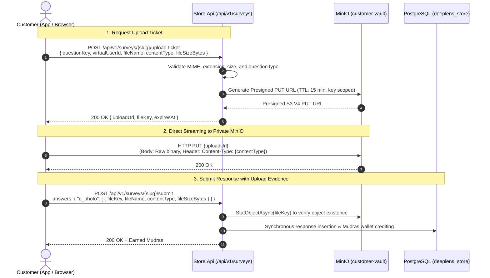

# Customer Vault & Survey File Upload Framework

This document outlines the architecture, security guarantees, data contracts, and client integration flow for customer-specific object storage and file upload questions in the DeepLens Store platform.

---

## 1. Bucket Isolation & Access Topology

| Dimension | `store-assets` (Public) | `customer-vault` (Private) |
| :--- | :--- | :--- |
| **Data Scope** | Product photography, video reels, swatches, promotional banners | Customer feedback photos, return evidence, damage receipts, measurements |
| **Anonymous Access** | `download` (`s3:GetObject` permitted anonymously) | `none` (`403 Forbidden` on all anonymous requests) |
| **Public Serving Gateway** | Reverse-proxied via Nginx at `media.vayyarifashions.com` | No public gateway exposure; direct Presigned URLs only |
| **Write Mode** | Internal service credentials (WorkerService, Ingestion, Store.Api) | Scoped Presigned PUT/POST URLs generated per ticket |
| **Read Mode** | Direct static URLs cached via CDN edge | Scoped Presigned GET URLs with ephemeral TTL (1 hour) |
| **Storage Layout** | `products/{code}/{image}.webp` | `surveys/{slug}/{virtualUserId}/{questionKey}/{guid}_{filename}` |

---

## 2. Standardized File Upload Question Definition

In the dynamic survey question bank (`survey_questions`), questions requesting files specify:
* `question_type`: `"file_upload"`
* `validation_rules_json`: Stored as structured JSON with the following parameters:

```json
{
  "minFiles": 1,
  "maxFiles": 3,
  "maxFileSizeMb": 10,
  "minFileSizeKb": 10,
  "allowedMimeTypes": [
    "image/jpeg",
    "image/png",
    "image/webp",
    "application/pdf"
  ],
  "allowedExtensions": [
    ".jpg",
    ".jpeg",
    ".png",
    ".webp",
    ".pdf"
  ],
  "captureMode": "camera_or_gallery"
}
```

### Parameter Reference

* `minFiles` (int): Minimum files required (0 indicates optional upload, $\ge 1$ indicates mandatory step).
* `maxFiles` (int): Maximum file count allowable for this question step.
* `maxFileSizeMb` (int): Upper bound on size per individual file.
* `minFileSizeKb` (int): Lower bound to prevent empty/corrupted 0-byte uploads.
* `allowedMimeTypes` (string[]): Explicit MIME types validated by the server before minting a ticket.
* `allowedExtensions` (string[]): Permitted file extensions (lowercased, dot-prefixed).
* `captureMode` (string): Client hint for native device pickers:
  * `"camera_only"`: Opens device camera directly.
  * `"gallery_only"`: Opens photo picker only.
  * `"camera_or_gallery"`: Default option allowing user choice.
  * `"document"`: Opens system document and PDF selector.

---

## 3. End-to-End Upload & Submission Lifecycle



---

## 4. Admin Studio Review & Ephemeral Download Resolution

When an authorized staff member inspects survey submissions via `GET /api/v1/admin/surveys/responses/{responseId}`:
1. The backend inspects `answers_json`.
2. For any question configured as `file_upload`, the backend converts each raw `fileKey` into a short-lived presigned GET URL (`WithExpiry(3600)`).
3. The Admin Studio renders images in an inspection modal without exposing permanent links or compromising bucket privacy.
